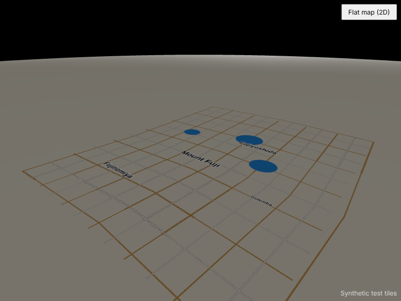
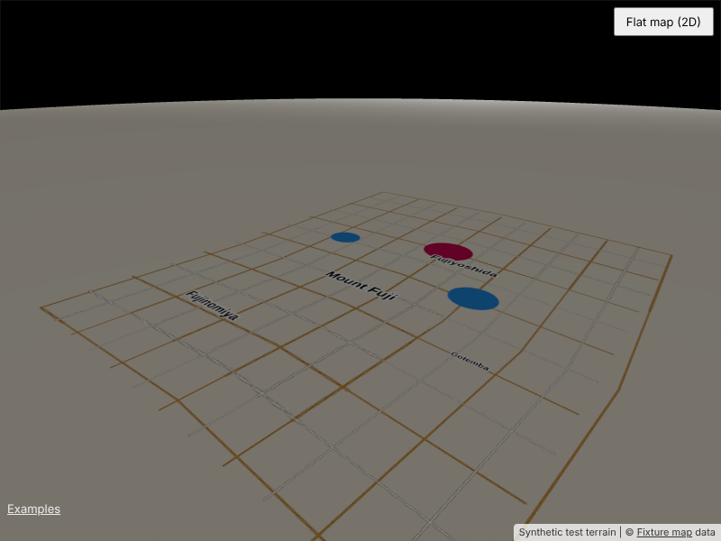
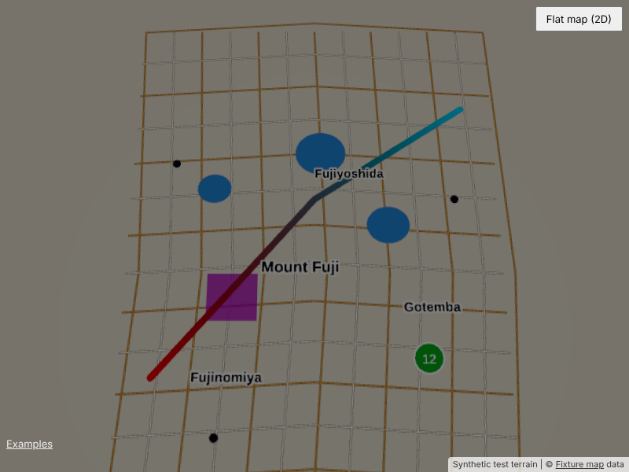
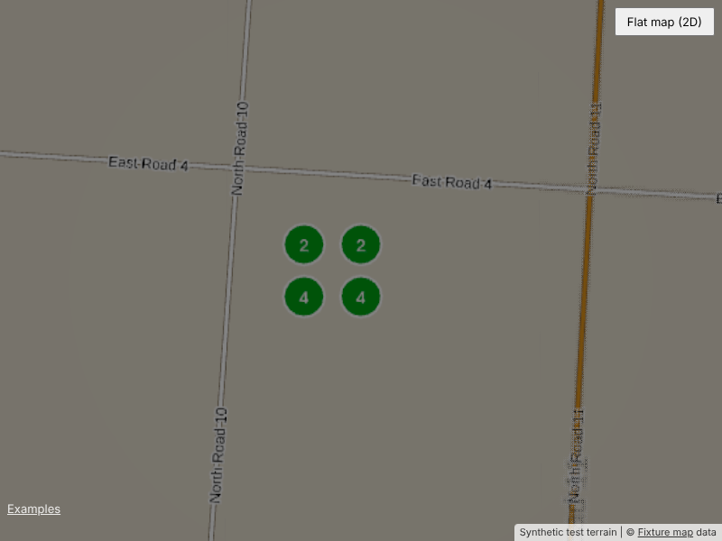
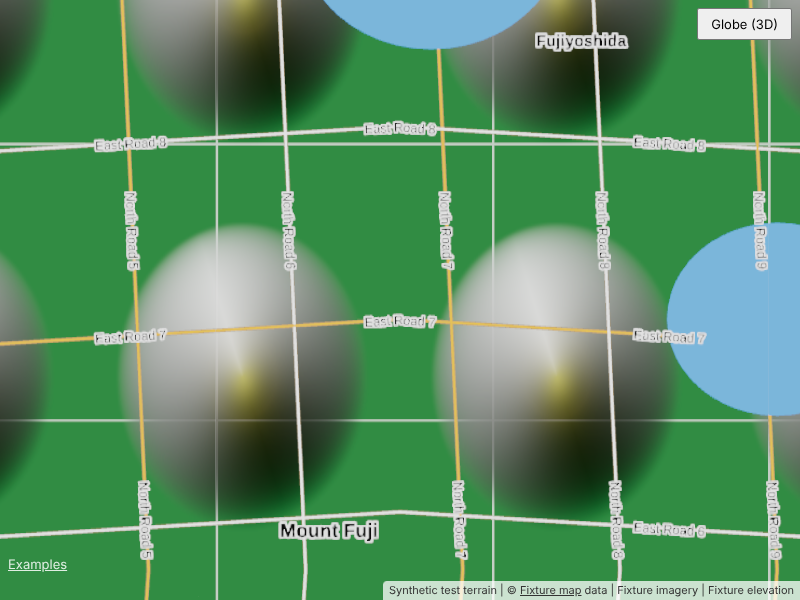
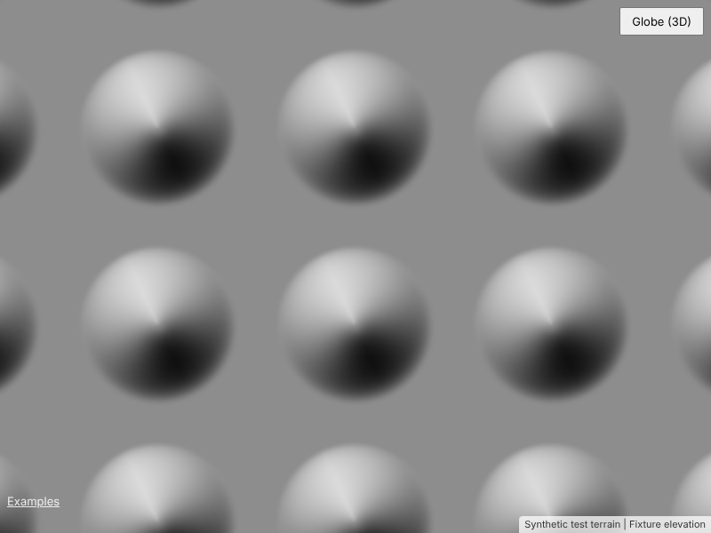
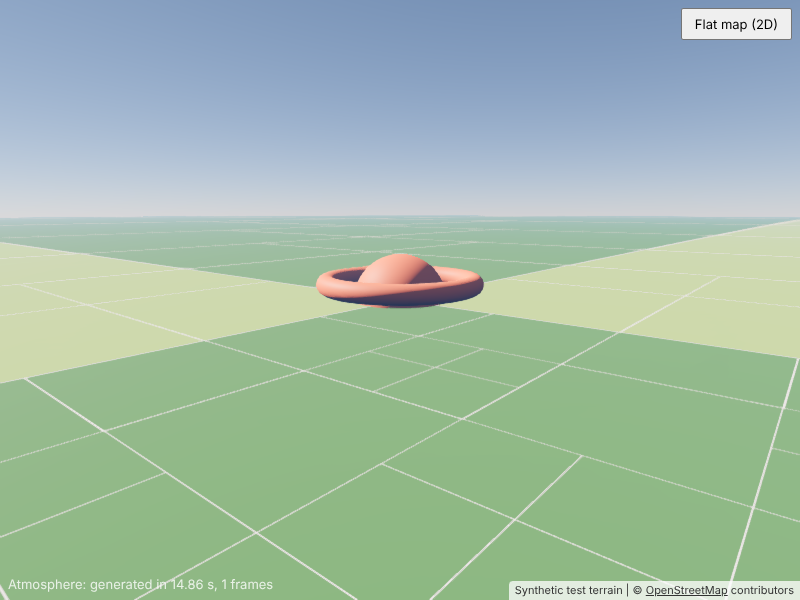
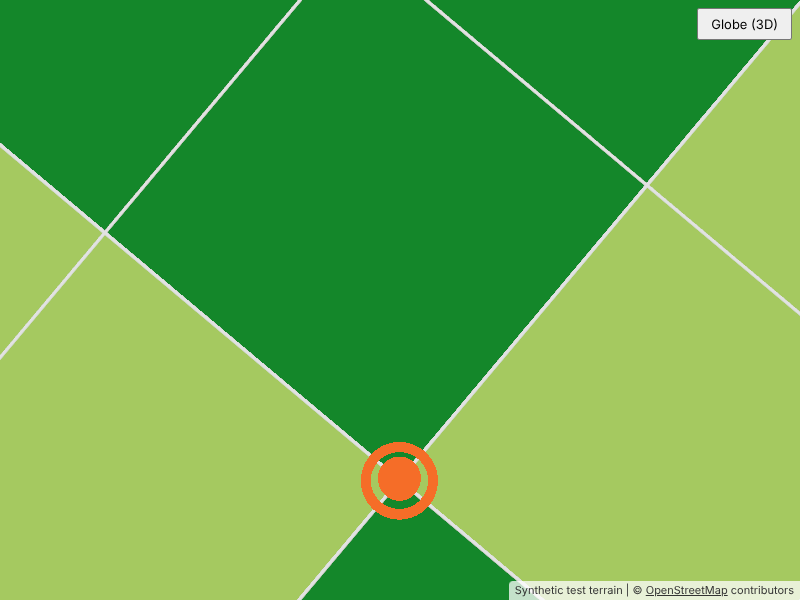
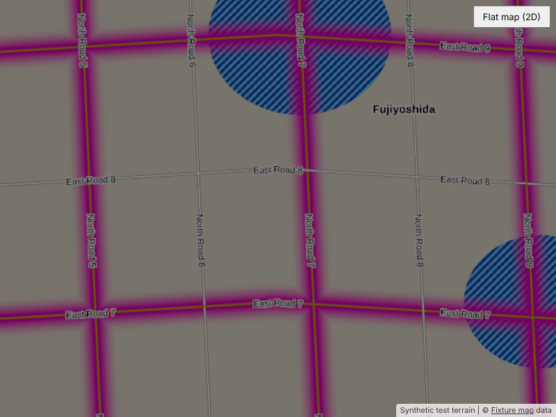
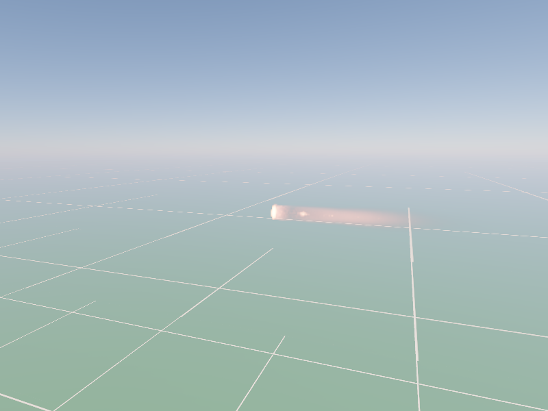

# Spike: terrain, imagery and atmosphere on R3F v10 WebGPU

## The flat map (2D) and the globe-to-map morph

```tsx
<Earth view={view /* '3d' | '2d' */} viewTransitionSeconds={1.5}>…</Earth>
// vanilla: earth.setView('2d', { durationSeconds: 1.5 }); earth.view.morph goes 0 → 1
```

How it works (`src/view/`, `src/tiles/FlatMapPlugin.ts`, `src/tiles/EarthTilesRenderer.ts`):

- **Where the map lies.** The flat map is spherical Web Mercator (what XYZ raster servers use), laid on the plane
  tangent to WGS84 at an anchor: the point the camera looks at when the morph starts. It is scaled by
  cos(anchor latitude), so around the anchor the map and the globe coincide at true size, and the camera never
  jumps. Heights are scaled by Mercator's local factor too, so relief keeps its shape. Going back to 3D
  re-anchors under the screen centre first (the camera is carried along), so the globe rolls up around the
  place you are looking at.
- **Morph in the vertex shader.** Each terrain mesh gets a `positionFlat` attribute at load: every vertex
  converted to Mercator on the CPU in double precision (Bowring's closed form, about 0.2 ms per tile), relative
  to the mesh's own flat centre. The tile material's `positionNode` mixes globe and flat positions. On the globe
  it returns the original position bit for bit (identity matrix, weight 0), so 3D is unchanged.
- **Precision on the map.** For each draw on the map, the mesh's `matrixWorld` is swapped for its flat frame
  (the anchor plane offset to the mesh's flat centre) and restored right after the draw, so
  `renderer.highPrecision` keeps centimetres in 2D as in 3D, and raycasts between frames see the globe.
- **Imagery stays aligned** by construction: the overlay UVs are vertex attributes, so they move with the
  vertices. The 2D check shows the same checker as 3D (97 % of pixels).
- **Tile selection on the map.** `EarthTilesRenderer` projects each tile's region onto the map plane and scales
  its geometric error by Mercator's enlargement there. During the morph a tile loads if either view needs it.
  Tiles without a region volume (boxes, spheres) are selected as on the globe.
- **Atmosphere and light.** Sky, haze and the sun fade out with the morph (`atmosphere.opacity`). On the map,
  standard tile materials emit their imagery colour, so night and slopes don't darken the map;
  `<Atmosphere>` scales it to undo its exposure. Lights of your own are not faded for you: scale them by
  `1 - earth.view.morph`.
- **Controls.** `EarthViewControls` (vanilla, used by `<EarthControls>`) gives input to `GlobeControls` on the
  globe and to `FlatMapControls` (3DTilesRenderer's `EnvironmentControls` on the map plane) on the map: pan,
  zoom to cursor and rotate, top-down by default (`maximumFlatMapTiltDegrees` allows tilt). Input is ignored
  while morphing. The camera is kept above the highest loaded terrain under it.
- **No seam at ±180°.** Each mesh and tile is placed on the copy of the world nearest the anchor.

| Check (SwiftShader, fixtures) | Result |
| --- | --- |
| 2D, atmosphere off and on | 97 % checker pixels, no errors |
| 3D map checks after the change | unchanged (78 % checker; 92 % sky or haze) |
| Precision, highPrecision on | unchanged: 1 cm = 128.7 px, worst error 0.7 px |
| Unit tests | 76 pass |


Morph from 12,000 km, with the atmosphere: globe, halfway, flat map.

  

Not done yet:

- 2.5D "columbus" view, and copies of the world side by side when zoomed out in 2D.
- Normals on the map are the globe's turned into the map plane (right near the anchor, tilted far from it).
  It only shows with your own lights on the map, since the atmosphere's sun is faded out there.
- Halfway through the morph, the blended geometry can sit outside both views' frusta, so a tile at the edge
  may drop out for a frame or two. Not seen in testing.
- The camera's lower limit in 2D uses the tile regions' maximum height, not the terrain itself.
- The `Earth` must stay at the scene origin (as `setCameraView` and the controls already assume).

## Map camera, project / unproject and events (`earth.camera`)

```ts
earth.camera.getView() // { longitudeDegrees, latitudeDegrees, heightMeters, zoom, headingDegrees, pitchDegrees, distanceMeters }
earth.camera.jumpTo({ longitudeDegrees: 2.35, latitudeDegrees: 48.86, zoom: 12 })
earth.camera.getBounds(); earth.project(position); earth.unproject({ xPixels, yPixels }); earth.queryTerrainElevation(position)
earth.addEventListener('moveend', …) // React: useEarthCamera(), useEarthEvent('moveend', …)
```

How it works (`src/core/EarthCamera.ts`, `events.ts`, `projection.ts`, `zoom.ts`):

- **Zoom is MapLibre's** (512-pixel tiles), measured at the screen centre from the camera's distance to it
  and its focal length in CSS pixels: on the globe from ground metres per pixel at the centre's latitude, on
  the flat map from Web Mercator metres per pixel (the map's flat coordinates). At the morph anchor both
  agree by construction, so a morph keeps centre, zoom and heading (the browser check measures 2·10⁻⁶ zoom).
- **The centre and `unproject` follow the terrain**: a raycast on the loaded tiles (3DTilesRenderer's own
  raycast, first hit only), the ellipsoid where none is loaded. On the flat map the screen ray is taken into
  flat coordinates and settled on the relief in four fixed-point steps (plane at the height
  `queryTerrainElevation` finds under the last guess), since the map's geometry only exists in the shader.
- **`project` follows the morph exactly**: the tile shader mixes globe and flat positions linearly in the
  Earth's frame, so the projected point is the same mix. Points beyond the ellipsoid's horizon are hidden
  with Cesium's ellipsoidal occluder test; terrain does not hide points yet.
- **World copies**: on the flat map, `project` and `jumpTo` use the copy of the world around the camera
  (`view.worldCopyReferenceXMeters`), so a place stays under the camera through a long pan across the
  antimeridian, and `getBounds` keeps longitudes continuous across copies (a view wider than one world spans
  every longitude).
- **Camera placement looks straight down without degenerating**: `placeCameraAround` builds the camera's
  basis from heading and pitch instead of `lookAt`, and `setCameraView` now uses it.
- **Events need no hooks in the controls**: `Earth.update` compares the camera's world matrix, field of view
  and canvas size with the last frame, so controls, `jumpTo`, the morph and app code all produce
  `movestart` / `move` / `moveend` (a running morph counts as one move). `idle` waits for the tileset root,
  3DTilesRenderer's running tasks (download, parse, child preparation), a pending `needs-update` (a loaded
  tile not yet shown) or `load-error`, queued imagery compositions and a running atmosphere generation (a
  failed one does not hold it back); `load` is the first `idle`.
- **Bounds** walk the screen's edges on the ellipsoid (the map's plane in 2D), bisect to the horizon where
  an edge goes from ground to sky, add the globe's outline where it is on screen (exact: the ellipsoid's
  outline is a circle in the frame where it is the unit sphere), and open to every longitude over a pole.
  `Earth.update` asks for one more frame after a move so `moveend` fires with `frameloop="demand"`, and
  `jumpTo` dispatches `framerequest`, which `<Earth>` turns into `invalidate()`.
- Changed from the brief: no edits to `EarthControls.ts` (motion is detected, not reported), and zoom
  helpers live in `zoom.ts` for the 2D thread and later workstreams to share.

| Check | Result |
| --- | --- |
| Fixture terrain (3.9 km hill), pitched camera: unproject → project | 3·10⁻⁸ px |
| unproject height vs `queryTerrainElevation`; terrain point → screen → back | 0 m; 3 µm |
| Flat map: unproject → project | 2·10⁻⁹ px |
| `getView` before / after the morph (top-down) | same centre, zoom within 2·10⁻⁶ |
| Morph events | `movestart`, `moveend`, `idle` |

With relief under a pitched camera, the morph anchors on the ellipsoid
point under the screen centre rather than the terrain point, so the centre shifts by the relief's parallax
during a 3D→2D morph. `getBounds` ignores terrain. `idle` does not wait for imagery added after tiles loaded
(those textures download outside 3DTilesRenderer's counters).

## Camera animations and pointer events (W1b)

```ts
await earth.camera.flyTo({ longitudeDegrees: 2.35, latitudeDegrees: 48.86, zoom: 12 }) // true, or false when stopped
earth.camera.fitBounds(bounds, { paddingPixels: 40 }); earth.camera.setPadding({ leftPixels: 320 })
earth.addEventListener('click', event => event.geographic) // <Earth initialView={…}>, formatViewHash / parseViewHash
```

How it works (`src/core/cameraAnimation.ts`, `EarthCamera.ts`, `events.ts`, `Earth.ts`, `viewHash.ts`):

- **Animations are view interpolations replayed through `jumpTo`'s placement**: each frame computes a full
  view (centre, height, zoom, heading, pitch) and places the camera with it, so they behave the same on the
  globe and on the flat map, world copies included. `Earth.update` advances them before the morph and the
  tiles, so tiles load for the frame's pose. The centre moves along a great circle on the globe and a
  straight Mercator line on the map; heading goes the short way round.
- **`flyTo` is MapLibre's van Wijk–Nuij curve** (`createFlightPath`: `curve`, `speed`, `screenSpeed`,
  `minimumZoom`, `maximumDurationSeconds`), with the distance measured in Mercator pixels at the start zoom.
  With nothing to fly over (only heading or pitch change) it eases, as MapLibre does.
- **The end height is re-read every frame**: coarse quantized-mesh tiles sit up to 2 km below the ground (the
  chord of a large tile), so a height read at the start left the camera kilometres off once Paris loaded
  (the browser check caught zoom 12.9 instead of 11). Re-reading the terrain under the end centre each frame
  lets the flight land on the tiles that load as it approaches.
- **Promises, not events, report the end**: each animation returns `Promise<boolean>`, false when stopped by
  `stop()`, `jumpTo`, another animation, a morph or user input. User input is the controls' own `start`
  event (3DTilesRenderer fires it on drag, wheel and double tap), hooked in `EarthViewControls`, not in
  `FlatMapControls`. `prefers-reduced-motion` turns every animation into a jump unless `essential`.
  Animations called before the first frame wait for the camera, and `initialView` applies without
  stopping them. The first step counts one frame at most, so a host idle for seconds does not skip ahead.
- **Padding slides the camera across its screen plane** instead of shifting the projection's principal
  point: the target lands at the padded centre with heading and pitch untouched, no change to the
  projection matrix (which R3F, the atmosphere and the controls also own). `getView` casts its ray through
  the padded centre and measures distance along the camera's axis, so zoom keeps meaning the scale there.
- **`cameraForBounds` fits on the map, then on screen**: the Web Mercator fit (MapLibre's maths, with
  heading and uneven padding) is exact on the flat map seen from above; on the globe it is off by up to 6 px
  for a 13°-wide box (Mercator's scale changes across the box), and tilted views are worse. Up to six steps
  then place a copy of the camera, project the box's edges and correct zoom and centre, so the box touches
  the padding within half a pixel on the globe too, tilted or not. When part of the box starts past the
  horizon (a Pacific-wide box), it first zooms out a level at a time until all of it shows.
- **Zoom / rotate / pitch events** come from the same per-frame comparison as `move`, on a cheap
  ellipsoid-only view (no terrain raycast). `zoom` follows ground metres per pixel, not `getView().zoom`,
  which changes with latitude on the globe while panning at a fixed altitude.
- **Pointer events**: `earth.attachPointerEvents(element, { canvas })` (`<Earth>` calls it with R3F's event
  source and the canvas, so positions stay right with an `eventSource` that is not the canvas) dispatches `click` (press and
  release within 3 px, MapLibre's tolerance), `doubleclick`, `contextmenu` and `pointermove`. Nothing is
  measured without a listener, and `geographic` is a lazy getter, so `pointermove` costs no raycast unless a
  listener reads it.
- Changed from the brief: no `rollDegrees` (nothing in the camera vocabulary uses it yet), the hash is
  pure functions rather than a URL writer (the app owns `history`), and `animating` replaces MapLibre's
  `isMoving` (movement is already the `movestart` / `moveend` pair).

| Check (fixtures, SwiftShader) | Result |
| --- | --- |
| `flyTo` Tokyo → Paris, 4 s, globe and flat map | ends at the view within 10⁻¹² ° and 2·10⁻¹³ zoom; zooms out to about 2 |
| Events during the flights | `movestart, zoomstart, rotatestart, zoomend, rotateend, moveend` |
| Mouse wheel during a 20 s flight | promise resolves false |
| `fitBounds` with 40 px padding, globe | corners inside the padding |
| Click at the centre over the 3.9 km hill | exact position, height equals `queryTerrainElevation`; a drag is not a click |
| Unit tests: `fitBounds` on both views, 5 boxes (city, uneven padding, antimeridian, rotated, view padding) | inside and snug within 0.5 px |

Not done yet: `rollDegrees`, `around` for `zoomTo`, the `offset` option, animating `padding`.

## Vector map styles (`src/vector/`)

`<Imagery><MapStyleSource url="https://…/style.json" /></Imagery>` drapes a MapLibre style (version 8) on the
terrain. Vector sources can be XYZ `tiles`, a TileJSON `url`, or a PMTiles archive (`pmtiles://https://…`).
Vanilla: `new Imagery({ sources: [new MapStyleSource({ url })] })`, and `imagery.dispose()` after removing it.

How it works:

- A module worker (`vector-worker.js` in the build) fetches tiles, decodes MVT, evaluates the style's filters and
  properties with `@maplibre/maplibre-gl-style-spec` (the same expression engine as MapLibre), tessellates
  fills, lines (joins, caps, dashes, gap width, offset) and circles, and lays out text labels: SDF glyphs from the
  style's `glyphs` server, or drawn locally with TinySDF when there is none; point and line placement, wrapping,
  anchors, halos, per-tile collision with `symbol-sort-key` and top layers first. It returns typed arrays,
  transferred, not copied. If the worker cannot start, tiles are processed on the main thread with a warning.
- The main thread never rasterises tiles. For each terrain tile's region, the covering vector tiles are drawn
  straight into the region's texture at its own resolution, with 4× MSAA in a shared scratch target, through the
  existing `ImageryCompositor` (same 2 ms budget and priorities as raster). One draw per tile and layer group;
  fragments outside the tile square are dropped so buffers never overdraw neighbours. A ring of neighbour tiles
  adds only their labels (when within label reach of the region), so labels crossing a tile edge are not cut.
- The style is evaluated at the region's zoom (512-pixel tiles, as MapLibre). Past the data's maximum zoom,
  tiles are overzoomed (widths and text keep their pixel size); terrain tiles split up to `maximumZoom` (20).
- Processed tiles stay in a 32 MB cache of unused buckets (`retainedTileBytes`); raw tiles in the worker LRU.

GeoJSON sources (with clustering and `line-gradient`) are drawn too, see W2 below.

Not supported yet: icons along lines and on draped labels (point icons face the viewer, see W6 part 3 below), heatmap layers (skipped with one
warning; raster, hillshade and colour relief: see W7 below), right-to-left and complex scripts, `fill-extrusion` in 3D (drawn flat), line labels colliding across
tiles with `symbols: 'draped'` (labels face the viewer and collide on the whole screen by default, see W6 below), and symbol layers below shape layers (all labels draw on top). Tile, TileJSON and glyph requests go
through the worker's `fetch` with `requestHeaders` and the source's `transformRequest` / protocols, not
3DTilesRenderer's `preprocessURL` (the style request does). Draped labels (line labels, or every label with `symbols: 'draped'`) change size by 2× where neighbouring
terrain tiles are textured at different zooms: draped text has a fixed size on the ground.

| Check (fixtures: synthetic water, roads, places; SwiftShader) | Result |
| --- | --- |
| Overview, atmosphere off | water, roads and place labels drape on terrain; 106 regions composed, no errors |
| Close-up, 9 km, 50° pitch | road names follow the roads upright, labels sharp at region resolution |
| WebGL2 fallback | same image as WebGPU |
| Raster map checks | unchanged |
| Unit tests | 32 new, 98 total (style evaluation, tessellation areas, glyph PBF and atlas, shaping and placement, TileJSON, TMS, PMTiles range requests, caches, region tiles, ring reach) |

  

### Redrawing changed regions: `invalidate(bounds)` (F1)

`MapStyleSource.invalidate(bounds?)` redraws what changed on the tile server, with no flicker and no hole. It is
the foundation GeoJSON `setData`, style edits, feature-state and runtime images will build on.

- Regions are redrawn **in place**. `drawRegion` already renders into the shared multisampled scratch target and
  resolves into the region's own target, so a redraw enqueues a new job into the same `RenderTarget`: the terrain
  material keeps sampling the old content until one copy pass overwrites it. No texture swap, no 3DTilesRenderer
  private API.
- The worker forgets raw tiles overlapping the bounds (a new `invalidate` message; messages are ordered, so later
  tile requests fetch again). Processed buckets in the bounds are `discard`ed from the `RefCountedCache`: the next
  lock loads them again, while regions still drawing with the old bucket hold it through a **lease** (`acquire`),
  so a release can never hit the new entry. Buckets outside the bounds stay cached: only changed tiles are refetched.
- **Which regions redraw** is exact rather than a widened box: a region redraws when any tile it draws overlaps the
  bounds, including the label ring (neighbour tiles whose labels reach in). This replaces the brief's "widen the
  bounds by the label reach" with the same test the region uses to pick its tiles, so it cannot drift from it.
- Bounds crossing the antimeridian (west > east) become two rectangles in normalised Web Mercator; 360° or more is
  everything; a point or line is widened by 1e-12 so it touches the tiles it lies on, while tiles that only share
  an edge with real bounds are left out.
- A region invalidated **while loading** finishes and shows what it drew, then redraws once (a stale flag per load
  in flight rather than a generation counter, so nothing per key outlives the load). A region invalidated during its
  own redraw redraws once more after. A region released mid-redraw aborts the redraw before its target is freed.
- **Scheduling**: `ImageryCompositor` has a third queue, `recomposition`, between `waited` (first textures of
  visible tiles) and `preload`, under the same per-frame budget. Invalidations mark regions synchronously and start
  their redraws from `runBeforeNextRender`, a once-per-frame task, so calls within a frame coalesce into one redraw
  per region.
- Refetches cannot come back stale from the browser: the worker remembers the last 4096 tiles it fetched, and
  those in the bounds are fetched once with `cache: 'no-cache'` (a conditional request, 304 when unchanged). A
  PMTiles source gets a fresh reader on any invalidate (header and every directory read again: pmtiles' own
  cache invalidation keeps leaf directories), and its range requests revalidate from then on.
- A cache disposed while leases are out ignores their later release, so a disposed overlay keeps nothing.
- `earth.inspect().terrain.imageryRecompositionsPending` counts regions waiting or redrawing; redraws also count
  in `imageryTilesComposited`.
- Raster overlays (`XYZImageryOverlay`) are out of scope: their exact-tile fast path hands the source texture to
  terrain materials, so a redraw would need to rebind materials through upstream private state (W7 / W14 if needed).

| Check | Result |
| --- | --- |
| Unit tests | 13 new (158 total): only overlapping regions (label ring included) redraw, antimeridian, invalidation during a load and during a redraw end fresh, released regions stop redrawing, coalescing, leases and dispose, queue order, worker raw-tile cache and revalidation, replaced PMTiles archive |
| Browser (`?fixtures&map=vector&test=invalidate`, SwiftShader) | the fixture server recolours the lakes, `invalidate(bounds)` around them: of 106 regions held, 90 reach into the bounds and redraw once each; lakes go from blue to pink, and every screenshot taken while redrawing still shows them (no missing texture) |

 

### Runtime style API and feature-state (W3)

The style can change after it loaded. `MapStyleSource` has MapLibre's methods (`setPaintProperty`,
`setLayoutProperty`, `setFilter`, `setLayerZoomRange`, `setLayerVisibility`, `addLayer` / `removeLayer` /
`moveLayer`, `addSource` / `removeSource`, `setStyle` with the style specification's `diff`,
`setGlobalStateProperty`, `setFeatureState` / `removeFeatureState` / `getFeatureState`, `transformRequest`,
`addProtocol`) and `styledata` / `sourcedata` / `error` events. `<StyleLayer>` wraps a vanilla `StyleLayer`
that diffs its props into those calls and survives `setStyle`. `<MapStyleSource>` applies a new `url` or
`style` prop with `setStyle` instead of rebuilding.

How it works:

- **One model, many renderers.** `MapStyle` (main thread) holds the document as it is now, feature-state and
  `global-state` values. Setters check their arguments against the document (`worker/styleDocument.ts`, the
  same code the worker runs, so the two copies cannot drift) and hand the change to every overlay, batched
  per microtask and numbered. An overlay starts its worker from a snapshot and sends only changes numbered
  after it, so nothing is applied twice or lost (including the fall back to the main thread when the worker
  fails).
- **Worker protocol.** Style edits travel as `{ type: 'style', commands }`, where a command has the shape of the
  style specification's `diff` output (`{ command: 'setPaintProperty', args }`), so `setStyle` sends `diff()`
  as is. A change `diff` cannot express (glyphs, sprite, base URL) sends `reload`, which keeps the glyph atlas
  and colour slots so buckets still on screen stay valid. `featureState` carries feature-state changes.
  Results may carry `featureColors`, applied before the result resolves (like the glyph atlas), so a bucket
  never arrives before the slot colours it uses. The worker asks the main thread to resolve requests
  (`resource` messages) only when there is a `transformRequest` or a non-http scheme.
- **What gets processed again.** The worker answers which sources to rebuild: the sources of changed layers,
  and those whose layer order or layer groups moved (groups set draw order across sources; a new layer of
  another source between two layers of one source renumbers the groups above it). `global-state` changes
  rebuild only sources whose layers read the changed name (`globalStateRefs`). Rebuilding re-tessellates from
  the worker's raw-tile cache: nothing is fetched. The overlay discards those buckets (`rebuildTiles`) and
  redraws regions in place through F1's machinery. Deviation from the brief: re-tessellation is per tile and
  source, not per layer. Keeping per-layer geometry would need per-layer buffers in every bucket for a rare
  gain (a paint change on one layer of a source re-tessellates the source's other layers in that tile, a few
  milliseconds in the worker).
- **Feature-state.** Measured first, as the brief asked: re-tessellating a tile for a hover change costs the
  whole tile (labels included) plus a worker round trip per tile. Default design kept, with one change: a
  per-vertex *slot* instead of a feature index. The worker gives each (feature, layer, colour role, zoom) of a
  layer whose colour or opacity reads feature-state a slot in a colour table (`FeatureColorTable`, 1024 wide,
  up to 1024 rows); vertices carry the slot, and the shape material reads the colour from the table texture in
  the vertex stage. A state change re-evaluates the feature's slots in the worker (the full expression,
  any shape) and sends the changed colours; the overlay redraws only regions whose buckets hold the feature
  (an index from feature key to loaded buckets, built from each bucket's `featureStateKeys`: W4's feature
  index can replace it). No tile is processed. State-dependent paint that changes geometry (`line-width`,
  `circle-radius`, any text paint) lists the feature in `rebuildFeatureKeys`, and a change re-tessellates the
  tiles holding it; a bucket started before such a change is processed again on arrival
  (`featureStateVersion`). Features in slot layers are tessellated even while transparent, so a highlight can
  appear. Past a million slots, colours are baked and those features take the rebuild path.
- **`promoteId`** on vector sources (string, or per source layer) gives tiles without ids feature-state.

| Check (fixtures, SwiftShader; correctness only, never frame times) | Result |
| --- | --- |
| `setPaintProperty('water', 'fill-color', pink)` | lakes 0.44 % blue → 0.43 % pink, 106 regions redrawn |
| `setLayerVisibility('water', false)`, then back | lakes gone, then back blue |
| `addLayer` (hover layer) + `setFeatureState` on one lake of three | one lake pink, 0 tiles processed, 50 regions redrawn, 2.1 s to settle on the CPU rasteriser |

`setStyle` is asynchronous even for an object (the style specification's `diff` loads on first use, to keep it
out of the main bundle): changes made while it resolves are held and applied to the new style, and the last of
overlapping calls wins. Feature colour slots and W5's patterns share one set of shape materials (plain, slotted,
patterned, both); a patterned fill or line bakes its opacity, so a state-dependent opacity there re-tessellates.

Hover recomposition on a device still needs measuring (SwiftShader rasterises on the CPU; the 2.1 s above is
50 region redraws there). Not done: `zoom` in expressions is still evaluated at each region's integer level,
so zoom-interpolated paint steps per level (W6 brings a camera zoom); `setSprite` and `setGlyphs` reload the
style; a source added at a zoom where terrain tiles had no content shows once those tiles reload.

### Sprites, image atlas and patterns (W5)

`fill-pattern`, `line-pattern` and `background-pattern` draw images from the style's `sprite` (URL or MapLibre 3
array, `@2x` on high-density screens, falling back to 1x), and `MapStyleSource.addImage` / `updateImage` /
`removeImage` / `hasImage` add runtime images, with `onStyleImageMissing` (MapLibre's `styleimagemissing`).

- The worker (`worker/sprites.ts`) fetches the sprite JSON and PNG and decodes them with `createImageBitmap` +
  `OffscreenCanvas`. Images are packed into an RGBA atlas (`worker/imageAtlas.ts`, a shelf packer like the glyph
  atlas) **only when a tile or the background first uses them**, not the whole sheet. Entries are premultiplied
  (so linear filtering does not darken transparent edges) and padded with a wrapped copy of their opposite edges
  (so repeats filter seamlessly). Changes travel as `imageAtlas` on any worker result and are applied before it
  resolves, as glyphs are; `MapStyleOverlay.imageAtlas` is the main-thread copy, public for plugins (W17).
- **Patterns stay in the shape mesh, in style order.** A tile with any pattern gets two extra vertex attributes
  (atlas rectangle as normalised 16-bit, image coordinates as floats) and a second shape material; tiles without
  patterns keep the colour-only material and no extra bytes. The shader picks pattern or colour per vertex,
  `fract`s the image coordinates into the rectangle, unpremultiplies and decodes sRGB; the vertex alpha carries the
  opacity.
- Fill coordinates are in image pixels anchored at the world's top-left corner; each tile's offset into the
  repeating image is reduced modulo the image in 64-bit in the worker, so 32-bit vertex values stay small at zoom
  20 and patterns continue across tiles and regions. Line coordinates run along the line (cumulative distance)
  and across its width, with the image scaled so its height spans the width (MapLibre); mitre vertices use the
  mean direction, stretched by the mitre, so the across coordinate stays on the edges. The background pattern is
  a uniform-driven quad with the same world anchoring, offset reduced on the CPU, drawn over the background
  colour (one colour and one pattern per zoom: a translucent colour layer above a pattern draws under it).
- **Image changes redraw only what uses them.** Buckets list the image ids they asked for (and which were missing);
  the overlay keeps an image id → bucket keys record that outlives cache eviction (pruned to tiles of held regions and cached buckets
  on each change), so regions whose buckets left the 32 MB cache still redraw.
  The worker answers an image change with `rebuild`: false when the image was rewritten in place (same size and
  pixel ratio), so regions drawing those buckets are only redrawn through F1's in-place redraw; true when it
  appeared, disappeared or moved, so those buckets are re-tessellated from the worker's raw-tile cache (no
  refetch). Buckets still processing during a change are rebuilt too. Label-ring placements are skipped (patterns
  are shapes). The helpers are `rebuildTiles(matches)` and `redrawRegions(bucketKeys)`, names shared with W3.
- Deviation from the brief: `updateImage` accepts another size (it rebuilds instead of throwing as MapLibre
  does). Icon metadata (`sdf`, `stretchX/Y`, `content`) is parsed and kept; W6 part 3 packs icons in their own
  transparent-padded slot rather than the wrapped one.

| Check (`?fixtures&map=patterns`, SwiftShader) | Result |
| --- | --- |
| WebGPU and WebGL2 | green checks (background) on 83 % of the view, blue stripes on the lakes, red and white dashes along primary roads; the lake using `hatch` (not in the sprite) draws nothing and is reported once |
| `addImage('hatch')`, then `updateImage` (same size) | the lake turns magenta, then yellow; the update redrew 46 of 50 regions (the fixture lake's zoom 10 tile covers most of the view) with no re-tessellation |
| Unit tests | 18 new: sprite URLs and index, atlas padding, premultiplication, in-place rewrite and slot reuse, fill and line pattern coordinates, cross-tile continuity, processor sprites (@2x, array sprites, fallback, failures, runtime images), redraw scope, missing-image reports (background included), evicted buckets, background stacking, `MapStyleSource` image API |

 

### Screen-space symbols (W6), part 1: point labels facing the viewer

Point-placed labels no longer go into region textures: they stand upright on the screen at their `text-size`
(`MapStyleSourceOptions.symbols`, default `'screen'`; `'draped'` keeps the old path).

- **Which tiles.** Terrain regions vary in zoom across the screen, so labels taken from them would repeat or
  vanish at the seams. `CameraTilePyramid.ts` picks symbol tiles from the camera instead, as MapLibre's source
  cache: a quadtree from zoom 0, culled by the visible cap of the globe (exact nearest-point test, a degree of
  slack and room for 9 km summits past the horizon) and a frustum sphere, split while a tile's half-edge spans more
  than 512 px. Tiles reaching behind the camera estimate their size from their distance, floored at the
  camera's height, so a view along the ground stops at about 80 tiles instead of splitting to zoom 21 underfoot.
  Capped at 128 tiles. Past the data's maximum zoom a tile overzooms its parent's data. The tiles are reused by
  W12's extrusions.
- **Worker.** A symbol tile (`TileRequest.symbols`, cache key prefix `s:`) shapes each point label once, glyph
  corners in pixels of a 24 px font around the anchor, `text-size` evaluated at the tile's zoom and the next so
  the main thread interpolates by the camera zoom. Label key: layer id and text.
- **Each frame** (`ScreenSymbols.update`, from `Earth.update`): anchors are lifted onto the terrain as drawn,
  projected with double-precision matrices, and culled behind the ellipsoid's horizon. Sizes follow MapLibre's
  perspective ratio, `clamp(0.5 + 0.5 · centreDistance / w, 0, 4)`. Heights come from `sampleTerrainHeight`
  (`src/tiles/terrainHeights.ts`): the deepest visible terrain tile, a 16×16 longitude/latitude grid of its
  triangles built once per geometry, barycentric in ECEF, skirts skipped. A raycast per label was far too slow
  (88 reads pending after seconds on SwiftShader). Reads are budgeted (512 reads or 1 ms of reading a frame), refreshed every
  3 s, and clamped at −500 m: coarse terrain cuts a chord kilometres below the curved Earth, which put labels
  behind the horizon. A label waits for its first read before it shows; where no terrain tile is loaded yet it
  stands on the ellipsoid and moves once a tile arrives, and refreshes snap to finer terrain without easing.
- **Placement** (`SymbolPlacement.ts`, pure, unit tested): one 64 px collision grid for the screen, at most every
  100 ms while the camera moves (positions still follow every frame). Order: higher style layer, then
  `symbol-sort-key`, then labels already showing (so equal labels do not swap as tiles change), then tile order.
  A label with the same key as one claimed within 24 px is a duplicate from an overlapping tile and is dropped.
  Opacity fades over 0.3 s and follows the label from one tile to its replacement; a tile being replaced stays
  drawn until its successor has loaded.
- **Drawing.** One mesh per tile, all sharing one TSL material. The vertex shader reads each label's anchor, scale
  and opacity from a float RGBA texture (16 bytes per label, uploaded only when a value changed), so glyph
  vertices never change after a tile loads; the tile's first slot is a per-object uniform. SDF fill and halo as
  draped text. Drawn in the scene pass without depth test, so the atmosphere hazes labels like the ground under
  them; colours follow `flatMapLuminance` on the map.
- **Idle.** With the camera still, nothing fading and no height waiting, `update` returns after picking tiles; a
  pass still runs every second to follow terrain that loaded finer. While the camera moves, tiles are chosen again
  at most every 100 ms, as labels are placed. Labels follow the imagery layer's `opacity`.

Deviations from MapLibre, for later parts: line-placed labels stay draped (done in part 2a below); `text-variable-anchor` takes its first
anchor (done in part 2b); labels are not hidden behind mountains, only behind the globe (done in part 2b); labels hide while the view morphs between
globe and map; on the flat map only the world copy nearest the camera has labels; each `MapStyleSource` places its
labels on its own, so two styles' labels can overlap. Positions are ECEF against the camera's world matrix: the
Earth group must not be moved or rotated in the scene for labels to line up.

| Check (`?fixtures&map=labels`, 124 towns and places, 40 km, SwiftShader) | Result |
| --- | --- |
| Top-down / pitched 60° | 43 / 34 shown, 81 / 90 collided, 0 overlapping boxes, 0 duplicates |
| Box height at the screen centre | 19.2 px top-down, 20.3 px pitched (16 px text + padding) |
| WebGL2, StrictMode, flat map, atmosphere on | same placement, no errors |
| Placement | 0.2 ms for 124 labels (2.4 ms on the first, with JIT warm-up) |
| `symbols: 'draped'` | no screen labels, labels drawn on the ground |

Frame times on phones are not measured yet: SwiftShader proves correctness only. Per frame the CPU work is one
projection per label of the drawn tiles and one 4-float write per changed label; the GPU draws one mesh per tile.

### Screen-space symbols (W6), part 2a: road names facing the viewer

Line-placed labels (`line`, `line-center`) now face the viewer too; with `symbols: 'screen'` no label is draped.

- **Worker.** Anchors as before (`symbol-spacing` at the tile's zoom, the label must fit on the line). For each,
  `lineLabelPaths` keeps the stretch of line within two label lengths each side of the anchor (a tile shows down
  to half its own scale, and the perspective ratio shrinks labels less than the ground), the anchor inserted as a
  point. The text is shaped once on one row; per glyph the tile stores its offset from the label's middle along
  the line and its half advance (`SymbolMesh.lineStarts`, `linePoints`, `glyphOffsets`, ...). Glyph corners are
  around each glyph's own centre on the baseline, with a `glyphIndex` vertex attribute.
- **Each frame** (`ScreenSymbols.layoutLineGlyphs`): the stretch is projected at the anchor's terrain height,
  point by point as the walk reaches it (a far end behind the camera does not hide the label), and the glyphs are
  found by one incremental walk each way from the anchor, offsets times the label's scale. Upright: turned around
  when the first glyph lands right of the last by more than a tenth of the label's length, so a name on a road
  running up the screen does not turn back and forth. A label hides where a glyph runs off the stretch or the line
  turns more than `text-max-angle` summed over the label; one already shown keeps its last glyphs and fades out
  at the next placement instead of blinking. Each glyph gets an axis-aligned box of its rotated advance and text
  height. On the map, path points take the anchor's world copy.
- **Placement** collides those per-glyph boxes (`PlacementCandidate.boxes`), the label's bounds used only to find
  grid cells; feature queries hit the same boxes.
- **Drawing.** A second state texture holds each glyph's screen position and angle (12 of 16 bytes used); the
  vertex shader rotates the glyph's corner by its angle, point labels (`glyphIndex` −1) unchanged.

| Check (`?fixtures&map=vector`, 12 km, SwiftShader) | Result |
| --- | --- |
| Pitched 60° / top-down | 31 / 11 road names, none upside down, 0 overlapping glyph boxes, 0 duplicates |
| `?map=labels` (dense towns above the roads) | unchanged: towns win, road names collide away |

Deviations: road names are always viewer-facing (MapLibre's default for line placement is pitch-aligned, lying on
the ground); glyphs stand at the anchor's height, not each at its own; `text-offset` and multi-line text are not
applied along lines.

### Screen-space symbols (W6), part 2b: variable anchors and labels behind terrain

- **Variable anchors.** With `text-variable-anchor`, the worker shapes the text centred and stores, per anchor,
  the shift from the centred box: the anchor names the side of the text at the point, then `text-radial-offset`
  (on a diagonal for corners) or `text-offset` (its size, pointed away from the point), MapLibre's rules
  (`variableAnchorShifts`, `SymbolMesh.anchorShifts`). Placement tries the anchor the label's fade state
  showed with, then the others in order, and moves the box to the first that fits (`SymbolPlacement.placeAnchors`);
  the state texture gets the shifted position, so glyph vertices never change. In `?map=labels` the towns try
  five anchors: 56 of 124 labels show top-down instead of 43, 17 of them beside their point.
- **Terrain occlusion.** At each placement, a ray from the camera to each label's anchor (at its height) is read
  against the terrain as drawn at up to 12 points at fixed distances from the label, 150 m growing by 1.7× to
  about 50 km (fixed distances, so reads do not slide over a ridge as the camera pans; densest near the label),
  skipping points above 9 km with a closed-form height estimate along the chord. Ground more than 30 m above the
  ray hides the label: it stays a candidate with `hidden`, so it fades out like a collision and a copy in another
  tile can take over. Each style's pass stops after 1 ms: labels never read go first (a tile that just arrived), then
  the rest in turn from where the last pass stopped; with the camera still, the once-a-second pass places again, so
  terrain that loaded finer hides or shows labels. Globe only. `inspect().terrain.symbols.labelsOccluded`.
  The fixture terrain is flat under the labels, so the browser checks only prove nothing is hidden wrongly; unit
  tests cover a ridge, a low hill, missing tiles, a slope and a wall in front of a label.

Deviations: `text-variable-anchor-offset` is not read; the 7 px baseline correction of vertical offsets is left
out; `text-justify: auto` does not follow the anchor (multi-line text stays centred); with `text-rotate` the
offset turns with the text; occlusion tests the anchor point only (MapLibre tests
depth per symbol in the shader), and is decided at placement, every 100 ms while moving.

### Screen-space symbols (W6), part 3: icons from the sprite atlas

- **Atlas.** `icon-image` (a name, a token string or a resolved image) is looked up in the style's sprite. Icons get
  their own slot in the W5 image atlas (key `\u0001icon\u0000<id>`) padded with transparent pixels instead of the
  wrapped edge patterns use, so linear filtering does not bleed the far edge into the quad. A sprite update rewrites
  the slot in place when its size, pixel ratio and `sdf` flag are unchanged.
- **Worker.** A point symbol with an icon gets one more quad in the same `SymbolMesh`, written before its glyphs
  and marked by its glyph index (-2 colour, -3 SDF), so one draw call still draws every label of a tile. The quad
  is sized by `icon-size` (MapLibre's 24 px icon unit relative to the text size when there is text), placed by
  `icon-anchor`, `icon-offset` and `icon-rotate`. Its collision box (`SymbolMesh.iconBoxes`) is stored next to
  the text box. An icon alone collides with `icon-padding`, `icon-allow-overlap` and `icon-ignore-placement`;
  icon with text uses both flags (overlap only when both allow it). Missing images are reported as for patterns.
- **Placement.** An icon with text collides as two boxes (icon, then text). Variable anchors move only the text
  box: the icon stays on its point (`PlacementCandidate.anchorBoxStart`). The state texture now holds two texels
  per label, the anchor position and the anchor shift, so the shader shifts text and not the icon.
- **Shader.** Colour icons sample the image atlas premultiplied, sRGB to linear, times `icon-opacity` and the
  layer opacity; SDF icons read the atlas alpha as a distance field (MapLibre's 0.75 edge) and draw with
  `icon-color`, `icon-halo-color` and `icon-halo-width` through the glyph path.
- In `?map=labels` places carry a red pin and Mount Fuji a blue SDF disc with a white halo; the browser check
  counts icon labels and the red and blue pixels.

Not supported yet: icons along lines (`symbol-placement: line`), `icon-text-fit`, `icon-optional` /
`text-optional` (icon and text show or hide together), `icon-keep-upright`, `icon-pitch-alignment` and
`icon-rotation-alignment: map` (icons face the viewer), stretchable icons (`stretchX/Y`, `content`), and icons in
`symbols: 'draped'`.

### Feature querying and layer events (W4)

`earth.queryRenderedFeatures(point | box | nothing, { layers, filter, tolerancePixels })` and
`MapStyleSource.querySourceFeatures(sourceId, { sourceLayer, filter })` answer MapLibre-shaped features (`id`,
`properties`, GeoJSON `geometry` in degrees, `source`, `sourceLayer`, `state`, `layer`; rendered ones also
`mapStyleSource`). `earth.layerEvents` adds layer-scoped `click`, `doubleclick`, `contextmenu`, `pointermove`,
`pointerenter` and `pointerleave` (MapLibre's `mouseenter` / `mouseleave`), `addCursor` and `addHoverState`;
React has `useEarthEvent(type, handler, { layers })`, `useLayerCursor` and `useHoverFeatureState`. `Earth`
fires a new `pointerout` when the pointer leaves its element.

How it works:

- **Main thread: what is drawn there.** The screen point is unprojected (`earth.camera.unproject`, terrain
  raycast) into normalised Web Mercator. Each `MapStyleOverlay` reads the region textures of *visible* terrain
  tiles under it: it now follows 3DTilesRenderer's `setRegionVisible` (an upstream method without typings),
  because a region stays locked and loaded while its terrain tile is only cached, so after zooming out the old
  fine regions would otherwise answer. A point reads the finest visible region under it; a box every visible
  region it overlaps, each at its own level. The query sends those regions' tiles, with the label ring each region
  reads (same reach test as drawing), at the zoom each was drawn at: exactly what the terrain shows, and tiles
  already processed. A box is unprojected along its outline (16 samples) so pitch and the globe bend it; when part
  of the outline is on the sky (the whole globe in view), a 13 × 13 grid inside it is sampled and its hull used.
- **Worker: hit tests from the raw tiles.** No decoded features are kept per tile. The raw tile comes from the
  worker's raw-tile cache, and a grid index of feature boxes (`featureIndex.ts`, 16 × 16 cells, built from
  `feature.bbox()` without allocating points) is kept in a `WeakMap` keyed by the decoded tile, so it lives exactly
  as long as the raw tile. Candidates are decoded and tested as drawn: fills even-odd (holes are holes), lines by
  half width (gap lines are their two sides and the gap, hairlines one pixel, `line-offset` applied with mitred
  corners), circles by radius plus stroke, all at the drawn zoom's pixels. The query is clipped to the tile square,
  since a tile draws nothing outside it. Hit testers are a registry by layer type (`featureHitTesters`), not a
  `switch`, so custom types can add theirs.
- **Labels hit their placed boxes.** `processTile` now records the boxes of the labels it placed (with the source
  layer and feature index) in an LRU of 256 tiles, keyed to the decoded tile by a serial number (so the cache keeps
  no tile alive). A query reuses them while the raw tile and the compiled layers are the ones they were placed
  from; otherwise it lays the tile out again. A style change while a query loads tiles makes it start again (up to
  three tries), so an answer never mixes two styles. Labels sort above every shape, because
  they draw above every shape (top style layer first among themselves).
  Point labels facing the viewer (W6) are not in those boxes: the main thread hits them by their box on the screen
  (`ScreenSymbols.hitScreenLabels`, placed labels only), and the worker resolves each hit's symbol tile, source layer
  and feature index (`RenderedFeatureQuery.screenLabels`). A refresh after a feature-state change keeps the labels'
  fades and screen boxes, so hovering a label does not make it blink.
- **Order and duplicates.** Top imagery layer first; in a style, labels, then shapes from the top style layer down,
  later features in a tile first. A feature with an id is listed once per layer across tiles (MapLibre does the same
  through its feature index); features without ids can repeat in box queries. `querySourceFeatures` reads every
  feature of the source's tiles under held regions, once per tile, clipped, as MapLibre does.
- **Layer events** run one `queryRenderedFeatures` per pointer event for all listeners of its type (the union of their
  layers), one per distinct `tolerancePixels` so a listener's tolerance never widens another's. A source disposed
  during a query answers nothing instead of failing the others. Pointer moves keep one query in flight and query the latest move next; a `pointerout` meanwhile
  discards the answer. `pointerenter` / `pointerleave` track, per listener, whether the pointer was over its layers.

Deviations from the brief:

- **No flatbush dependency.** A tile holds at most a few thousand features per source layer; a fixed grid over the
  tile (with its buffer) answers a point query with a handful of candidates and costs nothing to depend on.
- **No worker-side id → tiles index for feature-state.** W3 already keeps, on the main thread, the exact map from
  feature key to loaded buckets (built from each bucket's `featureStateKeys`), which is what a state change needs to
  pick regions to redraw. A second index in the worker would duplicate it, so W3's stays.
- Queries are asynchronous (MapLibre's are synchronous): the features live in the worker. Layer listeners therefore
  run after the DOM event; `preventDefault` there is too late, and the docs say so.
- Line and circle candidates are looked up within 128 map pixels of the query: a data-driven half width beyond
  that (not known until the feature is read) can be missed near its edge.

Not supported yet: custom layer types (plugins), icons, raster sources and draped layers answer nothing;
`fill-translate` and friends are not drawn either, so not queried; hover does not follow a camera move under a still
pointer (as in MapLibre).

| Check (`?fixtures&map=vector&hover`, SwiftShader; correctness only) | Result |
| --- | --- |
| `queryRenderedFeatures` at Lake Kawaguchi's screen position | `water-hover` (transparent) and `water`, id 1, "Lake Kawaguchi", a Polygon |
| at East Road 6, `tolerancePixels: 3` | `road` above `road-casing`, both "East Road 6" |
| real mouse click on the lake | the `click` listener for `water`, `road`, labels gets `[water 1]` only |
| hover, then leave | feature-state `hover` true, cursor `pointer`, `pointerenter` with lake 1, lake 0.15 % pink; then false, cursor restored, `pointerleave`, blue again |
| whole screen, `layers: ['water']`; `querySourceFeatures('fixture', { sourceLayer: 'water' })` | lakes 1, 2, 3 |
| point query round trip | 1.7 ms average (worker hit test and message, CPU-only machine) |
| Unit tests | 33 new: point in polygon with holes, line half width and tolerance, circles, line offset, label boxes, clipping, grid order, screen box outline across the antimeridian, worker order (labels first, top layer first), hidden layers, ring tiles, `layers` / `filter` / bad filter, de-duplication with state, label re-layout after a style change, `querySourceFeatures`, overlay tile choice and antimeridian columns, visible regions only, layer events (scoping, enter / leave, one query in flight, tolerance per listener, cleanup), hover state (cleared on dispose), cursor, a whole globe inside a box |



### GeoJSON sources, clustering and line gradients (W2)

`geojson` sources draw like vector sources: in a style (`data` as an object or a URL), at runtime with
`addSource`, or from the app with `GeoJsonSource` / `<GeoJsonSource>` (inside `<MapStyleSource>`, holding the
`<StyleLayer>`s that read it). `setData` replaces the data and `updateData` changes features by id (MapLibre's
`GeoJSONSourceDiff`); `getClusterExpansionZoom`, `getClusterChildren` and `getClusterLeaves` answer from the worker.

- **One source interface in the worker.** `worker/tileProviders.ts` defines `VectorTileProvider` (decoded tiles
  shaped like `@mapbox/vector-tile`'s, plus zoom range and attribution) and `TILE_PROVIDER_FACTORIES` maps a style
  source type to its factory: `vector` wraps the existing fetchers (XYZ, TileJSON, PMTiles), `geojson` is
  `worker/geoJsonSource.ts`. The per-tile pipeline (filters, tessellation, labels, feature-state, plugins) is
  unchanged and reads both the same way; a GeoJSON tile has one layer (`_geojsonTileLayer`, MapLibre's name) that
  every layer of the source reads whatever its `source-layer`. W7 and W14 add raster and image sources as providers.
- **Tiling as MapLibre does**: geojson-vt (shapes) or supercluster (points, `cluster: true`), both ISC, with
  MapLibre's defaults converted to this renderer's 4096-unit tiles: `buffer` 128 px, `tolerance` 0.375 px, `maxzoom`
  18, `clusterRadius` 50 px, `clusterMaxZoom` = `maxzoom` − 1, `clusterMinPoints` 2. `clusterProperties` compile to
  supercluster `map` / `reduce` with the style-spec expression engine, as MapLibre's worker does. The source
  `filter` runs before tiling. `promoteId` goes through the processor's existing promotion; feature-state keys of
  GeoJSON sources have no source layer.
- **Data changes are style commands**, so they share W3's ordering, batching and replay: `setGeoJSONSourceData` (the
  style-spec `diff` emits it, so `setStyle` with new data no longer reloads), `updateGeoJSONSourceData` and
  `setSource` (add, or replace while layers keep reading it) are runtime-only. Data objects are kept by reference on
  the main thread (no JSON clone; `snapshot()` still copies), and changes run one after another in the worker.
- **Only regions near the change redraw.** The worker answers each data change with `rebuiltAreas`: rectangles of
  the old and the new data (`setData`), of the changed features before and after (`updateData`), or of the whole old
  and new data when clustered (a cluster sits inside its points' box, so this is exact without tracking clusters).
  The overlay rebuilds tiles overlapping them, each tile widened by the buffer at its own zoom (by the cluster
  radius when larger, since supercluster pads tiles by it) (`tileOverlapsWithMargin`), and F1 redraws the regions drawing those tiles in place. Deviation from the brief: no
  global `invalidate`; raw-tile caches are dropped per source and nothing is fetched again.
- **Cluster queries** go through `MapStyle.querySource`: the first overlay whose backend is ready answers, after every
  change made before the call (queued behind the microtask that hands changes to the overlays, and behind a pending
  `setStyle`).
- **`updateData` cost.** Each diff is applied up to three times on the main thread (the `GeoJsonSource`, the
  `MapStyle` document, and the processor's document on the inline backend), so `applyGeoJsonDiff` keeps the id
  index of the list it returns and the next diff on that list reuses it: lookups cost O(changes), and only the copy
  of the feature list is O(features). Feature-state on a geojson source ignores `sourceLayer`, as in MapLibre (once the source is in the style: a state set with a `sourceLayer` before that keeps it, so leave `sourceLayer` out for geojson sources).
- **`line-gradient`** (with `lineMetrics`): geojson-vt adds `mapbox_clip_start` / `mapbox_clip_end` to each clipped
  line. The ramp is sampled 256 times per layer and zoom (MapLibre's texture width) and cached; `ShapeBuilder`
  splits the line into pieces of at most 1/128 of its progress and colours every vertex, so the gradient continues
  across tiles with no shader change and no extra vertex attribute. Deviation from the brief: no gradient lookup in
  the line shader; colours are baked like every other line colour. Without line metrics the layer draws with
  `line-color` and warns once.
- **Feature queries** (W4, merged first) read GeoJSON sources too: a style layer's tile layer is the source's single
  layer, state keys have no source layer, and GeoJSON tile features answer `bbox()` and `toGeoJSON()` like decoded
  vector tile features.
- React: `<GeoJsonSource>` mounts its children only once the source is in the style, so their `addLayer` finds it,
  and removes the source a microtask after unmounting, once its layers are gone (React unmounts parents first). A
  source still read by the style's own layers stays with its last data.

Not supported yet: `updateData` on URL data (the main thread does not hold it), `getData`, clustering lines and
polygons (dropped, as in MapLibre), and `line-gradient` with `line-dasharray`.

| Check (`?fixtures&map=vector&geojson`, SwiftShader) | Result |
| --- | --- |
| WebGPU, WebGL2 and StrictMode | magenta area, red-to-cyan route, a cluster of 12 labelled `12`, lone stations; at 6 km the cluster splits into 2, 2, 4, 4 |
| A new `data` prop | the area moves east; the route and clusters are unchanged |
| `setData` 20 km from a close view | 0 of 16 detailed regions in view redrawn (50 of 66 held regions are coarser ancestors spanning both places) |
| `updateData` on the clustered source, cluster query with a wrong id | regions redrawn; the worker's error states the fix |
| Unit tests | 31 new: feature queries on a GeoJSON source, diffs, ids and `promoteId`, bounds across the antimeridian, buffer margins, tiling, URL data, source filter, clusters with `clusterProperties`, expansion zoom, leaves and children, changed areas for `setData` / `updateData` / clustered, failed URLs, gradients across tiles, `GeoJsonSource` options, replacement, `setStyle` and removal, `update` after `updateData`, query order behind `setStyle`, MultiPoint clusters, cluster-radius margins |

 

### Raster, hillshade and colour relief layers (W7)

Styles with `raster` and `raster-dem` sources draw `raster`, `hillshade` and `color-relief` layers, in style order
with the vector layers (satellite under roads, relief under labels). `RasterTileSource` also gained `tileJsonUrl`
and `{-y}`.

- **Sources**: `raster` and `raster-dem` are providers in W2's `TILE_PROVIDER_FACTORIES` (`createRasterTileProvider`
  in `worker/tileProviders.ts`: bytes, no features), on the vector fetchers of `worker/tileSources.ts`: XYZ `tiles` (now with
  `{-y}`, `{quadkey}` and `{bbox-epsg-3857}`), TileJSON `url`, and `pmtiles://` archives of PNG, JPEG, WebP or AVIF
  tiles. `tileSize` (default 512, MapLibre's), `bounds` and `encoding` come from the style, else its TileJSON.
  The overlay requests a source's tiles at `level + log2(512 / tileSize)` and none outside its `bounds`. A layer
  reading a source of the wrong kind is skipped and does not load the source.
- **Decoding in the worker** (`raster/rasterTiles.ts`): raster tiles become `ImageBitmap`s (straight alpha, no colour
  conversion, as the imagery compositor's tiles), transferred. Raster-dem tiles are decoded to Float32 elevations
  with MapLibre's unpack factors (Terrarium, Mapbox Terrain-RGB, `custom`). Deviation from the brief, which put
  the decode on the GPU: the CPU decode is exact (no filtering of packed bytes), unit-testable, what MapLibre does
  in its worker, and reusable by terrain from raster-dem (W8).
- **Paint in the worker, per zoom** (`raster/rasterLayers.ts`): each layer type is a handler in
  `RASTER_LAYER_TYPES` (source type + `evaluatePaint`), not a branch. Paint is evaluated at zooms 0 to 24 as the
  background is, already in shader terms: MapLibre's hue-rotation weights, saturation and contrast factors,
  hillshade's low-zoom slope boost (`2^((15 − z) × f)`), lights padded as MapLibre pads them. A colour relief
  ramp is read from the compiled `interpolate` or `step` expression's stops (a step becomes stop pairs 1 cm apart),
  evaluated with `elevation`, and resampled past 256 stops.
- **Drawing** (`raster/RasterLayerRenderer.ts`): each raster layer is a draw group of its own in the region pass.
  `raster` layers draw one quad per tile with MapLibre's colour maths (brightness mixed in sRGB, then decoded).
  For DEM layers, each region builds an **elevation field** once per source: (E) the covering tiles' pixel
  centres copied into an R32F grid (every `stride`-th pixel, a power of two so the region fits its resolution,
  with a one-texel border), then (D) a HalfFloat texture of east slope, south slope (metres per metre, Sobel over
  the ground step, corrected for latitude), elevation and coverage. Hillshade and colour relief sample D
  bilinearly through a 64-bit-computed mapping, so a pixel's slope does not depend on which tile or region it
  falls in: **no seams at tile or region edges**. A ring of neighbour DEM tiles 0.02 tiles deep feeds the border.
  The data passes write through `fragmentNode`: the `colorNode` path clamps negative slopes.
- Hillshade: all five `hillshade-method`s (standard, basic, combined, igor, multidirectional with up to 4 lights),
  exaggeration, accent, shadow and highlight colours, as MapLibre's shaders. Colour relief: binary search in a
  ramp texture of up to 256 stops.
- Not done: `hillshade-illumination-anchor: 'viewport'` is read as `map` (on a globe the screen's up turns with
  the camera); a light tied to the atmosphere's sun was not built; `raster-fade-duration` is ignored (regions
  redraw in place); a raster-dem source shades the drape and does not raise the terrain (W8).
- Caches and failures: compressed raster tiles stay in the worker (64 MB LRU, cleared by `invalidate` and source
  removal), so a paint change decodes them again without fetching; it redraws only the regions drawing that
  layer's source. A tile that is not an image (an error page answered with 200) is skipped with one warning per
  source, and the region's other layers still draw. `RasterTileSource` ignores a TileJSON's `minzoom` and `bounds`.
- Known differences, not measured against MapLibre: elevation is stored as half float in the field, so colour
  relief band edges are exact to about 2 to 4 m above 2,000 m; the low-zoom hillshade boost uses the map zoom,
  where MapLibre may use the DEM tile's zoom (one deeper for 256-pixel DEM tiles), so 256-pixel DEM hillshade may
  look slightly softer or stronger than MapLibre's at low zoom.

| Check (`?fixtures&map=relief`, Terrarium DEM of the fixture heights with round hills; SwiftShader) | Result |
| --- | --- |
| 2D at Fuji, WebGPU and WebGL2 | imagery checker on 60 % of the view under colour relief and hillshade, primary roads and labels on top; same numbers on both backends |
| 3D at Fuji | raster layer, relief and hillshade drape on terrain; no errors or warnings |
| Hillshade alone (`?map=hillshade`), 2D, WebGPU and WebGL2, and on the globe from 150 km | no seam column or row: the check (a column whose step beats its neighbours' on 30 % of rows) does find the terrain's own faint seam at 90° W, so the views avoid it |
| Unit tests | 21 new: DEM encodings, raster decoding, worker raster cache and undecodable tiles, paint factors, slope boost, colour relief ramps (interpolate, step, constant, resampling), per-zoom summaries and lights, draw groups, processor raster tiles (TMS `{-y}`, TileJSON metadata, PMTiles raster, 404s, wrong source kind), URL templates, TileJSON for `RasterTileSource`, elevation field grids |

 

## Plugins (W17), part 1: the plugin core and 3D SDF shapes

Design: `handoff/plugin-system-design.md` in the project files (reviewed by Romain; he chose 3D raymarched
shapes as the first example). This part needs nothing from the vector path, so it landed before the style layer
types and render passes.

- **Plugin core** (`src/plugins/`). `EarthPlugin` is `{ name, apiVersion, install(context), uninstall?, inspect? }`;
  `earth.addPlugin` / `removePlugin`, `earth.plugins`, `<Earth plugins>` (installed in a layout effect, so it
  survives StrictMode) and `usePlugin`. The `PluginContext` records every call (`onUpdate`, `addObject`,
  `trackLoading`, `addEventListener`, `onDispose`) and undoes them in reverse order on removal. An async
  `install` holds `idle`; a rejection removes the plugin and fires `pluginerror`. `onUpdate` is timed per
  plugin in `earth.inspect().plugins`, with one warning over 1 ms on average. `PLUGIN_API_VERSION = 1`.
- **`earth.createGeographicAnchor(position, { headingDegrees })`**. The terrain is never moved to a flat
  position: `FlatMapPlugin` blends each vertex in the shader. So an `Object3D` must be blended the same way,
  every frame: position (globe ECEF to the flat position on the nearest world copy), rotation (east-north-up
  to the flat frame) and scale (to `view.scale × mercatorScaleFactor(latitude)`), so it keeps its size against the
  terrain away from the morph anchor. `Earth.update` does it after `view.update`.
- **Scene helpers.** `createLocalCameraPositionNode()` (the camera in the object's frame, 64-bit on the CPU,
  per object), `depthFromViewZ(viewZ)` (three's `viewZTo…Depth` picked from `reversedDepthBuffer` /
  `logarithmicDepthBuffer`), `createFlatMapEmissionNode(colorNode, view)` (flat terrain's unlit emission).
- **Example plugin** (`apps/playground/src/sdf/`, `?sdf`). A box mesh drawn with back faces; the shader finds
  the box entry backwards from the exit point (slab method), sphere-traces a TSL distance function with a
  tolerance of one pixel's footprint and a per-object step cap (64), writes the hit's depth, and takes its
  normal from a tetrahedron gradient for `MeshStandardNodeMaterial`, so the atmosphere's sun and sky light it.
  One material per distance function; size, colour and steps are per-object uniforms. Only small numbers reach
  the GPU: the view-space hit is `positionView + (modelViewMatrix · vec4(hit − exit, 0)).xyz`.

Not done from the design: over-relaxed sphere tracing and `alphaToCoverage` edges (simple tracing is enough for
the example), exact pointer hits (they hit the box), shadows on terrain (the library has no shadow maps), and
shapes on world copies other than the one next to the camera.

| Check (`?fixtures&sdf`, a shape half buried in the fixture peak; SwiftShader) | Result |
| --- | --- |
| Near, atmosphere off | renders (0.11 % orange pixels); nothing below the ground line. Without `depthNode`: 0.06 %, the box's underground back faces hide the shape's lower visible part, so the check can fail |
| Near (3 km) and far (40 km), atmosphere on | lit orange near (red − blue 98); hazed far (red − blue 37) |
| Flat map | on its spot (orange at its projected centre), emits its colour, not black |
| WebGL2 fallback | same pixel count as WebGPU |
| StrictMode (`?strict`) | the plugin is removed and installed again at mount: same shape, one pipeline, no error |
| Unit tests | 22 new: lifecycle and undo order, duplicate and version errors, failed sync and async installs, `onUpdate` frames and errors, loading and `idle`, `inspect` JSON, anchors on the globe, with heading and on the flat map (same place as `toScenePosition`, flat axes, map scale), 64-bit local camera, an async install settling after a StrictMode remove, removal from inside `onUpdate`, anchors disposed with their plugin, flat-map distances away from the reference point |

 

## Plugins (W17), part 2: custom style layer types

A style layer whose `type` a plugin registers (`context.registerStyleLayerType`, kept in `earth.styleLayerTypes`)
is drawn by it in every map style source, at its place in the style. The worker evaluates, the main thread draws.

- **Registry to worker.** `Earth.setTerrain` hands the registry to the terrain's `ImageOverlayPlugin`, which hands
  it to each `MapStyleOverlay` (as it hands the compositor). Types reach the worker as plain descriptors (property
  specifications, module `href`, reach). Layers compile against them with the style specification's own
  `normalizePropertyExpression`, so expressions, `feature-state` and `global-state` work. A layer of an unknown
  type is listed in `summary.missingLayerTypes` and warned about once, naming the type.
- **Late registration.** A new `layerTypes` worker message recompiles the layers and drops the processed buckets
  of the affected sources, keeping the raw tiles; regions redraw in place. Changes are serialised in the worker
  (a module still importing cannot overwrite a later change) and coalesced per task on the main thread.
- **Draw order.** A custom layer gets a draw group of its own (`assignLayerOrder`), so its render order
  `group × 10 000 + tile` places it exactly between the built-in layers around it.
- **Material tier** (`geometry: 'fill' | 'line' | 'circle'`): the built-in `ShapeBuilder` tessellates, and each paint
  property becomes a vertex attribute (`paint0`… : colours as 4 normalised bytes, numbers as floats);
  `geometryInput` feeds widths, offsets and radii. One material per type per overlay.
- **Geometry tier** (`worker: { moduleUrl, exportName }`): the worker `import()`s the module once per descriptor
  revision (the inline backend does the same on the main thread) and calls its `WorkerLayerTypeFactory` with a
  `host` (`classifyRings`, `earcut`, `clampReach`, `isInsideTile`, `TILE_EXTENT`). Its output is validated
  (attribute lengths, identifiers, indices) and transferred. A module that fails to load skips its type with a
  warning naming the URL.
- **Reach and clipping.** Region ring tiles reach `max(labels, maximumReachPixels)`; ring tiles draw labels and
  the layers with reach. Layers without reach keep the tile-square clip.
- **Offscreen layers.** The region pass is split at each offscreen layer: what lies below into the multisampled
  scratch, the layer into a region-sized half-float target with `max` or `add` blending (one/one factors, which
  WebGPU requires for min/max), then the target composited over the scratch (sampled at `screenUV`), and on.

| Check (`?fixtures&map=vector&glow`, 15 km above the fixture roads; SwiftShader) | Result |
| --- | --- |
| `sdf-glow` (worker module, offscreen maximum) | 11 % magenta pixels; glow beside primary roads, none beside minor ones (the filter applies); crossings do not double up |
| `striped-fill` (built-in fill, own shader) | both stripe blues in the lakes, 563 alternations; stripes keep 5 px at every zoom |
| WebGL2 fallback | the same pixel counts as WebGPU |
| Installed after the style loaded, then removed | nothing before; glow and stripes after; nothing after removal; no tile fetched again either time |
| Unit tests | 9 new: registry validation and undo, material tier (per-vertex paint, own draw group), worker module tier (attributes, reach clamp), filters, missing types then late registration without refetching, ordered changes, a module that does not load |



Not done from the design: per-bucket constants for zoom-only paint (every paint property is per vertex), line
progress for the material tier (needs W2's `lineMetrics`), reach per zoom (the type's maximum is used), and typed
`<StyleLayer>` paint props for custom types.

## Plugins (W17), part 3: render passes and draped layers

- **`EarthRenderPipeline`** (`src/core/EarthRenderPipeline.ts`, vanilla) builds a three `RenderPipeline`'s output
  from the scene pass's colour and depth in three stages: `scene` → `radiance` (after aerial perspective and the
  sky, linear HDR; the scene colour without an atmosphere) → `display` (after `renderOutput`; the built-in FXAA is
  a registered pass that runs last, on an 8-bit target as before). The output is rebuilt in a microtask when
  passes, the atmosphere or the antialiasing change, so an `install` that registers several passes rebuilds once;
  never per frame. What a build allocated (`disposeOnRebuild`) is freed by the next one.
- **React.** `EarthRenderPipelineHost` plugs it into `useRenderPipeline`, which keeps owning the pipeline and the
  scene pass. `<Atmosphere>` mounts it as `AtmosphereRenderPipeline` did (`renderPipeline={false}` still leaves
  the pipeline to the app). Without an atmosphere, `<Earth>` mounts one only while passes are registered and no
  child claims the pipeline (`<Atmosphere>`, `<EarthRenderPipelineHost>`, `useClaimRenderPipeline()`;
  `<Earth renderPipeline={false}>` opts out), so plain maps keep rendering the scene directly. The host frees
  its targets one task after unmount, after `useRenderPipeline`'s deferred release, so a last render cannot
  allocate them again. The output is pixel-identical to before: the four `map` screenshots
  differ only in the atmosphere status text.
- **`context.registerRenderPass({ name, stage, order, build })`** returns a remover, undone with the plugin, into
  `earth.renderPasses`. `earth.inspect().renderPasses` lists each pass with `active`, `timing` (`fused` for pure
  node passes, `unavailable` for passes that own targets: v1 has no GPU timestamp queries yet) and the error of
  a build that threw (that pass is skipped). `order` must be finite; FXAA is appended after the sorted passes,
  so it stays last.
- **`context.registerDrapedLayer({ id, bounds, draw })`** returns `{ invalidate(bounds?), remove() }`. Each layer
  becomes a `DrapedLayerOverlay` in the terrain's `ImageOverlayPlugin`, ordered above every imagery overlay
  (imagery now counts its order below a fixed base, so imagery added later stays under it). Regions draw through
  the `ImageryCompositor` queue and budget (`preload`, `waited`, `recomposition`). A region outside `bounds`
  holds a 1 × 1 render target that is never drawn (new GPU textures start zeroed); `invalidate` resizes it in
  place when it enters or leaves the bounds, so terrain materials keep the same `Texture`. `draw` gets the
  region's Mercator range, bounds, zoom and a 64-bit `project` into a camera spanning the region. The
  compositor resets autoClear, MRT and the clear colour after each custom draw, so one layer's state does not
  leak into the next job.
- **Draped layer costs, as measured in the code.** Imagery sources and draped layers share the terrain shader's
  10 layer slots; registering past them throws with the fix. Bounds do not keep a layer off tiles: upstream
  builds every overlay's UVs on the CPU for every tile whether or not `hasContent`, and the shader samples every
  layer, so tiles outside get a 1 × 1 texture and no draw, never no layer (`hasContent` false would also freeze
  bounds at load time). Registering or removing a layer recompiles every terrain material and rebuilds every
  loaded tile's UVs: register at install, leave it in place, and change content with `invalidate`. A region
  resized by `invalidate` makes the tile set recount its memory.
- **Two terrain-material bugs this exposed**, both from adding an overlay after the first compile (any imagery
  layer added at runtime had them too): the overlay and fade wrappers each replaced `material.defines` with a
  spread copy, which turned the other's `LAYER_COUNT` / `FEATURE_FADE` accessor into a plain value (its setter
  never ran again); and the per-layer-count colour nodes are parameterless `Fn`s with equal cache keys, so even a
  new colour node kept the old program. The wrappers now copy property descriptors, and the layer count is part
  of `customProgramCacheKey`. A resized render target also kept its old binding until its texture version
  changed: `resizeTarget` sets `needsUpdate`.

| Check (`?fixtures&effects=late`, 20 km above the fixture peak; SwiftShader) | Result |
| --- | --- |
| Visual identity (`map` checks before and after the move to `EarthRenderPipeline`) | 0 pixels differ with the atmosphere off; with it on, only the status text (rows 579–591) |
| Vignette (display) and highlight lift (radiance), installed at runtime | corners 23 % darker (58.8 → 45.2), the middle unchanged; both `fused`; with the atmosphere, `fxaa` reported last |
| Selection glow | nothing before a selection (0 regions drawn); `select` marks 44 of 166 held regions; 45 regions drawn, glow at the place above the imagery; moving it clears the old place (23 regions left drawn) |
| Plugins removed | the plain image again (corner brightness equal), no pass or layer left |
| WebGL2 fallback | the same pixel counts as WebGPU |
| Full browser suite | 157 assertions pass (128 before, 29 new) |
| Unit tests | 23 new (render pass registry and pipeline stages, rebuild coalescing, resources, plugin undo; draped layer registry, overlay regions, bounds, resizing, ordering above imagery; the wrapper accessor fix) |

Not done from the design: GPU timing of passes that own targets (reported `unavailable`), a normals buffer
(left out on purpose), and draped layers that animate (static by design: motion belongs in passes or objects).

## Map controls (W10)

DOM controls over the canvas (`src/controls/`, `src/react/controls.tsx`), skill `map-controls`.

- **Structure.** `Controls({ earth, container, position })` owns a corner element (`.react-three-earth-controls`,
  shared and reference-counted per container and corner, so two `Controls` in one corner stack). Items implement
  `ControlsItem { element, onAdd, onRemove }`; `MapControl` is the base class with `addTo` and `attach`/`detach`. That
  is the plugin seam: a third-party control is a `MapControl` subclass. The React `<Controls>` creates the vanilla object in a layout
  effect and renders its children once it exists; each control component wraps the vanilla class of the same name and
  rebuilds it when a primitive option changes.
- **Controls.** `NavigationControl` (zoom by `camera.zoomTo`, summing presses made during the ease; compass from the
  `rotate`/`pitch` events, `visualizePitch` tilts the needle and resets pitch too), `ScaleControl` (`computeScaleBar`,
  MapLibre's 1-2-3-5 steps, from `getGroundResolutionMetersPerPixel` on `move`/`zoom`), `GeolocateControl`,
  `FullscreenControl`, `ViewControl` (`earth.setView`, follows `earth.view.mode` on the `update` event, `viewchange` event
  for apps that keep `<Earth view>` in state). Labels come from `ControlsLocale`.
- **Geolocate.** States `off | waiting | tracking | background | error`. The dot and the accuracy circle are two
  `Marker`s (the circle `pitchAlignment: 'map'`, sized as accuracy over metres per pixel). "The user took the map" is a
  a `pointerdown`, `wheel` or `touchstart` on the container (the corner stops those from the buttons; a `movestart` check
  was dropped because viewport resizes, the iPhone address bar and the view morph also fire it). A lost fix keeps the state
  before it and restores it on the next fix; `trackuserlocationend` pairs with every `trackuserlocationstart`. A denied Permissions API state or a code-1 error disables the button.
- **Phone.** `pointer: coarse` makes buttons 44 px; corners add `env(safe-area-inset-*)`; `touch-action: manipulation`.
  iPhone Safari has no element Fullscreen API, so `FullscreenControl` falls back to a `position: fixed; 100dvh` class on
  the container (Escape leaves), or hides with `unsupported: 'hide'`. Not tested on a real iPhone yet.
- **Gestures.** The corner stops `pointerdown`, `click`, `dblclick`, `contextmenu`, `wheel` and `touchstart` so a press
  on a control never starts a map gesture or a map `click`.
- **Not done.** `TerrainControl` (needs W8 exaggeration), disabled zoom buttons at the limits, compass dragging.
- **Checks.** `test/mapControls.test.ts` (scale rounding, compass maths, every control against a stub earth); browser check
  `map controls` clicks zoom in/out, compass reset, view toggle, scale, geolocate (granted position near the fixture peak),
  fullscreen, and a 390 px touch context with 44 px buttons (`controls-desktop.png`, `controls-phone.png`). Terrain
  loading changes the zoom (measured from the ground), so the check waits for `earth.idle` before measuring.

## Attribution

Every source can carry a credit, and a control shows them all (`src/core/attribution.ts`, `src/controls/AttributionControl.ts`,
`src/react/AttributionControl.tsx`).

- **Sources.** `RasterTileSource`, `QuantizedMeshSource` and `MapStyleSource` take `attribution` (a string or an array)
  and extend `AttributionTracker`, which gives them `getAttributions()`, `setAttribution()` and
  `addAttributionListener()`. A changed React `attribution` prop calls `setAttribution` instead of rebuilding the source,
  so credits never reload tiles.
- **Plugin seam.** Collection works on a structural interface, `AttributionProvider { getAttributions(); addAttributionListener?() }`,
  not on source classes. `TerrainSource` and `ImagerySource` extend `Partial<AttributionProvider>`, so a custom source
  opts in by adding the method (or by extending `AttributionTracker`). `Terrain` and `Imagery` forward their sources.
- **Earth.** `earth.getAttributions()` returns the de-duplicated strings, terrain first, then imagery layers in the order
  added, sources in order within a layer. Duplicates are matched after trimming and collapsing whitespace. Earth is a
  three `Group`, so the `attributionchange` event is three's own `EventDispatcher` (typed through `EarthEventMap`). It
  fires on `setTerrain`, `addImagery`, `removeImagery`, when a source changes its attribution, and when a `MapStyleSource`
  finishes loading.
- **Style metadata.** `MapStyleProcessor` puts `summary.attributions` together in the style's source order: a style
  source's own `attribution` wins over its TileJSON's; a PMTiles archive's metadata `attribution` is read only when the style gives none. pmtiles does not cache that
  JSON block, so the fetcher keeps the bytes of its first read (offset 0, 16 KiB) and answers later ranges inside them from
  memory: the metadata costs no extra request unless it lies past the first 16 KiB, in which case it is one range request
  after the header. A failure is ignored. Only sources a drawn layer uses, with a working fetcher, are credited. `MapStyleOverlay` reports it through its new `onLoad(summary)` option,
  and the source's `attribution` option is added to it. 
- **Sanitising.** `parseAttribution(html)` is a small tokenizer that returns `{ text, href? }` segments and needs no DOM,
  so it is unit-tested in Node. Only `<a href>` with an absolute `http(s)` URL (after decoding entities and removing the
  control characters browsers ignore) becomes a link; every other tag is dropped but its text kept, apart from
  `<script>`, `<style>`, `<iframe>` and similar, whose content goes too. Parsing is linear (sticky regex, 100 KB of pathological tags in a few ms) and each entry is capped at 2048 characters. Attributes other than `href` are never read.
  Entities decode to plain text and are not parsed again. The control builds text nodes and `<a>` elements
  (`target="_blank" rel="noopener noreferrer"`) and never uses `innerHTML`. App-provided strings take the same path.
- **Control.** Role `group`; resizes rebuild only when the compact state flips; several controls may share a container. Vanilla `new AttributionControl({ earth, container, compact?, customAttribution? })` adds a bottom-right
  element to `container` (made `position: relative` if static) and injects one small `<style>` per document (needs `style-src 'unsafe-inline'` under a strict CSP), themed by
  `--react-three-earth-attribution-background`, `-color`, `-link-color` and `-font-size`. `compact` true or false forces
  the mode; undefined is automatic, compact while the container is under 640 px wide (a `ResizeObserver` follows it; the
  rule is the pure `resolveCompact`). Compact shows a "ⓘ" button that expands the text. `<AttributionControl compact
  customAttribution container />` wraps it, mounting into the canvas's parent unless `container` is given.

Deviations from the brief: the sources' `attribution` accepts an array as well as a string; `Earth.getAttributions()`
needs sources to expose an optional change listener (`addAttributionListener`) next to `getAttributions()`, so the
event fires when a style loads; `MapStyleSource` appends to, rather than replaces, what the style declares; the
control takes the `earth` and `container` in an options object (the brief left the constructor's shape open).

| Check | Result |
| --- | --- |
| Unit tests | collection, de-duplication, order, events, the style, TileJSON and PMTiles metadata, sanitising (script, `javascript:` and encoded variants, event attributes, nesting, entities, malformed tags) |
| Browser, `?fixtures` | OSM link with `target` and `rel`, terrain first, bottom-right; compact with the button at 400 px and expands on click; a style's source attribution appears after the style loads |

### Markers and popups (W9)

HTML markers and popups, MapLibre-style, on the globe and the flat map (`src/core/Marker.ts`, `src/core/Popup.ts`,
`src/core/ScreenOverlay.ts`, `src/core/markerLayout.ts`, `src/react/Marker.tsx`, `src/react/Popup.tsx`,
`src/react/domRoot.tsx`).

- **API.** Vanilla `Marker` and `Popup` (three `EventDispatcher`s) with `addTo(earth, container)`, and React `<Marker>` and
  `<Popup>`. A `<Popup>` anywhere inside `<Marker>` attaches to it through context and opens on click, Enter or Space;
  everything renders in the marker's element, with a fallback pin that CSS shows only while it is the sole element. `<Popup>` outside a marker points at a position, follows the pointer (`trackPointer`) or
  is controlled with `open` and `onClose`. Markers take `heightMeters` (a number, or `'terrain'`, the default), `anchor`,
  `offsetPixels`, `rotationDegrees`, `rotationAlignment` and `pitchAlignment`, `draggable`, `occludedOpacity` and a
  `label` for screen readers.
- **React content.** React Three Fiber's reconciler cannot hold DOM nodes, so the content of each marker and popup renders
  in its own `react-dom` root, with an `its-fine` context bridge: `useEarth`, `useMarker` and the app's own contexts work
  inside it.
- **Placement.** Every marker and popup of an earth shares one `ScreenOverlay`, which listens to the new Earth `update`
  event, fired at the end of `earth.update`, so the DOM is placed from the camera, morph and tiles of the frame that draws
  (no lag behind the map). The overlay gives each frame a budget of 4 terrain raycasts, spent on terrain height reads
  (`heightMeters: 'terrain'`) and occlusion tests, served round robin from where the budget ran out (a unit test
  checks 100 markers all get theirs). Each marker re-checks at most every 250 ms, and only when the scene changed
  (camera, morph, tiles loading); a check that had to wait asks for a frame, for `frameloop="demand"`: when its interval runs out, or at once
  when only the budget was short.
  Hidden markers spend nothing.
- **Visibility.** `'visible'`, `'occluded'` (faded to `occludedOpacity`) or `'hidden'` (behind the camera or the globe's
  horizon). Terrain occlusion runs only on the globe at rest: on the flat map the tiles are moved on the GPU, so the meshes
  the raycast sees do not match what is drawn.

Changed from the brief:

- The CSS is injected once per document and themed with CSS variables (`--react-three-earth-marker-color`,
  `--react-three-earth-popup-background`, `-color`, `-shadow`, `-radius`, `-padding`, `-font`), like `AttributionControl`,
  instead of a separate CSS export to import.
- `anchor` defaults to `'bottom'` for the default pin and `'center'` for an element or content of your own.
- A popup on a marker opens beside the marker's box (`popupPointOnBox`), so it clears any pin or content size, instead of
  a per-anchor offset table.
- New Earth `update` event (see above), so markers are placed in the frame that draws.
- Terrain occlusion only on the globe at rest (see above).
- `onClose` fires only when the user closes a popup, never when `open` turns false or the component unmounts, and a
  popup's close-on-click listens in the capture phase, so clicking marker B closes A before B opens: the usual
  "one selected popup" state works.
- Focus: a popup opened from its marker takes focus; one the app opens takes it only when its content has a control;
  a pointer-tracking tooltip never does. `closeOnClick` closes only on clicks on the map (canvas or markers), not on
  controls or other popups. With `<Popup open>` on a marker, a marker click calls `onOpen` (`marker.togglePopupOnClick`).
- Each React root renders into a fresh `display: contents` host per effect run, so StrictMode never puts two roots on one
  element (a browser check runs the markers under `?strict`).
- A popup on a marker restores focus to the marker when it closes (a press on the map can keep the marker from taking
  focus), and `aria-expanded` follows it.
- A shared `containerPosition` helper (`holdContainerPosition`, `releaseContainerPosition`) makes a static container
  `position: relative` for markers, popups and now `AttributionControl` too.

Not supported yet: wheel over a marker in a vanilla container that is not inside the controls' element does not zoom;
occluded markers still take clicks; no clustering (draw thousands of places as W2 / W6 symbols, not DOM).

| Check | Result |
| --- | --- |
| Unit tests | `test/markers.test.ts`: anchors, offsets and transforms, popup side and placement beside the marker's box, rotation and tilt with the map, marker lands on `earth.camera.project` in the same update, hidden behind the globe and the camera, shared layer per container, focus and labels, popup open and close (Escape, map click, drag, camera move), pointer tracking |
| Browser (`?fixtures&markers`, SwiftShader) | the pin on the 3900 m hill reads a terrain height of 3899.99 m |
| | a marker buried under the hill (height 0) is `'occluded'` at opacity 0.2 |
| | over 41 frames of camera motion, the pin's transform differs from `earth.project` by at most 0.66 px (whole-pixel rounding, 0.71 px at worst) and the DOM element's tip by 0.66 px |
| | hidden from the far side of the globe |
| | the popup opens on click above the pin (gap 0 px, centred within 1 px) with focus inside; `Escape` closes it and returns focus to the marker |
| | dragging 80 px moves the pin 80 px, fires one `dragend`, and moves the camera 0 m |

## Atmosphere and @aeronautic effects

@aeronautic's effects (afterburner today; contrails and wing vapour later) render inside the atmosphere with one
sun, one air and one haze. Playground: `/?test=afterburner&fixtures`.

- **Pipeline.** `<Atmosphere renderPipeline={false}>` leaves the render pipeline to its children (`useAtmosphere()`).
  `atmosphere.createBackdropNode(camera)` is the `backdropNode` of @aeronautic/core's `volume_pass`: the opaque
  scene gets aerial perspective and the sky, and the plumes are composited over it at half resolution.
- **Haze on effects.** `atmosphere.createAerialPerspectiveAlongRay()` gives transmittance and in-scattered light
  for any distance (and optionally direction) in a shader; the playground's afterburner `radiance` hook applies
  it premultiplied.
- **Light.** `atmosphere.getSunAndSkyIlluminance(ecef)` (CPU) and `getSunAndSkyIlluminanceNode(ecefKm)` (TSL)
  give sunlight and skylight anywhere. They agree to 0.02 % in the browser check. The bridge
  (`apps/playground/src/aeronautic/atmosphereBridge.ts`) converts them to @aeronautic's units: its radiance unit
  is a 2000 K blackbody's luminance, 4.65 × 10⁵ cd/m².
- **Air.** Air molecules now follow the International Standard Atmosphere by default (as @aeronautic's
  `standard_atmosphere`), with `temperatureOffsetKelvin`. `AtmosphereParameters.fromVisibility(m)` sets the
  haze the way @aeronautic's `extinction()` does, and `parameters.getAirExtinction(altitude)` hands effects the
  sky's own air in @aeronautic's `Extinction` shape. This changes every sky slightly: the Rayleigh column goes
  from 8.0 to 8.43 km of sea-level air. `rayleighDensityProfile: 'exponential'` restores Bruneton's profile.
- **three 0.187.** @aeronautic 0.x pins three 0.186.x. A pnpm `peerDependencyRules` entry lets the playground
  run it on 0.187, and it works in the browser check. The proper fix is an @aeronautic release for 0.187.



## Round 3: faster atmosphere startup

Lookup-texture generation was the slowest part of startup and caused long frames while it ran. Three changes:

- **One single-scattering pass instead of three.** Rayleigh and Mie single scattering are integrated once and
  written to two textures by a multiple-render-target pass, then copied texel for texel into the scattering
  texture. The generated textures are bit-identical to before on WebGPU and on the WebGL 2 fallback.
- **Batches timed on the GPU.** Each animation frame runs a batch of passes (or slices of 3D passes) sized so
  that it takes about `generationBudgetMillisecondsPerFrame` (default 4 ms) of GPU time. The cost is measured
  after each batch (WebGPU `onSubmittedWorkDone`, a WebGL 2 fence), after the app has submitted its own
  frame, so the same code adapts to a desktop GPU and a phone. Batches grow at most twice as heavy as the
  last measured one, a shader's first compile is not counted, cheap copy passes run all slices at once, and
  a GPU that stops answering falls back to a fixed number of passes per frame. `Infinity` generates
  everything in one frame (a loading screen).
- **IndexedDB cache.** Generated textures are stored keyed by every parameter, the storage type and
  `ATMOSPHERE_PRECOMPUTE_VERSION` (a unit test fails when the generating code changes, as a reminder to bump
  it). Later page loads copy them back instead of generating. On by default (`<Atmosphere cache={false} />`
  opts out); two sets are kept, 8 MB each with half-float scattering (16 MB with 32-bit). A read-back that
  cannot be right (a WebGL 2 driver that cannot read half floats leaves zeros) is never stored. The
  playground caches in dev too (`?nocache` turns it off).

`earth.inspect().atmosphere` now also reports `generationFrames` and `loadedFromCache`, and the playground
shows them in the bottom-left corner. Playground switches: `?nocache`, `?atmosphereBudget=<ms>`.

### Results in SwiftShader (CPU rasteriser: compare the two columns, not the absolute numbers)

Textures alone (`tests/atmosphere.mjs`), output bit-identical before and after on both backends, from
generation and from the cache:

| Run | Before | After |
| --- | --- | --- |
| WebGPU, total generation | 30.2 s | 18.7 s |
| WebGPU, longest frame during generation | 2033 ms (p95 633 ms) | 16.8 ms (p95 16.8 ms) |
| WebGL 2, total generation | 51.2 s | 42.4 s |
| WebGL 2, longest frame during generation | 1400 ms | 83 ms (p95 16.7 ms) |
| Second page load (cache hit) | same as first | 0.20 s WebGPU, 0.15 s WebGL 2, about 10 frames |

Inside the full map scene, SwiftShader frames take over a second each, so paced generation runs one pass per
frame and takes minutes (237 frames); the browser checks pass `?atmosphereBudget=Infinity`. A pass is never
split, so on a real device generation needs at least about 240 frames (4 s at 60 fps) the first time. If a
phone shows long frames or a slow first start, the next steps are splitting density slices into row bands
and a larger budget when the app has headroom.

`node apps/playground/tests/atmosphere.mjs [webgl] [cache]` (with `pnpm dev` running, under xvfb) prints these
numbers and fingerprints of the textures.

### On devices

The playground is published to GitHub Pages by `.github/workflows/playground-pages.yml` once Pages is enabled
(Settings → Pages → Source: GitHub Actions). Open it once to warm the cache, then with `?nocache` to time
generation; the bottom-left line gives the time and frame count.

| Device | Browser | Generation | Frames | Cache load |
| --- | --- | --- | --- | --- |
| Pixel | Chrome | to measure | | |
| iPhone | Safari | to measure | | |

## Round 2: our own atmosphere, GPU imagery, takram removed

Romain's call after round 1: drop takram and write our own atmosphere, and move imagery composition to the GPU.
Both are done, reviewed by a second model and fixed. The library now depends only on three, 3d-tiles-renderer
and (optionally) React and R3F, and it makes no network request of its own.

### Atmosphere (`src/atmosphere/`)

- Bruneton 2017 precomputed scattering, ported to typed TSL (BSD-3, see THIRD_PARTY_NOTICES.md).
- Lookup textures are generated on the device at startup from `AtmosphereParameters` (SI units), with fragment
  passes only, so WebGPU and the WebGL2 fallback behave the same. Change the parameters (haze, another planet)
  and the textures regenerate. Generation is spread over about 60 frames to avoid a hitch; until it finishes the
  scene renders without haze or sky, and `earth.inspect().atmosphere.ready` turns true when it does.
- Transmittance and irradiance are always 32-bit (half floats flush grazing-ray transmittance to zero and give
  NaNs near the horizon on phones). Scattering is 32-bit where the device can filter and blend it, half float
  otherwise. Memory: 8 MB (half) or 16 MB (float) kept, plus 24 / 48 MB transient during generation.
- Positions are corrected per fragment so the model's altitude equals the height above WGS84 (view and sun
  directions are rotated to match, so the sky horizon meets the terrain within 0.01°): exact on the
  ground at every latitude, within 27 m above ground even from 20,000 km.
- Sun light is a `DirectionalLight` registered with `Light.registerNode` (r187's replacement for `addLight`):
  sunlight attenuated at each fragment plus sky irradiance as ambient. Stock `MeshStandardNodeMaterial` works.
- Our own solar ephemeris (Astronomical Almanac + GMST), unit-tested against solstice and equinox values.
- The playground creates the renderer with `reversedDepthBuffer: true`; without it, haze bands from orbit
  (float depth steps reach hundreds of km). The atmosphere warns once if it is off.
- Not done: stars, moon, shadow length, and correction for geometry beyond the horizon.

Generation time is not measured on a real GPU yet: SwiftShader (a CPU rasteriser) takes 40 to 55 s, which says
nothing about phones. Measuring it on a Pixel and an iPhone is the first on-device task.

### Imagery (`src/tiles/imagery/`)

- Each terrain tile's imagery is composed on the GPU into a 256×256 render target, one quad per covering source
  tile, instead of a main-thread canvas. Decoding was already off-thread (`createImageBitmap`).
- On SwiftShader the main-thread cost per tile went from about 58 ms (canvas upload) to about 1 to 2 ms.
- Compositions run inside a per-frame budget (2 ms by default, `imageryCompositionBudgetMilliseconds`). Tiles
  3DTilesRenderer is waiting for go before preloads. Source tiles' GPU copies are freed once composed. Frames
  are requested while work is pending, so R3F's `frameloop="demand"` works.
- `earth.inspect().terrain` reports `imageryTilesComposited`, `imageryMainThreadMilliseconds` (last frame) and
  totals, for on-device profiling.
- It overrides a private 3d-tiles-renderer class instance (`TiledRegionImageSource`), isolated in
  `composeRegionsOnGpu.ts`: pin the version, and ask upstream for an extension point.

### Results now

| Check | Result |
| --- | --- |
| Precision, highPrecision on | 1 cm = 128.7 px, worst error 0.7 px |
| Map, atmosphere off | imagery drapes correctly (78 % checker pixels), same image as the canvas path |
| Map, atmosphere on | sky, horizon glow, haze, sunlit terrain (92 % sky or haze, 0 % black) |
| WebGL2 fallback | same images |
| Console and Vite startup | no warnings or errors |
| Unit tests | 66 pass |

 

---

## Round 1 (historical)

**Question:** can we build react-three-earth on 3DTilesRendererJS and takram three-geospatial, rendering
with WebGPU through React Three Fiber v10? And do we keep centimeter precision at planet scale?

**Answer:** yes, with two caveats.

1. takram needs patching to run on three r185 and later.
2. Imagery composition runs on the CPU, which is a performance concern for mobile.

Both are fixable, and neither changes the architecture in the proposal.

Versions tested:

- three 0.187.0
- @react-three/fiber 10.0.0-alpha.6 and @react-three/tsl 10.0.0-alpha.6
- 3d-tiles-renderer 0.5.4
- @takram/three-atmosphere 0.19.1 and @takram/three-geospatial 0.9.1
- React 19.3

## What runs

```tsx
<Canvas>
  <Earth date={new Date('2026-11-22T07:00:00Z')}>
    <Terrain>
      <QuantizedMeshSource url="https://terrain.reearth.land/cesium-mesh/ellipsoid/" />
    </Terrain>
    <Imagery>
      <RasterTileSource url="https://tile.openstreetmap.org/{z}/{x}/{y}.png" />
    </Imagery>
    <Atmosphere />
    <EarthControls />
  </Earth>
</Canvas>
```

Every component has a vanilla class of the same name (`new Earth()`, `new Terrain({ sources })`…). The React
layer only wires them to the R3F scheduler and the render pipeline. `earth.inspect()` returns plain JSON
(tiles loaded, visible, downloading, memory used and budget) for agents and tests.

## Results

All checks ran on real WebGPU, on Chromium with the SwiftShader Vulkan adapter. That adapter is a CPU
rasteriser, so these results show **correctness only**. Frame times here say nothing about phones.

### Precision: 1 cm at the summit of Fuji

The test places two 2 mm cubes 1 cm apart at 3776 m on the WGS84 ellipsoid and views them from 5 cm.
It then nudges them six times by 0.5 mm and finds their centroids on screen.

| `renderer.highPrecision` | Separation for 1 cm | Worst centroid error over 0.5 mm nudges |
| --- | --- | --- |
| on | 128.7 px (0.08 mm per px) | 0.94 px (0.07 mm) |
| off | cubes collapse into one | red cube not found |

three's `highPrecision` (model-view matrices computed in 64-bit on the CPU, relative to the eye) is enough.
We do not need our own relative-to-center rebasing. `Earth` turns it on when it connects to a renderer.

 

### Map: quantized-mesh terrain, raster imagery, atmosphere

The map check uses synthetic tiles served by the playground: a quantized-mesh encoder and a PNG checker
pattern. The sandbox cannot reach any tile host, so this check never touches the network.

| Atmosphere | Tiles loaded | Tiles visible | Result |
| --- | --- | --- | --- |
| off (plain lights) | 106 | 41 | the imagery drapes on terrain (79 % of pixels show the checker) |
| on | 106 | 41 | sky, sun light and aerial perspective render (89 % of pixels are sky-blue or hazed) |


The screenshot shows Fuji's area from 60 km at 16:00 local time on 22 November, with the sun low in the
south-west. The pink horizon band and the heavy haze over the dark synthetic albedo match what the
Bruneton model gives at that sun angle.

## What it took

### takram on three r185+ (patched)

- three r185 changed `struct()` to return a proxy. takram's `FnLayout` and `AtmosphereContextNode` read
  `struct.layout.name`, which no longer exists, so every atmosphere node fails to build.
- `patches/` fixes both packages: about six lines through `pnpm patchedDependencies`.
- The patches also fix a third bug: takram's blue-noise texture node dropped a custom `url` when TSL
  cloned it, so the texture always came from GitHub.
- **Maintenance risk:** the last takram release was May 2026. If an upstream PR does not land, vendor the
  atmosphere (MIT, a few thousand lines of TSL) under `src/vendor/`. We would then own it, which we will want
  anyway for mobile tuning.

### Runtime assets

- takram fetches its blue-noise texture (`stbn.bin`) from GitHub LFS at runtime. `stars.bin` ships in npm.
- `<Atmosphere starsUrl blueNoiseUrl>` lets an app self-host both files. We should ship them as package
  assets and default to those, so a fresh install needs no third-party host.

### Two integration traps

Both are fixed in `Atmosphere`, but they show where users would get stuck without the library:

- The sky compiles against `context.camera`. Inside a post-processing pass, the renderer's camera is the
  full-screen quad's, so sky rays point into the ground. `createAerialPerspective` now takes the scene camera.
- The aerial-perspective node keeps the scene's cleared alpha (0) in sky pixels. On a transparent canvas,
  the sky became the page behind it. The output is now forced opaque.

### 3DTilesRenderer

- **Works:**
  - quantized-mesh terrain
  - XYZ overlays
  - GlobeControls, which fits near and far for us
  - the LRU memory budget
- **Overlay material:** the stock `ImageOverlayPlugin` builds a GLSL `onBeforeCompile` material. We swap it
  for a TSL one by overriding its `_wrapMaterials`, which is a private API. We should pin the version and
  upstream a hook.
- **CPU composition:** overlays compose tiles on a main-thread canvas (`TiledTextureComposer`). On a phone,
  that is the most likely source of frame drops while panning. The fix that matches the "bake on the GPU"
  goal is a render-to-texture compositor (one draw per source tile), or a texture array sampled in the
  terrain shader. This should be the first performance task.
- The package declares an R3F peer of `^8 || ^9`. It is silenced in `pnpm-workspace.yaml`. Its R3F entry
  is not used.

### R3F v10

- `<Canvas>` is WebGPU by default. The scheduler's ids and `before` / `after` give a clean order:
  `earth:controls` runs before `earth:update`, which runs before render.
- `useRenderPipeline` from `@react-three/tsl` is the right hook for the atmosphere pass.
- `@react-three/fiber/extension` (the library entry) has no JSX types for `<primitive>`, so `<Earth>` adds
  its group with `scene.add`.

### Testing WebGPU in CI

Headless Chromium drops the GPU instance as soon as it presents a WebGPU canvas. What works is a headed
Chromium under `xvfb-run`, with SwiftShader's Vulkan backend:

```sh
pnpm dev &
xvfb-run -a node apps/playground/tests/run.mjs   # precision + map, writes test-results/
```

The flags are in `tests/run.mjs`. It should run on stock Linux CI runners, though only this sandbox has been tried.

## Not done in the spike

- Measuring frame time on a real Pixel and iPhone. This is the next step, with a hosted playground build.
- The 2D view and the morph to it, the columbus mode, and vector tiles (MapLibre style, PMTiles). They are
  designed in the proposal but not spiked.
- Strict types on the three adapted TSL files (`// @ts-nocheck` for now).
- Real tiles: the sandbox has no route to tile hosts, so the playground defaults (Re:Earth Terrain, OSM)
  are untested here. Run `pnpm dev` and open http://localhost:5173 to see them.

## Recommendation

Go ahead with 3DTilesRendererJS and takram as dependencies behind `src/compat/`.

- Open upstream PRs for the two takram fixes and for an overlay-material hook in 3DTilesRendererJS.
- Plan to vendor the atmosphere if upstream stalls.
- Make GPU overlay composition the first performance task, before any mobile measurement.
