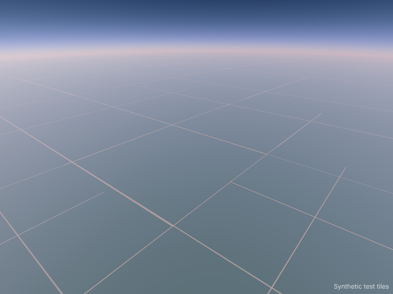
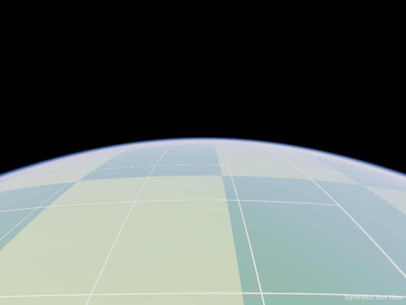

# Spike: terrain, imagery and atmosphere on R3F v10 WebGPU

## Atmosphere and @aeronautic effects

@aeronautic's effects (afterburner today; contrails and wing vapour later) render inside the atmosphere with one
sun, one air and one haze. Playground: `/?test=afterburner&fixtures`.

- **Pipeline.** `<Atmosphere renderPipeline={false}>` leaves the render pipeline to its children (`useAtmosphere()`).
  `atmosphere.createBackdropNode(camera)` is the `backdropNode` of @aeronautic/core's `volume_pass`: the opaque
  scene gets aerial perspective and the sky, and the plumes are composited over it at half resolution.
- **Haze on effects.** `atmosphere.createAerialPerspectiveAlongRay()` gives transmittance and in-scattered light
  for any distance (and optionally direction) in a shader; the playground's afterburner `radiance` hook applies
  it premultiplied.
- **Light.** `atmosphere.getSunAndSkyIlluminance(ecef)` (CPU) and `getSunAndSkyIlluminanceNode(ecefKm)` (TSL)
  give sunlight and skylight anywhere. They agree to 0.02 % in the browser check. The bridge
  (`apps/playground/src/aeronautic/atmosphereBridge.ts`) converts them to @aeronautic's units: its radiance unit
  is a 2000 K blackbody's luminance, 4.65 × 10⁵ cd/m².
- **Air.** Air molecules now follow the International Standard Atmosphere by default (as @aeronautic's
  `standard_atmosphere`), with `temperatureOffsetKelvin`. `AtmosphereParameters.fromVisibility(m)` sets the
  haze the way @aeronautic's `extinction()` does, and `parameters.getAirExtinction(altitude)` hands effects the
  sky's own air in @aeronautic's `Extinction` shape. This changes every sky slightly: the Rayleigh column goes
  from 8.0 to 8.43 km of sea-level air. `rayleighDensityProfile: 'exponential'` restores Bruneton's profile.
- **three 0.187.** @aeronautic 0.x pins three 0.186.x. A pnpm `peerDependencyRules` entry lets the playground
  run it on 0.187, and it works in the browser check. The proper fix is an @aeronautic release for 0.187.


## Round 2: our own atmosphere, GPU imagery, takram removed

Romain's call after round 1: drop takram and write our own atmosphere, and move imagery composition to the GPU.
Both are done, reviewed by a second model and fixed. The library now depends only on three, 3d-tiles-renderer
and (optionally) React and R3F, and it makes no network request of its own.

### Atmosphere (`src/atmosphere/`)

- Bruneton 2017 precomputed scattering, ported to typed TSL (BSD-3, see THIRD_PARTY_NOTICES.md).
- Lookup textures are generated on the device at startup from `AtmosphereParameters` (SI units), with fragment
  passes only, so WebGPU and the WebGL2 fallback behave the same. Change the parameters (haze, another planet)
  and the textures regenerate. Generation is spread over about 60 frames to avoid a hitch; until it finishes the
  scene renders without haze or sky, and `earth.inspect().atmosphere.ready` turns true when it does.
- Transmittance and irradiance are always 32-bit (half floats flush grazing-ray transmittance to zero and give
  NaNs near the horizon on phones). Scattering is 32-bit where the device can filter and blend it, half float
  otherwise. Memory: 8 MB (half) or 16 MB (float) kept, plus 24 / 48 MB transient during generation.
- Positions are corrected per fragment so the model's altitude equals the height above WGS84 (view and sun
  directions are rotated to match, so the sky horizon meets the terrain within 0.01°): exact on the
  ground at every latitude, within 27 m above ground even from 20,000 km.
- Sun light is a `DirectionalLight` registered with `Light.registerNode` (r187's replacement for `addLight`):
  sunlight attenuated at each fragment plus sky irradiance as ambient. Stock `MeshStandardNodeMaterial` works.
- Our own solar ephemeris (Astronomical Almanac + GMST), unit-tested against solstice and equinox values.
- The playground creates the renderer with `reversedDepthBuffer: true`; without it, haze bands from orbit
  (float depth steps reach hundreds of km). The atmosphere warns once if it is off.
- Not done: stars, moon, shadow length, and correction for geometry beyond the horizon.

Generation time is not measured on a real GPU yet: SwiftShader (a CPU rasteriser) takes 40 to 55 s, which says
nothing about phones. Measuring it on a Pixel and an iPhone is the first on-device task.

### Imagery (`src/tiles/imagery/`)

- Each terrain tile's imagery is composed on the GPU into a 256×256 render target, one quad per covering source
  tile, instead of a main-thread canvas. Decoding was already off-thread (`createImageBitmap`).
- On SwiftShader the main-thread cost per tile went from about 58 ms (canvas upload) to about 1 to 2 ms.
- Compositions run inside a per-frame budget (2 ms by default, `imageryCompositionBudgetMilliseconds`). Tiles
  3DTilesRenderer is waiting for go before preloads. Source tiles' GPU copies are freed once composed. Frames
  are requested while work is pending, so R3F's `frameloop="demand"` works.
- `earth.inspect().terrain` reports `imageryTilesComposited`, `imageryMainThreadMilliseconds` (last frame) and
  totals, for on-device profiling.
- It overrides a private 3d-tiles-renderer class instance (`TiledRegionImageSource`), isolated in
  `composeRegionsOnGpu.ts`: pin the version, and ask upstream for an extension point.

### Results now

| Check | Result |
| --- | --- |
| Precision, highPrecision on | 1 cm = 128.7 px, worst error 0.7 px |
| Map, atmosphere off | imagery drapes correctly (78 % checker pixels), same image as the canvas path |
| Map, atmosphere on | sky, horizon glow, haze, sunlit terrain (92 % sky or haze, 0 % black) |
| WebGL2 fallback | same images |
| Console and Vite startup | no warnings or errors |
| Unit tests | 66 pass |

 

---

## Round 1 (historical)

**Question:** can we build react-three-earth on 3DTilesRendererJS and takram three-geospatial, rendering
with WebGPU through React Three Fiber v10? And do we keep centimeter precision at planet scale?

**Answer:** yes, with two caveats.

1. takram needs patching to run on three r185 and later.
2. Imagery composition runs on the CPU, which is a performance concern for mobile.

Both are fixable, and neither changes the architecture in the proposal.

Versions tested:

- three 0.187.0
- @react-three/fiber 10.0.0-alpha.6 and @react-three/tsl 10.0.0-alpha.6
- 3d-tiles-renderer 0.5.4
- @takram/three-atmosphere 0.19.1 and @takram/three-geospatial 0.9.1
- React 19.3

## What runs

```tsx
<Canvas>
  <Earth date={new Date('2026-11-22T07:00:00Z')}>
    <Terrain>
      <QuantizedMeshSource url="https://terrain.reearth.land/cesium-mesh/ellipsoid/" />
    </Terrain>
    <Imagery>
      <RasterTileSource url="https://tile.openstreetmap.org/{z}/{x}/{y}.png" />
    </Imagery>
    <Atmosphere />
    <EarthControls />
  </Earth>
</Canvas>
```

Every component has a vanilla class of the same name (`new Earth()`, `new Terrain({ sources })`…). The React
layer only wires them to the R3F scheduler and the render pipeline. `earth.inspect()` returns plain JSON
(tiles loaded, visible, downloading, memory used and budget) for agents and tests.

## Results

All checks ran on real WebGPU, on Chromium with the SwiftShader Vulkan adapter. That adapter is a CPU
rasteriser, so these results show **correctness only**. Frame times here say nothing about phones.

### Precision: 1 cm at the summit of Fuji

The test places two 2 mm cubes 1 cm apart at 3776 m on the WGS84 ellipsoid and views them from 5 cm.
It then nudges them six times by 0.5 mm and finds their centroids on screen.

| `renderer.highPrecision` | Separation for 1 cm | Worst centroid error over 0.5 mm nudges |
| --- | --- | --- |
| on | 128.7 px (0.08 mm per px) | 0.94 px (0.07 mm) |
| off | cubes collapse into one | red cube not found |

three's `highPrecision` (model-view matrices computed in 64-bit on the CPU, relative to the eye) is enough.
We do not need our own relative-to-center rebasing. `Earth` turns it on when it connects to a renderer.

 

### Map: quantized-mesh terrain, raster imagery, atmosphere

The map check uses synthetic tiles served by the playground: a quantized-mesh encoder and a PNG checker
pattern. The sandbox cannot reach any tile host, so this check never touches the network.

| Atmosphere | Tiles loaded | Tiles visible | Result |
| --- | --- | --- | --- |
| off (plain lights) | 106 | 41 | the imagery drapes on terrain (79 % of pixels show the checker) |
| on | 106 | 41 | sky, sun light and aerial perspective render (89 % of pixels are sky-blue or hazed) |


The screenshot shows Fuji's area from 60 km at 16:00 local time on 22 November, with the sun low in the
south-west. The pink horizon band and the heavy haze over the dark synthetic albedo match what the
Bruneton model gives at that sun angle.

## What it took

### takram on three r185+ (patched)

- three r185 changed `struct()` to return a proxy. takram's `FnLayout` and `AtmosphereContextNode` read
  `struct.layout.name`, which no longer exists, so every atmosphere node fails to build.
- `patches/` fixes both packages: about six lines through `pnpm patchedDependencies`.
- The patches also fix a third bug: takram's blue-noise texture node dropped a custom `url` when TSL
  cloned it, so the texture always came from GitHub.
- **Maintenance risk:** the last takram release was May 2026. If an upstream PR does not land, vendor the
  atmosphere (MIT, a few thousand lines of TSL) under `src/vendor/`. We would then own it, which we will want
  anyway for mobile tuning.

### Runtime assets

- takram fetches its blue-noise texture (`stbn.bin`) from GitHub LFS at runtime. `stars.bin` ships in npm.
- `<Atmosphere starsUrl blueNoiseUrl>` lets an app self-host both files. We should ship them as package
  assets and default to those, so a fresh install needs no third-party host.

### Two integration traps

Both are fixed in `Atmosphere`, but they show where users would get stuck without the library:

- The sky compiles against `context.camera`. Inside a post-processing pass, the renderer's camera is the
  full-screen quad's, so sky rays point into the ground. `createAerialPerspective` now takes the scene camera.
- The aerial-perspective node keeps the scene's cleared alpha (0) in sky pixels. On a transparent canvas,
  the sky became the page behind it. The output is now forced opaque.

### 3DTilesRenderer

- **Works:**
  - quantized-mesh terrain
  - XYZ overlays
  - GlobeControls, which fits near and far for us
  - the LRU memory budget
- **Overlay material:** the stock `ImageOverlayPlugin` builds a GLSL `onBeforeCompile` material. We swap it
  for a TSL one by overriding its `_wrapMaterials`, which is a private API. We should pin the version and
  upstream a hook.
- **CPU composition:** overlays compose tiles on a main-thread canvas (`TiledTextureComposer`). On a phone,
  that is the most likely source of frame drops while panning. The fix that matches the "bake on the GPU"
  goal is a render-to-texture compositor (one draw per source tile), or a texture array sampled in the
  terrain shader. This should be the first performance task.
- The package declares an R3F peer of `^8 || ^9`. It is silenced in `pnpm-workspace.yaml`. Its R3F entry
  is not used.

### R3F v10

- `<Canvas>` is WebGPU by default. The scheduler's ids and `before` / `after` give a clean order:
  `earth:controls` runs before `earth:update`, which runs before render.
- `useRenderPipeline` from `@react-three/tsl` is the right hook for the atmosphere pass.
- `@react-three/fiber/extension` (the library entry) has no JSX types for `<primitive>`, so `<Earth>` adds
  its group with `scene.add`.

### Testing WebGPU in CI

Headless Chromium drops the GPU instance as soon as it presents a WebGPU canvas. What works is a headed
Chromium under `xvfb-run`, with SwiftShader's Vulkan backend:

```sh
pnpm dev &
xvfb-run -a node apps/playground/tests/run.mjs   # precision + map, writes test-results/
```

The flags are in `tests/run.mjs`. It should run on stock Linux CI runners, though only this sandbox has been tried.

## Not done in the spike

- Measuring frame time on a real Pixel and iPhone. This is the next step, with a hosted playground build.
- The 2D view and the morph to it, the columbus mode, and vector tiles (MapLibre style, PMTiles). They are
  designed in the proposal but not spiked.
- Strict types on the three adapted TSL files (`// @ts-nocheck` for now).
- Real tiles: the sandbox has no route to tile hosts, so the playground defaults (Re:Earth Terrain, OSM)
  are untested here. Run `pnpm dev` and open http://localhost:5173 to see them.

## Recommendation

Go ahead with 3DTilesRendererJS and takram as dependencies behind `src/compat/`.

- Open upstream PRs for the two takram fixes and for an overlay-material hook in 3DTilesRendererJS.
- Plan to vendor the atmosphere if upstream stalls.
- Make GPU overlay composition the first performance task, before any mobile measurement.
