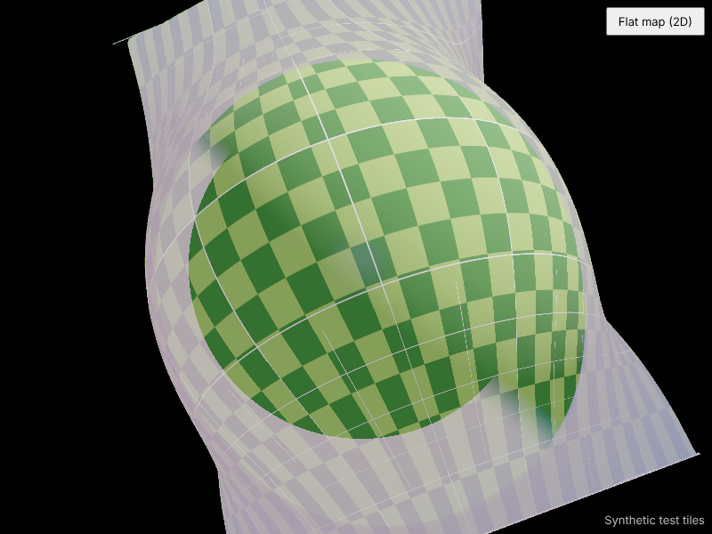
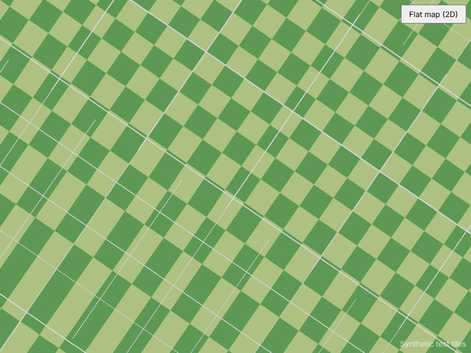
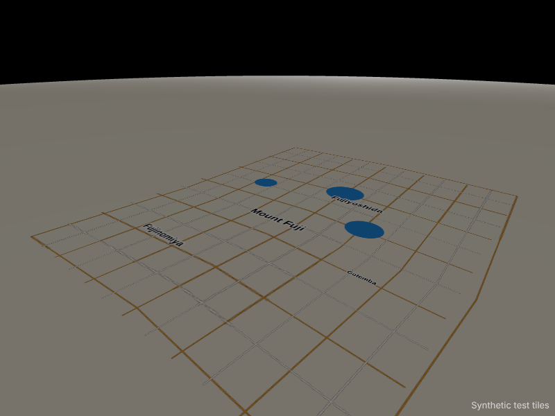
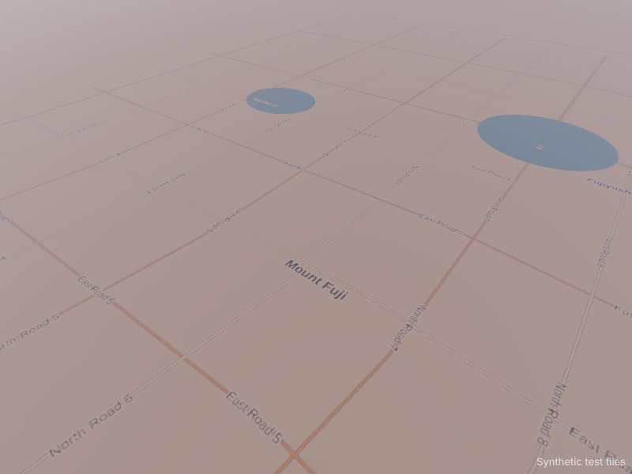
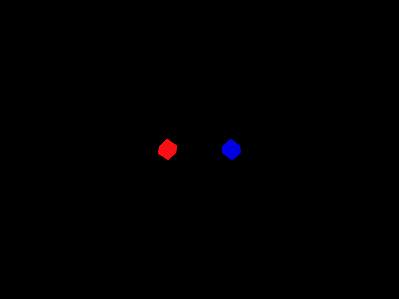

# Spike: terrain, imagery and atmosphere on R3F v10 WebGPU

## The flat map (2D) and the globe-to-map morph

```tsx
<Earth view={view /* '3d' | '2d' */} viewTransitionSeconds={1.5}>…</Earth>
// vanilla: earth.setView('2d', { durationSeconds: 1.5 }); earth.view.morph goes 0 → 1
```

How it works (`src/view/`, `src/tiles/FlatMapPlugin.ts`, `src/tiles/EarthTilesRenderer.ts`):

- **Where the map lies.** The flat map is spherical Web Mercator (what XYZ raster servers use), laid on the plane
  tangent to WGS84 at an anchor: the point the camera looks at when the morph starts. It is scaled by
  cos(anchor latitude), so around the anchor the map and the globe coincide at true size, and the camera never
  jumps. Heights are scaled by Mercator's local factor too, so relief keeps its shape. Going back to 3D
  re-anchors under the screen centre first (the camera is carried along), so the globe rolls up around the
  place you are looking at.
- **Morph in the vertex shader.** Each terrain mesh gets a `positionFlat` attribute at load: every vertex
  converted to Mercator on the CPU in double precision (Bowring's closed form, about 0.2 ms per tile), relative
  to the mesh's own flat centre. The tile material's `positionNode` mixes globe and flat positions. On the globe
  it returns the original position bit for bit (identity matrix, weight 0), so 3D is unchanged.
- **Precision on the map.** For each draw on the map, the mesh's `matrixWorld` is swapped for its flat frame
  (the anchor plane offset to the mesh's flat centre) and restored right after the draw, so
  `renderer.highPrecision` keeps centimetres in 2D as in 3D, and raycasts between frames see the globe.
- **Imagery stays aligned** by construction: the overlay UVs are vertex attributes, so they move with the
  vertices. The 2D check shows the same checker as 3D (97 % of pixels).
- **Tile selection on the map.** `EarthTilesRenderer` projects each tile's region onto the map plane and scales
  its geometric error by Mercator's enlargement there. During the morph a tile loads if either view needs it.
  Tiles without a region volume (boxes, spheres) are selected as on the globe.
- **Atmosphere and light.** Sky, haze and the sun fade out with the morph (`atmosphere.opacity`). On the map,
  standard tile materials emit their imagery colour, so night and slopes don't darken the map;
  `<Atmosphere>` scales it to undo its exposure. Lights of your own are not faded for you: scale them by
  `1 - earth.view.morph`.
- **Controls.** `EarthViewControls` (vanilla, used by `<EarthControls>`) gives input to `GlobeControls` on the
  globe and to `FlatMapControls` (3DTilesRenderer's `EnvironmentControls` on the map plane) on the map: pan,
  zoom to cursor and rotate, top-down by default (`maximumFlatMapTiltDegrees` allows tilt). Input is ignored
  while morphing. The camera is kept above the highest loaded terrain under it.
- **No seam at ±180°.** Each mesh and tile is placed on the copy of the world nearest the anchor.

| Check (SwiftShader, fixtures) | Result |
| --- | --- |
| 2D, atmosphere off and on | 97 % checker pixels, no errors |
| 3D map checks after the change | unchanged (78 % checker; 92 % sky or haze) |
| Precision, highPrecision on | unchanged: 1 cm = 128.7 px, worst error 0.7 px |
| Unit tests | 76 pass |


Morph from 12,000 km, with the atmosphere: globe, halfway, flat map.

  

Not done yet:

- 2.5D "columbus" view, and copies of the world side by side when zoomed out in 2D.
- Normals on the map are the globe's turned into the map plane (right near the anchor, tilted far from it).
  It only shows with your own lights on the map, since the atmosphere's sun is faded out there.
- Halfway through the morph, the blended geometry can sit outside both views' frusta, so a tile at the edge
  may drop out for a frame or two. Not seen in testing.
- The camera's lower limit in 2D uses the tile regions' maximum height, not the terrain itself.
- The `Earth` must stay at the scene origin (as `setCameraView` and the controls already assume).

## Vector map styles (`src/vector/`)

`<Imagery><MapStyleSource url="https://…/style.json" /></Imagery>` drapes a MapLibre style (version 8) on the
terrain. Vector sources can be XYZ `tiles`, a TileJSON `url`, or a PMTiles archive (`pmtiles://https://…`).
Vanilla: `new Imagery({ sources: [new MapStyleSource({ url })] })`, and `imagery.dispose()` after removing it.

How it works:

- A module worker (`vector-worker.js` in the build) fetches tiles, decodes MVT, evaluates the style's filters and
  properties with `@maplibre/maplibre-gl-style-spec` (the same expression engine as MapLibre), tessellates
  fills, lines (joins, caps, dashes, gap width, offset) and circles, and lays out text labels: SDF glyphs from the
  style's `glyphs` server, or drawn locally with TinySDF when there is none; point and line placement, wrapping,
  anchors, halos, per-tile collision with `symbol-sort-key` and top layers first. It returns typed arrays,
  transferred, not copied. If the worker cannot start, tiles are processed on the main thread with a warning.
- The main thread never rasterises tiles. For each terrain tile's region, the covering vector tiles are drawn
  straight into the region's texture at its own resolution, with 4× MSAA in a shared scratch target, through the
  existing `ImageryCompositor` (same 2 ms budget and priorities as raster). One draw per tile and layer group;
  fragments outside the tile square are dropped so buffers never overdraw neighbours. A ring of neighbour tiles
  adds only their labels (when within label reach of the region), so labels crossing a tile edge are not cut.
- The style is evaluated at the region's zoom (512-pixel tiles, as MapLibre). Past the data's maximum zoom,
  tiles are overzoomed (widths and text keep their pixel size); terrain tiles split up to `maximumZoom` (20).
- Processed tiles stay in a 32 MB cache of unused buckets (`retainedTileBytes`); raw tiles in the worker LRU.

Not supported yet: icons and fill patterns (sprites), raster, hillshade and heatmap layers (skipped with one
warning), right-to-left and complex scripts, `fill-extrusion` in 3D (drawn flat), labels colliding across
tiles, and symbol layers below shape layers (all labels draw on top). Tile, TileJSON and glyph requests go
through the worker's `fetch` with `requestHeaders`, not 3DTilesRenderer's `preprocessURL` (the style request
does). Labels change size by 2× where neighbouring terrain tiles are textured at different zooms: draped text
has a fixed size on the ground.

| Check (fixtures: synthetic water, roads, places; SwiftShader) | Result |
| --- | --- |
| Overview, atmosphere off | water, roads and place labels drape on terrain; 106 regions composed, no errors |
| Close-up, 9 km, 50° pitch | road names follow the roads upright, labels sharp at region resolution |
| WebGL2 fallback | same image as WebGPU |
| Raster map checks | unchanged |
| Unit tests | 32 new, 98 total (style evaluation, tessellation areas, glyph PBF and atlas, shaping and placement, TileJSON, TMS, PMTiles range requests, caches, region tiles, ring reach) |

  

### Redrawing changed regions: `invalidate(bounds)` (F1)

`MapStyleSource.invalidate(bounds?)` redraws what changed on the tile server, with no flicker and no hole. It is
the foundation GeoJSON `setData`, style edits, feature-state and runtime images will build on.

- Regions are redrawn **in place**. `drawRegion` already renders into the shared multisampled scratch target and
  resolves into the region's own target, so a redraw enqueues a new job into the same `RenderTarget`: the terrain
  material keeps sampling the old content until one copy pass overwrites it. No texture swap, no 3DTilesRenderer
  private API.
- The worker forgets raw tiles overlapping the bounds (a new `invalidate` message; messages are ordered, so later
  tile requests fetch again). Processed buckets in the bounds are `discard`ed from the `RefCountedCache`: the next
  lock loads them again, while regions still drawing with the old bucket hold it through a **lease** (`acquire`),
  so a release can never hit the new entry. Buckets outside the bounds stay cached: only changed tiles are refetched.
- **Which regions redraw** is exact rather than a widened box: a region redraws when any tile it draws overlaps the
  bounds, including the label ring (neighbour tiles whose labels reach in). This replaces the brief's "widen the
  bounds by the label reach" with the same test the region uses to pick its tiles, so it cannot drift from it.
- Bounds crossing the antimeridian (west > east) become two rectangles in normalised Web Mercator; 360° or more is
  everything; a point or line is widened by 1e-12 so it touches the tiles it lies on, while tiles that only share
  an edge with real bounds are left out.
- A region invalidated **while loading** finishes and shows what it drew, then redraws once (a stale flag per load
  in flight rather than a generation counter, so nothing per key outlives the load). A region invalidated during its
  own redraw redraws once more after. A region released mid-redraw aborts the redraw before its target is freed.
- **Scheduling**: `ImageryCompositor` has a third queue, `recomposition`, between `waited` (first textures of
  visible tiles) and `preload`, under the same per-frame budget. Invalidations mark regions synchronously and start
  their redraws from `runBeforeNextRender`, a once-per-frame task, so calls within a frame coalesce into one redraw
  per region.
- Refetches cannot come back stale from the browser: tiles in areas invalidated so far are fetched with
  `cache: 'no-cache'` (a conditional request, 304 when unchanged; past 64 areas, every tile). A PMTiles source
  re-reads its header and directories on any invalidate, and its range requests revalidate from then on.
- A cache disposed while leases are out ignores their later release, so a disposed overlay keeps nothing.
- `earth.inspect().terrain.imageryRecompositionsPending` counts regions waiting or redrawing; redraws also count
  in `imageryTilesComposited`.
- Raster overlays (`XYZImageryOverlay`) are out of scope: their exact-tile fast path hands the source texture to
  terrain materials, so a redraw would need to rebind materials through upstream private state (W7 / W14 if needed).

| Check | Result |
| --- | --- |
| Unit tests | 13 new (158 total): only overlapping regions (label ring included) redraw, antimeridian, invalidation during a load and during a redraw end fresh, released regions stop redrawing, coalescing, leases and dispose, queue order, worker raw-tile cache and revalidation, replaced PMTiles archive |
| Browser (`?fixtures&map=vector&test=invalidate`, SwiftShader) | the fixture server recolours the lakes, `invalidate(bounds)` around them: of 106 regions held, 90 reach into the bounds and redraw once each; lakes go from blue to pink, and every screenshot taken while redrawing still shows them (no missing texture) |

 

## Atmosphere and @aeronautic effects

@aeronautic's effects (afterburner today; contrails and wing vapour later) render inside the atmosphere with one
sun, one air and one haze. Playground: `/?test=afterburner&fixtures`.

- **Pipeline.** `<Atmosphere renderPipeline={false}>` leaves the render pipeline to its children (`useAtmosphere()`).
  `atmosphere.createBackdropNode(camera)` is the `backdropNode` of @aeronautic/core's `volume_pass`: the opaque
  scene gets aerial perspective and the sky, and the plumes are composited over it at half resolution.
- **Haze on effects.** `atmosphere.createAerialPerspectiveAlongRay()` gives transmittance and in-scattered light
  for any distance (and optionally direction) in a shader; the playground's afterburner `radiance` hook applies
  it premultiplied.
- **Light.** `atmosphere.getSunAndSkyIlluminance(ecef)` (CPU) and `getSunAndSkyIlluminanceNode(ecefKm)` (TSL)
  give sunlight and skylight anywhere. They agree to 0.02 % in the browser check. The bridge
  (`apps/playground/src/aeronautic/atmosphereBridge.ts`) converts them to @aeronautic's units: its radiance unit
  is a 2000 K blackbody's luminance, 4.65 × 10⁵ cd/m².
- **Air.** Air molecules now follow the International Standard Atmosphere by default (as @aeronautic's
  `standard_atmosphere`), with `temperatureOffsetKelvin`. `AtmosphereParameters.fromVisibility(m)` sets the
  haze the way @aeronautic's `extinction()` does, and `parameters.getAirExtinction(altitude)` hands effects the
  sky's own air in @aeronautic's `Extinction` shape. This changes every sky slightly: the Rayleigh column goes
  from 8.0 to 8.43 km of sea-level air. `rayleighDensityProfile: 'exponential'` restores Bruneton's profile.
- **three 0.187.** @aeronautic 0.x pins three 0.186.x. A pnpm `peerDependencyRules` entry lets the playground
  run it on 0.187, and it works in the browser check. The proper fix is an @aeronautic release for 0.187.


## Round 3: faster atmosphere startup

Lookup-texture generation was the slowest part of startup and caused long frames while it ran. Three changes:

- **One single-scattering pass instead of three.** Rayleigh and Mie single scattering are integrated once and
  written to two textures by a multiple-render-target pass, then copied texel for texel into the scattering
  texture. The generated textures are bit-identical to before on WebGPU and on the WebGL 2 fallback.
- **Batches timed on the GPU.** Each animation frame runs a batch of passes (or slices of 3D passes) sized so
  that it takes about `generationBudgetMillisecondsPerFrame` (default 4 ms) of GPU time. The cost is measured
  after each batch (WebGPU `onSubmittedWorkDone`, a WebGL 2 fence), after the app has submitted its own
  frame, so the same code adapts to a desktop GPU and a phone. Batches grow at most twice as heavy as the
  last measured one, a shader's first compile is not counted, cheap copy passes run all slices at once, and
  a GPU that stops answering falls back to a fixed number of passes per frame. `Infinity` generates
  everything in one frame (a loading screen).
- **IndexedDB cache.** Generated textures are stored keyed by every parameter, the storage type and
  `ATMOSPHERE_PRECOMPUTE_VERSION` (a unit test fails when the generating code changes, as a reminder to bump
  it). Later page loads copy them back instead of generating. On by default (`<Atmosphere cache={false} />`
  opts out); two sets are kept, 8 MB each with half-float scattering (16 MB with 32-bit). A read-back that
  cannot be right (a WebGL 2 driver that cannot read half floats leaves zeros) is never stored. The
  playground's dev server never caches, so shader edits always show.

`earth.inspect().atmosphere` now also reports `generationFrames` and `loadedFromCache`, and the playground
shows them in the bottom-left corner. Playground switches: `?nocache`, `?atmosphereBudget=<ms>`.

### Results in SwiftShader (CPU rasteriser: compare the two columns, not the absolute numbers)

Textures alone (`tests/atmosphere.mjs`), output bit-identical before and after on both backends, from
generation and from the cache:

| Run | Before | After |
| --- | --- | --- |
| WebGPU, total generation | 30.2 s | 18.7 s |
| WebGPU, longest frame during generation | 2033 ms (p95 633 ms) | 16.8 ms (p95 16.8 ms) |
| WebGL 2, total generation | 51.2 s | 42.4 s |
| WebGL 2, longest frame during generation | 1400 ms | 83 ms (p95 16.7 ms) |
| Second page load (cache hit) | same as first | 0.20 s WebGPU, 0.15 s WebGL 2, about 10 frames |

Inside the full map scene, SwiftShader frames take over a second each, so paced generation runs one pass per
frame and takes minutes (237 frames); the browser checks pass `?atmosphereBudget=Infinity`. A pass is never
split, so on a real device generation needs at least about 240 frames (4 s at 60 fps) the first time. If a
phone shows long frames or a slow first start, the next steps are splitting density slices into row bands
and a larger budget when the app has headroom.

`node apps/playground/tests/atmosphere.mjs [webgl] [cache]` (with `pnpm dev` running, under xvfb) prints these
numbers and fingerprints of the textures.

### On devices

The playground is published to GitHub Pages by `.github/workflows/playground-pages.yml` once Pages is enabled
(Settings → Pages → Source: GitHub Actions). Open it once to warm the cache, then with `?nocache` to time
generation; the bottom-left line gives the time and frame count.

| Device | Browser | Generation | Frames | Cache load |
| --- | --- | --- | --- | --- |
| Pixel | Chrome | to measure | | |
| iPhone | Safari | to measure | | |

## Round 2: our own atmosphere, GPU imagery, takram removed

Romain's call after round 1: drop takram and write our own atmosphere, and move imagery composition to the GPU.
Both are done, reviewed by a second model and fixed. The library now depends only on three, 3d-tiles-renderer
and (optionally) React and R3F, and it makes no network request of its own.

### Atmosphere (`src/atmosphere/`)

- Bruneton 2017 precomputed scattering, ported to typed TSL (BSD-3, see THIRD_PARTY_NOTICES.md).
- Lookup textures are generated on the device at startup from `AtmosphereParameters` (SI units), with fragment
  passes only, so WebGPU and the WebGL2 fallback behave the same. Change the parameters (haze, another planet)
  and the textures regenerate. Generation is spread over about 60 frames to avoid a hitch; until it finishes the
  scene renders without haze or sky, and `earth.inspect().atmosphere.ready` turns true when it does.
- Transmittance and irradiance are always 32-bit (half floats flush grazing-ray transmittance to zero and give
  NaNs near the horizon on phones). Scattering is 32-bit where the device can filter and blend it, half float
  otherwise. Memory: 8 MB (half) or 16 MB (float) kept, plus 24 / 48 MB transient during generation.
- Positions are corrected per fragment so the model's altitude equals the height above WGS84 (view and sun
  directions are rotated to match, so the sky horizon meets the terrain within 0.01°): exact on the
  ground at every latitude, within 27 m above ground even from 20,000 km.
- Sun light is a `DirectionalLight` registered with `Light.registerNode` (r187's replacement for `addLight`):
  sunlight attenuated at each fragment plus sky irradiance as ambient. Stock `MeshStandardNodeMaterial` works.
- Our own solar ephemeris (Astronomical Almanac + GMST), unit-tested against solstice and equinox values.
- The playground creates the renderer with `reversedDepthBuffer: true`; without it, haze bands from orbit
  (float depth steps reach hundreds of km). The atmosphere warns once if it is off.
- Not done: stars, moon, shadow length, and correction for geometry beyond the horizon.

Generation time is not measured on a real GPU yet: SwiftShader (a CPU rasteriser) takes 40 to 55 s, which says
nothing about phones. Measuring it on a Pixel and an iPhone is the first on-device task.

### Imagery (`src/tiles/imagery/`)

- Each terrain tile's imagery is composed on the GPU into a 256×256 render target, one quad per covering source
  tile, instead of a main-thread canvas. Decoding was already off-thread (`createImageBitmap`).
- On SwiftShader the main-thread cost per tile went from about 58 ms (canvas upload) to about 1 to 2 ms.
- Compositions run inside a per-frame budget (2 ms by default, `imageryCompositionBudgetMilliseconds`). Tiles
  3DTilesRenderer is waiting for go before preloads. Source tiles' GPU copies are freed once composed. Frames
  are requested while work is pending, so R3F's `frameloop="demand"` works.
- `earth.inspect().terrain` reports `imageryTilesComposited`, `imageryMainThreadMilliseconds` (last frame) and
  totals, for on-device profiling.
- It overrides a private 3d-tiles-renderer class instance (`TiledRegionImageSource`), isolated in
  `composeRegionsOnGpu.ts`: pin the version, and ask upstream for an extension point.

### Results now

| Check | Result |
| --- | --- |
| Precision, highPrecision on | 1 cm = 128.7 px, worst error 0.7 px |
| Map, atmosphere off | imagery drapes correctly (78 % checker pixels), same image as the canvas path |
| Map, atmosphere on | sky, horizon glow, haze, sunlit terrain (92 % sky or haze, 0 % black) |
| WebGL2 fallback | same images |
| Console and Vite startup | no warnings or errors |
| Unit tests | 66 pass |

 

---

## Round 1 (historical)

**Question:** can we build react-three-earth on 3DTilesRendererJS and takram three-geospatial, rendering
with WebGPU through React Three Fiber v10? And do we keep centimeter precision at planet scale?

**Answer:** yes, with two caveats.

1. takram needs patching to run on three r185 and later.
2. Imagery composition runs on the CPU, which is a performance concern for mobile.

Both are fixable, and neither changes the architecture in the proposal.

Versions tested:

- three 0.187.0
- @react-three/fiber 10.0.0-alpha.6 and @react-three/tsl 10.0.0-alpha.6
- 3d-tiles-renderer 0.5.4
- @takram/three-atmosphere 0.19.1 and @takram/three-geospatial 0.9.1
- React 19.3

## What runs

```tsx
<Canvas>
  <Earth date={new Date('2026-11-22T07:00:00Z')}>
    <Terrain>
      <QuantizedMeshSource url="https://terrain.reearth.land/cesium-mesh/ellipsoid/" />
    </Terrain>
    <Imagery>
      <RasterTileSource url="https://tile.openstreetmap.org/{z}/{x}/{y}.png" />
    </Imagery>
    <Atmosphere />
    <EarthControls />
  </Earth>
</Canvas>
```

Every component has a vanilla class of the same name (`new Earth()`, `new Terrain({ sources })`…). The React
layer only wires them to the R3F scheduler and the render pipeline. `earth.inspect()` returns plain JSON
(tiles loaded, visible, downloading, memory used and budget) for agents and tests.

## Results

All checks ran on real WebGPU, on Chromium with the SwiftShader Vulkan adapter. That adapter is a CPU
rasteriser, so these results show **correctness only**. Frame times here say nothing about phones.

### Precision: 1 cm at the summit of Fuji

The test places two 2 mm cubes 1 cm apart at 3776 m on the WGS84 ellipsoid and views them from 5 cm.
It then nudges them six times by 0.5 mm and finds their centroids on screen.

| `renderer.highPrecision` | Separation for 1 cm | Worst centroid error over 0.5 mm nudges |
| --- | --- | --- |
| on | 128.7 px (0.08 mm per px) | 0.94 px (0.07 mm) |
| off | cubes collapse into one | red cube not found |

three's `highPrecision` (model-view matrices computed in 64-bit on the CPU, relative to the eye) is enough.
We do not need our own relative-to-center rebasing. `Earth` turns it on when it connects to a renderer.

 

### Map: quantized-mesh terrain, raster imagery, atmosphere

The map check uses synthetic tiles served by the playground: a quantized-mesh encoder and a PNG checker
pattern. The sandbox cannot reach any tile host, so this check never touches the network.

| Atmosphere | Tiles loaded | Tiles visible | Result |
| --- | --- | --- | --- |
| off (plain lights) | 106 | 41 | the imagery drapes on terrain (79 % of pixels show the checker) |
| on | 106 | 41 | sky, sun light and aerial perspective render (89 % of pixels are sky-blue or hazed) |


The screenshot shows Fuji's area from 60 km at 16:00 local time on 22 November, with the sun low in the
south-west. The pink horizon band and the heavy haze over the dark synthetic albedo match what the
Bruneton model gives at that sun angle.

## What it took

### takram on three r185+ (patched)

- three r185 changed `struct()` to return a proxy. takram's `FnLayout` and `AtmosphereContextNode` read
  `struct.layout.name`, which no longer exists, so every atmosphere node fails to build.
- `patches/` fixes both packages: about six lines through `pnpm patchedDependencies`.
- The patches also fix a third bug: takram's blue-noise texture node dropped a custom `url` when TSL
  cloned it, so the texture always came from GitHub.
- **Maintenance risk:** the last takram release was May 2026. If an upstream PR does not land, vendor the
  atmosphere (MIT, a few thousand lines of TSL) under `src/vendor/`. We would then own it, which we will want
  anyway for mobile tuning.

### Runtime assets

- takram fetches its blue-noise texture (`stbn.bin`) from GitHub LFS at runtime. `stars.bin` ships in npm.
- `<Atmosphere starsUrl blueNoiseUrl>` lets an app self-host both files. We should ship them as package
  assets and default to those, so a fresh install needs no third-party host.

### Two integration traps

Both are fixed in `Atmosphere`, but they show where users would get stuck without the library:

- The sky compiles against `context.camera`. Inside a post-processing pass, the renderer's camera is the
  full-screen quad's, so sky rays point into the ground. `createAerialPerspective` now takes the scene camera.
- The aerial-perspective node keeps the scene's cleared alpha (0) in sky pixels. On a transparent canvas,
  the sky became the page behind it. The output is now forced opaque.

### 3DTilesRenderer

- **Works:**
  - quantized-mesh terrain
  - XYZ overlays
  - GlobeControls, which fits near and far for us
  - the LRU memory budget
- **Overlay material:** the stock `ImageOverlayPlugin` builds a GLSL `onBeforeCompile` material. We swap it
  for a TSL one by overriding its `_wrapMaterials`, which is a private API. We should pin the version and
  upstream a hook.
- **CPU composition:** overlays compose tiles on a main-thread canvas (`TiledTextureComposer`). On a phone,
  that is the most likely source of frame drops while panning. The fix that matches the "bake on the GPU"
  goal is a render-to-texture compositor (one draw per source tile), or a texture array sampled in the
  terrain shader. This should be the first performance task.
- The package declares an R3F peer of `^8 || ^9`. It is silenced in `pnpm-workspace.yaml`. Its R3F entry
  is not used.

### R3F v10

- `<Canvas>` is WebGPU by default. The scheduler's ids and `before` / `after` give a clean order:
  `earth:controls` runs before `earth:update`, which runs before render.
- `useRenderPipeline` from `@react-three/tsl` is the right hook for the atmosphere pass.
- `@react-three/fiber/extension` (the library entry) has no JSX types for `<primitive>`, so `<Earth>` adds
  its group with `scene.add`.

### Testing WebGPU in CI

Headless Chromium drops the GPU instance as soon as it presents a WebGPU canvas. What works is a headed
Chromium under `xvfb-run`, with SwiftShader's Vulkan backend:

```sh
pnpm dev &
xvfb-run -a node apps/playground/tests/run.mjs   # precision + map, writes test-results/
```

The flags are in `tests/run.mjs`. It should run on stock Linux CI runners, though only this sandbox has been tried.

## Not done in the spike

- Measuring frame time on a real Pixel and iPhone. This is the next step, with a hosted playground build.
- The 2D view and the morph to it, the columbus mode, and vector tiles (MapLibre style, PMTiles). They are
  designed in the proposal but not spiked.
- Strict types on the three adapted TSL files (`// @ts-nocheck` for now).
- Real tiles: the sandbox has no route to tile hosts, so the playground defaults (Re:Earth Terrain, OSM)
  are untested here. Run `pnpm dev` and open http://localhost:5173 to see them.

## Recommendation

Go ahead with 3DTilesRendererJS and takram as dependencies behind `src/compat/`.

- Open upstream PRs for the two takram fixes and for an overlay-material hook in 3DTilesRendererJS.
- Plan to vendor the atmosphere if upstream stalls.
- Make GPU overlay composition the first performance task, before any mobile measurement.
