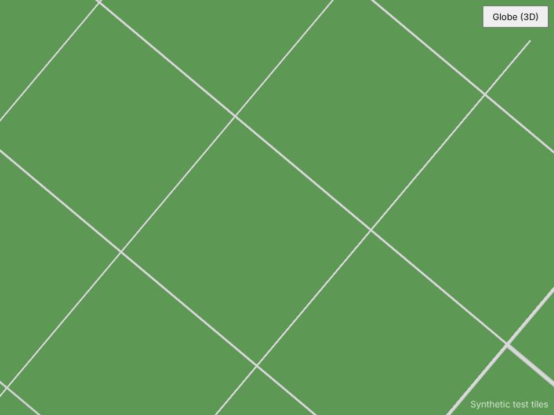
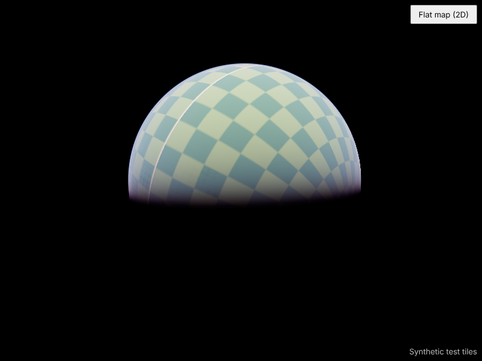
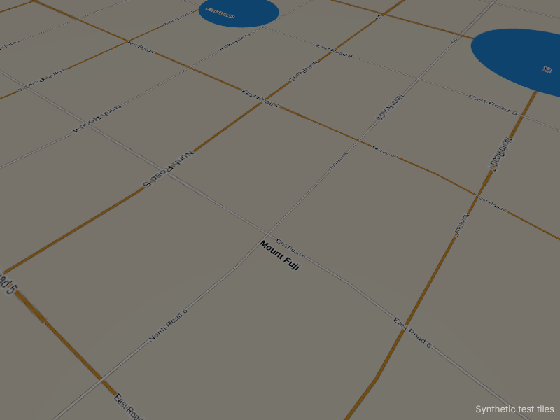
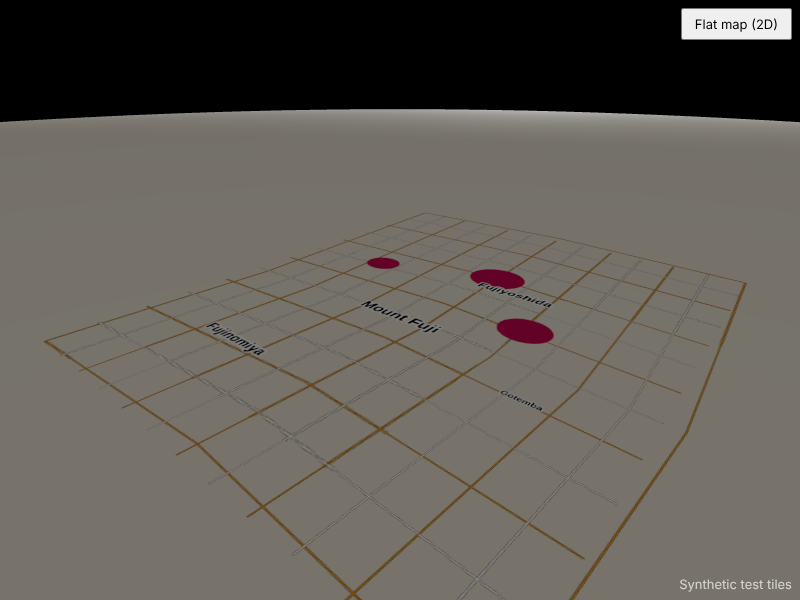
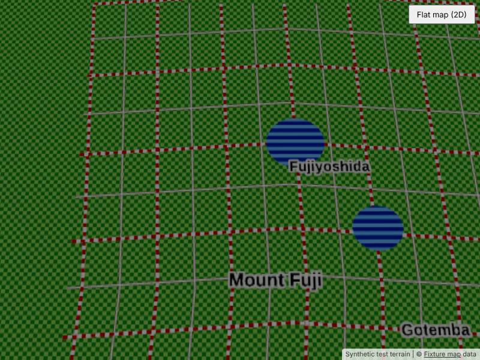
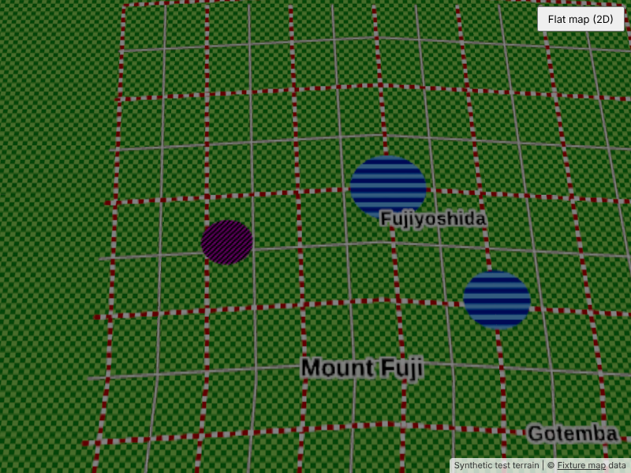
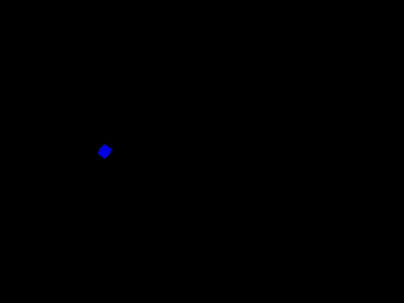

# Spike: terrain, imagery and atmosphere on R3F v10 WebGPU

## The flat map (2D) and the globe-to-map morph

```tsx
<Earth view={view /* '3d' | '2d' */} viewTransitionSeconds={1.5}>…</Earth>
// vanilla: earth.setView('2d', { durationSeconds: 1.5 }); earth.view.morph goes 0 → 1
```

How it works (`src/view/`, `src/tiles/FlatMapPlugin.ts`, `src/tiles/EarthTilesRenderer.ts`):

- **Where the map lies.** The flat map is spherical Web Mercator (what XYZ raster servers use), laid on the plane
  tangent to WGS84 at an anchor: the point the camera looks at when the morph starts. It is scaled by
  cos(anchor latitude), so around the anchor the map and the globe coincide at true size, and the camera never
  jumps. Heights are scaled by Mercator's local factor too, so relief keeps its shape. Going back to 3D
  re-anchors under the screen centre first (the camera is carried along), so the globe rolls up around the
  place you are looking at.
- **Morph in the vertex shader.** Each terrain mesh gets a `positionFlat` attribute at load: every vertex
  converted to Mercator on the CPU in double precision (Bowring's closed form, about 0.2 ms per tile), relative
  to the mesh's own flat centre. The tile material's `positionNode` mixes globe and flat positions. On the globe
  it returns the original position bit for bit (identity matrix, weight 0), so 3D is unchanged.
- **Precision on the map.** For each draw on the map, the mesh's `matrixWorld` is swapped for its flat frame
  (the anchor plane offset to the mesh's flat centre) and restored right after the draw, so
  `renderer.highPrecision` keeps centimetres in 2D as in 3D, and raycasts between frames see the globe.
- **Imagery stays aligned** by construction: the overlay UVs are vertex attributes, so they move with the
  vertices. The 2D check shows the same checker as 3D (97 % of pixels).
- **Tile selection on the map.** `EarthTilesRenderer` projects each tile's region onto the map plane and scales
  its geometric error by Mercator's enlargement there. During the morph a tile loads if either view needs it.
  Tiles without a region volume (boxes, spheres) are selected as on the globe.
- **Atmosphere and light.** Sky, haze and the sun fade out with the morph (`atmosphere.opacity`). On the map,
  standard tile materials emit their imagery colour, so night and slopes don't darken the map;
  `<Atmosphere>` scales it to undo its exposure. Lights of your own are not faded for you: scale them by
  `1 - earth.view.morph`.
- **Controls.** `EarthViewControls` (vanilla, used by `<EarthControls>`) gives input to `GlobeControls` on the
  globe and to `FlatMapControls` (3DTilesRenderer's `EnvironmentControls` on the map plane) on the map: pan,
  zoom to cursor and rotate, top-down by default (`maximumFlatMapTiltDegrees` allows tilt). Input is ignored
  while morphing. The camera is kept above the highest loaded terrain under it.
- **No seam at ±180°.** Each mesh and tile is placed on the copy of the world nearest the anchor.

| Check (SwiftShader, fixtures) | Result |
| --- | --- |
| 2D, atmosphere off and on | 97 % checker pixels, no errors |
| 3D map checks after the change | unchanged (78 % checker; 92 % sky or haze) |
| Precision, highPrecision on | unchanged: 1 cm = 128.7 px, worst error 0.7 px |
| Unit tests | 76 pass |



Morph from 12,000 km, with the atmosphere: globe, halfway, flat map.

  

Not done yet:

- 2.5D "columbus" view, and copies of the world side by side when zoomed out in 2D.
- Normals on the map are the globe's turned into the map plane (right near the anchor, tilted far from it).
  It only shows with your own lights on the map, since the atmosphere's sun is faded out there.
- Halfway through the morph, the blended geometry can sit outside both views' frusta, so a tile at the edge
  may drop out for a frame or two. Not seen in testing.
- The camera's lower limit in 2D uses the tile regions' maximum height, not the terrain itself.
- The `Earth` must stay at the scene origin (as `setCameraView` and the controls already assume).

## Map camera, project / unproject and events (`earth.camera`)

```ts
earth.camera.getView() // { longitudeDegrees, latitudeDegrees, heightMeters, zoom, headingDegrees, pitchDegrees, distanceMeters }
earth.camera.jumpTo({ longitudeDegrees: 2.35, latitudeDegrees: 48.86, zoom: 12 })
earth.camera.getBounds(); earth.project(position); earth.unproject({ xPixels, yPixels }); earth.queryTerrainElevation(position)
earth.addEventListener('moveend', …) // React: useEarthCamera(), useEarthEvent('moveend', …)
```

How it works (`src/core/EarthCamera.ts`, `events.ts`, `projection.ts`, `zoom.ts`):

- **Zoom is MapLibre's** (512-pixel tiles), measured at the screen centre from the camera's distance to it
  and its focal length in CSS pixels: on the globe from ground metres per pixel at the centre's latitude, on
  the flat map from Web Mercator metres per pixel (the map's flat coordinates). At the morph anchor both
  agree by construction, so a morph keeps centre, zoom and heading (the browser check measures 2·10⁻⁶ zoom).
- **The centre and `unproject` follow the terrain**: a raycast on the loaded tiles (3DTilesRenderer's own
  raycast, first hit only), the ellipsoid where none is loaded. On the flat map the screen ray is taken into
  flat coordinates and settled on the relief in four fixed-point steps (plane at the height
  `queryTerrainElevation` finds under the last guess), since the map's geometry only exists in the shader.
- **`project` follows the morph exactly**: the tile shader mixes globe and flat positions linearly in the
  Earth's frame, so the projected point is the same mix. Points beyond the ellipsoid's horizon are hidden
  with Cesium's ellipsoidal occluder test; terrain does not hide points yet.
- **World copies**: on the flat map, `project` and `jumpTo` use the copy of the world around the camera
  (`view.worldCopyReferenceXMeters`), so a place stays under the camera through a long pan across the
  antimeridian, and `getBounds` keeps longitudes continuous across copies (a view wider than one world spans
  every longitude).
- **Camera placement looks straight down without degenerating**: `placeCameraAround` builds the camera's
  basis from heading and pitch instead of `lookAt`, and `setCameraView` now uses it.
- **Events need no hooks in the controls**: `Earth.update` compares the camera's world matrix, field of view
  and canvas size with the last frame, so controls, `jumpTo`, the morph and app code all produce
  `movestart` / `move` / `moveend` (a running morph counts as one move). `idle` waits for the tileset root,
  3DTilesRenderer's running tasks (download, parse, child preparation), a pending `needs-update` (a loaded
  tile not yet shown) or `load-error`, queued imagery compositions and a running atmosphere generation (a
  failed one does not hold it back); `load` is the first `idle`.
- **Bounds** walk the screen's edges on the ellipsoid (the map's plane in 2D), bisect to the horizon where
  an edge goes from ground to sky, add the globe's outline where it is on screen (exact: the ellipsoid's
  outline is a circle in the frame where it is the unit sphere), and open to every longitude over a pole.
  `Earth.update` asks for one more frame after a move so `moveend` fires with `frameloop="demand"`, and
  `jumpTo` dispatches `framerequest`, which `<Earth>` turns into `invalidate()`.
- Changed from the brief: no edits to `EarthControls.ts` (motion is detected, not reported), and zoom
  helpers live in `zoom.ts` for the 2D thread and later workstreams to share.

| Check | Result |
| --- | --- |
| Fixture terrain (3.9 km hill), pitched camera: unproject → project | 3·10⁻⁸ px |
| unproject height vs `queryTerrainElevation`; terrain point → screen → back | 0 m; 3 µm |
| Flat map: unproject → project | 2·10⁻⁹ px |
| `getView` before / after the morph (top-down) | same centre, zoom within 2·10⁻⁶ |
| Morph events | `movestart`, `moveend`, `idle` |

With relief under a pitched camera, the morph anchors on the ellipsoid
point under the screen centre rather than the terrain point, so the centre shifts by the relief's parallax
during a 3D→2D morph. `getBounds` ignores terrain. `idle` does not wait for imagery added after tiles loaded
(those textures download outside 3DTilesRenderer's counters).

## Camera animations and pointer events (W1b)

```ts
await earth.camera.flyTo({ longitudeDegrees: 2.35, latitudeDegrees: 48.86, zoom: 12 }) // true, or false when stopped
earth.camera.fitBounds(bounds, { paddingPixels: 40 }); earth.camera.setPadding({ leftPixels: 320 })
earth.addEventListener('click', event => event.geographic) // <Earth initialView={…}>, formatViewHash / parseViewHash
```

How it works (`src/core/cameraAnimation.ts`, `EarthCamera.ts`, `events.ts`, `Earth.ts`, `viewHash.ts`):

- **Animations are view interpolations replayed through `jumpTo`'s placement**: each frame computes a full
  view (centre, height, zoom, heading, pitch) and places the camera with it, so they behave the same on the
  globe and on the flat map, world copies included. `Earth.update` advances them before the morph and the
  tiles, so tiles load for the frame's pose. The centre moves along a great circle on the globe and a
  straight Mercator line on the map; heading goes the short way round.
- **`flyTo` is MapLibre's van Wijk–Nuij curve** (`createFlightPath`: `curve`, `speed`, `screenSpeed`,
  `minimumZoom`, `maximumDurationSeconds`), with the distance measured in Mercator pixels at the start zoom.
  With nothing to fly over (only heading or pitch change) it eases, as MapLibre does.
- **The end height is re-read every frame**: coarse quantized-mesh tiles sit up to 2 km below the ground (the
  chord of a large tile), so a height read at the start left the camera kilometres off once Paris loaded
  (the browser check caught zoom 12.9 instead of 11). Re-reading the terrain under the end centre each frame
  lets the flight land on the tiles that load as it approaches.
- **Promises, not events, report the end**: each animation returns `Promise<boolean>`, false when stopped by
  `stop()`, `jumpTo`, another animation, a morph or user input. User input is the controls' own `start`
  event (3DTilesRenderer fires it on drag, wheel and double tap), hooked in `EarthViewControls`, not in
  `FlatMapControls`. `prefers-reduced-motion` turns every animation into a jump unless `essential`.
  Animations called before the first frame wait for the camera, and `initialView` applies without
  stopping them. The first step counts one frame at most, so a host idle for seconds does not skip ahead.
- **Padding slides the camera across its screen plane** instead of shifting the projection's principal
  point: the target lands at the padded centre with heading and pitch untouched, no change to the
  projection matrix (which R3F, the atmosphere and the controls also own). `getView` casts its ray through
  the padded centre and measures distance along the camera's axis, so zoom keeps meaning the scale there.
- **`cameraForBounds` fits on the map, then on screen**: the Web Mercator fit (MapLibre's maths, with
  heading and uneven padding) is exact on the flat map seen from above; on the globe it is off by up to 6 px
  for a 13°-wide box (Mercator's scale changes across the box), and tilted views are worse. Up to six steps
  then place a copy of the camera, project the box's edges and correct zoom and centre, so the box touches
  the padding within half a pixel on the globe too, tilted or not. When part of the box starts past the
  horizon (a Pacific-wide box), it first zooms out a level at a time until all of it shows.
- **Zoom / rotate / pitch events** come from the same per-frame comparison as `move`, on a cheap
  ellipsoid-only view (no terrain raycast). `zoom` follows ground metres per pixel, not `getView().zoom`,
  which changes with latitude on the globe while panning at a fixed altitude.
- **Pointer events**: `earth.attachPointerEvents(element, { canvas })` (`<Earth>` calls it with R3F's event
  source and the canvas, so positions stay right with an `eventSource` that is not the canvas) dispatches `click` (press and
  release within 3 px, MapLibre's tolerance), `doubleclick`, `contextmenu` and `pointermove`. Nothing is
  measured without a listener, and `geographic` is a lazy getter, so `pointermove` costs no raycast unless a
  listener reads it.
- Changed from the brief: no `rollDegrees` (nothing in the camera vocabulary uses it yet), the hash is
  pure functions rather than a URL writer (the app owns `history`), and `animating` replaces MapLibre's
  `isMoving` (movement is already the `movestart` / `moveend` pair).

| Check (fixtures, SwiftShader) | Result |
| --- | --- |
| `flyTo` Tokyo → Paris, 4 s, globe and flat map | ends at the view within 10⁻¹² ° and 2·10⁻¹³ zoom; zooms out to about 2 |
| Events during the flights | `movestart, zoomstart, rotatestart, zoomend, rotateend, moveend` |
| Mouse wheel during a 20 s flight | promise resolves false |
| `fitBounds` with 40 px padding, globe | corners inside the padding |
| Click at the centre over the 3.9 km hill | exact position, height equals `queryTerrainElevation`; a drag is not a click |
| Unit tests: `fitBounds` on both views, 5 boxes (city, uneven padding, antimeridian, rotated, view padding) | inside and snug within 0.5 px |

Not done yet: `rollDegrees`, `around` for `zoomTo`, the `offset` option, animating `padding`.

## Vector map styles (`src/vector/`)

`<Imagery><MapStyleSource url="https://…/style.json" /></Imagery>` drapes a MapLibre style (version 8) on the
terrain. Vector sources can be XYZ `tiles`, a TileJSON `url`, or a PMTiles archive (`pmtiles://https://…`).
Vanilla: `new Imagery({ sources: [new MapStyleSource({ url })] })`, and `imagery.dispose()` after removing it.

How it works:

- A module worker (`vector-worker.js` in the build) fetches tiles, decodes MVT, evaluates the style's filters and
  properties with `@maplibre/maplibre-gl-style-spec` (the same expression engine as MapLibre), tessellates
  fills, lines (joins, caps, dashes, gap width, offset) and circles, and lays out text labels: SDF glyphs from the
  style's `glyphs` server, or drawn locally with TinySDF when there is none; point and line placement, wrapping,
  anchors, halos, per-tile collision with `symbol-sort-key` and top layers first. It returns typed arrays,
  transferred, not copied. If the worker cannot start, tiles are processed on the main thread with a warning.
- The main thread never rasterises tiles. For each terrain tile's region, the covering vector tiles are drawn
  straight into the region's texture at its own resolution, with 4× MSAA in a shared scratch target, through the
  existing `ImageryCompositor` (same 2 ms budget and priorities as raster). One draw per tile and layer group;
  fragments outside the tile square are dropped so buffers never overdraw neighbours. A ring of neighbour tiles
  adds only their labels (when within label reach of the region), so labels crossing a tile edge are not cut.
- The style is evaluated at the region's zoom (512-pixel tiles, as MapLibre). Past the data's maximum zoom,
  tiles are overzoomed (widths and text keep their pixel size); terrain tiles split up to `maximumZoom` (20).
- Processed tiles stay in a 32 MB cache of unused buckets (`retainedTileBytes`); raw tiles in the worker LRU.

Not supported yet: icons (sprites load and serve patterns, see W5 below), raster, hillshade and heatmap layers (skipped with one
warning), right-to-left and complex scripts, `fill-extrusion` in 3D (drawn flat), labels colliding across
tiles, and symbol layers below shape layers (all labels draw on top). Tile, TileJSON and glyph requests go
through the worker's `fetch` with `requestHeaders`, not 3DTilesRenderer's `preprocessURL` (the style request
does). Labels change size by 2× where neighbouring terrain tiles are textured at different zooms: draped text
has a fixed size on the ground.

| Check (fixtures: synthetic water, roads, places; SwiftShader) | Result |
| --- | --- |
| Overview, atmosphere off | water, roads and place labels drape on terrain; 106 regions composed, no errors |
| Close-up, 9 km, 50° pitch | road names follow the roads upright, labels sharp at region resolution |
| WebGL2 fallback | same image as WebGPU |
| Raster map checks | unchanged |
| Unit tests | 32 new, 98 total (style evaluation, tessellation areas, glyph PBF and atlas, shaping and placement, TileJSON, TMS, PMTiles range requests, caches, region tiles, ring reach) |

  

### Redrawing changed regions: `invalidate(bounds)` (F1)

`MapStyleSource.invalidate(bounds?)` redraws what changed on the tile server, with no flicker and no hole. It is
the foundation GeoJSON `setData`, style edits, feature-state and runtime images will build on.

- Regions are redrawn **in place**. `drawRegion` already renders into the shared multisampled scratch target and
  resolves into the region's own target, so a redraw enqueues a new job into the same `RenderTarget`: the terrain
  material keeps sampling the old content until one copy pass overwrites it. No texture swap, no 3DTilesRenderer
  private API.
- The worker forgets raw tiles overlapping the bounds (a new `invalidate` message; messages are ordered, so later
  tile requests fetch again). Processed buckets in the bounds are `discard`ed from the `RefCountedCache`: the next
  lock loads them again, while regions still drawing with the old bucket hold it through a **lease** (`acquire`),
  so a release can never hit the new entry. Buckets outside the bounds stay cached: only changed tiles are refetched.
- **Which regions redraw** is exact rather than a widened box: a region redraws when any tile it draws overlaps the
  bounds, including the label ring (neighbour tiles whose labels reach in). This replaces the brief's "widen the
  bounds by the label reach" with the same test the region uses to pick its tiles, so it cannot drift from it.
- Bounds crossing the antimeridian (west > east) become two rectangles in normalised Web Mercator; 360° or more is
  everything; a point or line is widened by 1e-12 so it touches the tiles it lies on, while tiles that only share
  an edge with real bounds are left out.
- A region invalidated **while loading** finishes and shows what it drew, then redraws once (a stale flag per load
  in flight rather than a generation counter, so nothing per key outlives the load). A region invalidated during its
  own redraw redraws once more after. A region released mid-redraw aborts the redraw before its target is freed.
- **Scheduling**: `ImageryCompositor` has a third queue, `recomposition`, between `waited` (first textures of
  visible tiles) and `preload`, under the same per-frame budget. Invalidations mark regions synchronously and start
  their redraws from `runBeforeNextRender`, a once-per-frame task, so calls within a frame coalesce into one redraw
  per region.
- Refetches cannot come back stale from the browser: the worker remembers the last 4096 tiles it fetched, and
  those in the bounds are fetched once with `cache: 'no-cache'` (a conditional request, 304 when unchanged). A
  PMTiles source gets a fresh reader on any invalidate (header and every directory read again: pmtiles' own
  cache invalidation keeps leaf directories), and its range requests revalidate from then on.
- A cache disposed while leases are out ignores their later release, so a disposed overlay keeps nothing.
- `earth.inspect().terrain.imageryRecompositionsPending` counts regions waiting or redrawing; redraws also count
  in `imageryTilesComposited`.
- Raster overlays (`XYZImageryOverlay`) are out of scope: their exact-tile fast path hands the source texture to
  terrain materials, so a redraw would need to rebind materials through upstream private state (W7 / W14 if needed).

| Check | Result |
| --- | --- |
| Unit tests | 13 new (158 total): only overlapping regions (label ring included) redraw, antimeridian, invalidation during a load and during a redraw end fresh, released regions stop redrawing, coalescing, leases and dispose, queue order, worker raw-tile cache and revalidation, replaced PMTiles archive |
| Browser (`?fixtures&map=vector&test=invalidate`, SwiftShader) | the fixture server recolours the lakes, `invalidate(bounds)` around them: of 106 regions held, 90 reach into the bounds and redraw once each; lakes go from blue to pink, and every screenshot taken while redrawing still shows them (no missing texture) |

 

### Sprites, image atlas and patterns (W5)

`fill-pattern`, `line-pattern` and `background-pattern` draw images from the style's `sprite` (URL or MapLibre 3
array, `@2x` on high-density screens, falling back to 1x), and `MapStyleSource.addImage` / `updateImage` /
`removeImage` / `hasImage` add runtime images, with `onStyleImageMissing` (MapLibre's `styleimagemissing`).

- The worker (`worker/sprites.ts`) fetches the sprite JSON and PNG and decodes them with `createImageBitmap` +
  `OffscreenCanvas`. Images are packed into an RGBA atlas (`worker/imageAtlas.ts`, a shelf packer like the glyph
  atlas) **only when a tile or the background first uses them**, not the whole sheet. Entries are premultiplied
  (so linear filtering does not darken transparent edges) and padded with a wrapped copy of their opposite edges
  (so repeats filter seamlessly). Changes travel as `imageAtlas` on any worker result and are applied before it
  resolves, as glyphs are; `MapStyleOverlay.imageAtlas` is the main-thread copy, public for plugins (W17).
- **Patterns stay in the shape mesh, in style order.** A tile with any pattern gets two extra vertex attributes
  (atlas rectangle as normalised 16-bit, image coordinates as floats) and a second shape material; tiles without
  patterns keep the colour-only material and no extra bytes. The shader picks pattern or colour per vertex,
  `fract`s the image coordinates into the rectangle, unpremultiplies and decodes sRGB; the vertex alpha carries the
  opacity.
- Fill coordinates are in image pixels anchored at the world's top-left corner; each tile's offset into the
  repeating image is reduced modulo the image in 64-bit in the worker, so 32-bit vertex values stay small at zoom
  20 and patterns continue across tiles and regions. Line coordinates run along the line (cumulative distance)
  and across its width, with the image scaled so its height spans the width (MapLibre); mitre vertices use the
  mean direction, stretched by the mitre, so the across coordinate stays on the edges. The background pattern is
  a uniform-driven quad with the same world anchoring, offset reduced on the CPU, drawn over the background
  colour (one colour and one pattern per zoom: a translucent colour layer above a pattern draws under it).
- **Image changes redraw only what uses them.** Buckets list the image ids they asked for (and which were missing);
  the overlay keeps an image id → bucket keys record that outlives cache eviction (pruned to tiles of held regions and cached buckets
  on each change), so regions whose buckets left the 32 MB cache still redraw.
  The worker answers an image change with `rebuild`: false when the image was rewritten in place (same size and
  pixel ratio), so regions drawing those buckets are only redrawn through F1's in-place redraw; true when it
  appeared, disappeared or moved, so those buckets are re-tessellated from the worker's raw-tile cache (no
  refetch). Buckets still processing during a change are rebuilt too. Label-ring placements are skipped (patterns
  are shapes). The helpers are `rebuildTiles(matches)` and `redrawRegions(bucketKeys)`, names shared with W3.
- Deviation from the brief: `updateImage` accepts another size (it rebuilds instead of throwing as MapLibre
  does). Icon metadata (`sdf`, `stretchX/Y`, `content`) is parsed and kept for W6, which needs a transparent-padded
  icon slot rather than the wrapped one.

| Check (`?fixtures&map=patterns`, SwiftShader) | Result |
| --- | --- |
| WebGPU and WebGL2 | green checks (background) on 83 % of the view, blue stripes on the lakes, red and white dashes along primary roads; the lake using `hatch` (not in the sprite) draws nothing and is reported once |
| `addImage('hatch')`, then `updateImage` (same size) | the lake turns magenta, then yellow; the update redrew 46 of 50 regions (the fixture lake's zoom 10 tile covers most of the view) with no re-tessellation |
| Unit tests | 18 new: sprite URLs and index, atlas padding, premultiplication, in-place rewrite and slot reuse, fill and line pattern coordinates, cross-tile continuity, processor sprites (@2x, array sprites, fallback, failures, runtime images), redraw scope, missing-image reports (background included), evicted buckets, background stacking, `MapStyleSource` image API |

 

## Attribution

Every source can carry a credit, and a control shows them all (`src/core/attribution.ts`, `src/controls/AttributionControl.ts`,
`src/react/AttributionControl.tsx`).

- **Sources.** `RasterTileSource`, `QuantizedMeshSource` and `MapStyleSource` take `attribution` (a string or an array)
  and extend `AttributionTracker`, which gives them `getAttributions()`, `setAttribution()` and
  `addAttributionListener()`. A changed React `attribution` prop calls `setAttribution` instead of rebuilding the source,
  so credits never reload tiles.
- **Plugin seam.** Collection works on a structural interface, `AttributionProvider { getAttributions(); addAttributionListener?() }`,
  not on source classes. `TerrainSource` and `ImagerySource` extend `Partial<AttributionProvider>`, so a custom source
  opts in by adding the method (or by extending `AttributionTracker`). `Terrain` and `Imagery` forward their sources.
- **Earth.** `earth.getAttributions()` returns the de-duplicated strings, terrain first, then imagery layers in the order
  added, sources in order within a layer. Duplicates are matched after trimming and collapsing whitespace. Earth is a
  three `Group`, so the `attributionchange` event is three's own `EventDispatcher` (typed through `EarthEventMap`). It
  fires on `setTerrain`, `addImagery`, `removeImagery`, when a source changes its attribution, and when a `MapStyleSource`
  finishes loading.
- **Style metadata.** `MapStyleProcessor` puts `summary.attributions` together in the style's source order: a style
  source's own `attribution` wins over its TileJSON's; a PMTiles archive's metadata `attribution` is read only when the style gives none. pmtiles does not cache that
  JSON block, so the fetcher keeps the bytes of its first read (offset 0, 16 KiB) and answers later ranges inside them from
  memory: the metadata costs no extra request unless it lies past the first 16 KiB, in which case it is one range request
  after the header. A failure is ignored. Only sources a drawn layer uses, with a working fetcher, are credited. `MapStyleOverlay` reports it through its new `onLoad(summary)` option,
  and the source's `attribution` option is added to it. 
- **Sanitising.** `parseAttribution(html)` is a small tokenizer that returns `{ text, href? }` segments and needs no DOM,
  so it is unit-tested in Node. Only `<a href>` with an absolute `http(s)` URL (after decoding entities and removing the
  control characters browsers ignore) becomes a link; every other tag is dropped but its text kept, apart from
  `<script>`, `<style>`, `<iframe>` and similar, whose content goes too. Parsing is linear (sticky regex, 100 KB of pathological tags in a few ms) and each entry is capped at 2048 characters. Attributes other than `href` are never read.
  Entities decode to plain text and are not parsed again. The control builds text nodes and `<a>` elements
  (`target="_blank" rel="noopener noreferrer"`) and never uses `innerHTML`. App-provided strings take the same path.
- **Control.** Role `group`; resizes rebuild only when the compact state flips; several controls may share a container. Vanilla `new AttributionControl({ earth, container, compact?, customAttribution? })` adds a bottom-right
  element to `container` (made `position: relative` if static) and injects one small `<style>` per document (needs `style-src 'unsafe-inline'` under a strict CSP), themed by
  `--react-three-earth-attribution-background`, `-color`, `-link-color` and `-font-size`. `compact` true or false forces
  the mode; undefined is automatic, compact while the container is under 640 px wide (a `ResizeObserver` follows it; the
  rule is the pure `resolveCompact`). Compact shows a "ⓘ" button that expands the text. `<AttributionControl compact
  customAttribution container />` wraps it, mounting into the canvas's parent unless `container` is given.

Deviations from the brief: the sources' `attribution` accepts an array as well as a string; `Earth.getAttributions()`
needs sources to expose an optional change listener (`addAttributionListener`) next to `getAttributions()`, so the
event fires when a style loads; `MapStyleSource` appends to, rather than replaces, what the style declares; the
control takes the `earth` and `container` in an options object (the brief left the constructor's shape open).

| Check | Result |
| --- | --- |
| Unit tests | collection, de-duplication, order, events, the style, TileJSON and PMTiles metadata, sanitising (script, `javascript:` and encoded variants, event attributes, nesting, entities, malformed tags) |
| Browser, `?fixtures` | OSM link with `target` and `rel`, terrain first, bottom-right; compact with the button at 400 px and expands on click; a style's source attribution appears after the style loads |

### Markers and popups (W9)

HTML markers and popups, MapLibre-style, on the globe and the flat map (`src/core/Marker.ts`, `src/core/Popup.ts`,
`src/core/ScreenOverlay.ts`, `src/core/markerLayout.ts`, `src/react/Marker.tsx`, `src/react/Popup.tsx`,
`src/react/domRoot.tsx`).

- **API.** Vanilla `Marker` and `Popup` (three `EventDispatcher`s) with `addTo(earth, container)`, and React `<Marker>` and
  `<Popup>`. A `<Popup>` anywhere inside `<Marker>` attaches to it through context and opens on click, Enter or Space;
  everything renders in the marker's element, with a fallback pin that CSS shows only while it is the sole element. `<Popup>` outside a marker points at a position, follows the pointer (`trackPointer`) or
  is controlled with `open` and `onClose`. Markers take `heightMeters` (a number, or `'terrain'`, the default), `anchor`,
  `offsetPixels`, `rotationDegrees`, `rotationAlignment` and `pitchAlignment`, `draggable`, `occludedOpacity` and a
  `label` for screen readers.
- **React content.** React Three Fiber's reconciler cannot hold DOM nodes, so the content of each marker and popup renders
  in its own `react-dom` root, with an `its-fine` context bridge: `useEarth`, `useMarker` and the app's own contexts work
  inside it.
- **Placement.** Every marker and popup of an earth shares one `ScreenOverlay`, which listens to the new Earth `update`
  event, fired at the end of `earth.update`, so the DOM is placed from the camera, morph and tiles of the frame that draws
  (no lag behind the map). The overlay gives each frame a budget of 4 terrain raycasts, spent on terrain height reads
  (`heightMeters: 'terrain'`) and occlusion tests, served round robin from where the budget ran out (a unit test
  checks 100 markers all get theirs). Each marker re-checks at most every 250 ms, and only when the scene changed
  (camera, morph, tiles loading); a check that had to wait asks for a frame, for `frameloop="demand"`: when its interval runs out, or at once
  when only the budget was short.
  Hidden markers spend nothing.
- **Visibility.** `'visible'`, `'occluded'` (faded to `occludedOpacity`) or `'hidden'` (behind the camera or the globe's
  horizon). Terrain occlusion runs only on the globe at rest: on the flat map the tiles are moved on the GPU, so the meshes
  the raycast sees do not match what is drawn.

Changed from the brief:

- The CSS is injected once per document and themed with CSS variables (`--react-three-earth-marker-color`,
  `--react-three-earth-popup-background`, `-color`, `-shadow`, `-radius`, `-padding`, `-font`), like `AttributionControl`,
  instead of a separate CSS export to import.
- `anchor` defaults to `'bottom'` for the default pin and `'center'` for an element or content of your own.
- A popup on a marker opens beside the marker's box (`popupPointOnBox`), so it clears any pin or content size, instead of
  a per-anchor offset table.
- New Earth `update` event (see above), so markers are placed in the frame that draws.
- Terrain occlusion only on the globe at rest (see above).
- `onClose` fires only when the user closes a popup, never when `open` turns false or the component unmounts, and a
  popup's close-on-click listens in the capture phase, so clicking marker B closes A before B opens: the usual
  "one selected popup" state works.
- Focus: a popup opened from its marker takes focus; one the app opens takes it only when its content has a control;
  a pointer-tracking tooltip never does. `closeOnClick` closes only on clicks on the map (canvas or markers), not on
  controls or other popups. With `<Popup open>` on a marker, a marker click calls `onOpen` (`marker.togglePopupOnClick`).
- Each React root renders into a fresh `display: contents` host per effect run, so StrictMode never puts two roots on one
  element (a browser check runs the markers under `?strict`).
- A popup on a marker restores focus to the marker when it closes (a press on the map can keep the marker from taking
  focus), and `aria-expanded` follows it.
- A shared `containerPosition` helper (`holdContainerPosition`, `releaseContainerPosition`) makes a static container
  `position: relative` for markers, popups and now `AttributionControl` too.

Not supported yet: wheel over a marker in a vanilla container that is not inside the controls' element does not zoom;
occluded markers still take clicks; no clustering (draw thousands of places as W2 / W6 symbols, not DOM).

| Check | Result |
| --- | --- |
| Unit tests | `test/markers.test.ts`: anchors, offsets and transforms, popup side and placement beside the marker's box, rotation and tilt with the map, marker lands on `earth.camera.project` in the same update, hidden behind the globe and the camera, shared layer per container, focus and labels, popup open and close (Escape, map click, drag, camera move), pointer tracking |
| Browser (`?fixtures&markers`, SwiftShader) | the pin on the 3900 m hill reads a terrain height of 3899.99 m |
| | a marker buried under the hill (height 0) is `'occluded'` at opacity 0.2 |
| | over 41 frames of camera motion, the pin's transform differs from `earth.project` by at most 0.66 px (whole-pixel rounding, 0.71 px at worst) and the DOM element's tip by 0.66 px |
| | hidden from the far side of the globe |
| | the popup opens on click above the pin (gap 0 px, centred within 1 px) with focus inside; `Escape` closes it and returns focus to the marker |
| | dragging 80 px moves the pin 80 px, fires one `dragend`, and moves the camera 0 m |

## Atmosphere and @aeronautic effects

@aeronautic's effects (afterburner today; contrails and wing vapour later) render inside the atmosphere with one
sun, one air and one haze. Playground: `/?test=afterburner&fixtures`.

- **Pipeline.** `<Atmosphere renderPipeline={false}>` leaves the render pipeline to its children (`useAtmosphere()`).
  `atmosphere.createBackdropNode(camera)` is the `backdropNode` of @aeronautic/core's `volume_pass`: the opaque
  scene gets aerial perspective and the sky, and the plumes are composited over it at half resolution.
- **Haze on effects.** `atmosphere.createAerialPerspectiveAlongRay()` gives transmittance and in-scattered light
  for any distance (and optionally direction) in a shader; the playground's afterburner `radiance` hook applies
  it premultiplied.
- **Light.** `atmosphere.getSunAndSkyIlluminance(ecef)` (CPU) and `getSunAndSkyIlluminanceNode(ecefKm)` (TSL)
  give sunlight and skylight anywhere. They agree to 0.02 % in the browser check. The bridge
  (`apps/playground/src/aeronautic/atmosphereBridge.ts`) converts them to @aeronautic's units: its radiance unit
  is a 2000 K blackbody's luminance, 4.65 × 10⁵ cd/m².
- **Air.** Air molecules now follow the International Standard Atmosphere by default (as @aeronautic's
  `standard_atmosphere`), with `temperatureOffsetKelvin`. `AtmosphereParameters.fromVisibility(m)` sets the
  haze the way @aeronautic's `extinction()` does, and `parameters.getAirExtinction(altitude)` hands effects the
  sky's own air in @aeronautic's `Extinction` shape. This changes every sky slightly: the Rayleigh column goes
  from 8.0 to 8.43 km of sea-level air. `rayleighDensityProfile: 'exponential'` restores Bruneton's profile.
- **three 0.187.** @aeronautic 0.x pins three 0.186.x. A pnpm `peerDependencyRules` entry lets the playground
  run it on 0.187, and it works in the browser check. The proper fix is an @aeronautic release for 0.187.


## Round 3: faster atmosphere startup

Lookup-texture generation was the slowest part of startup and caused long frames while it ran. Three changes:

- **One single-scattering pass instead of three.** Rayleigh and Mie single scattering are integrated once and
  written to two textures by a multiple-render-target pass, then copied texel for texel into the scattering
  texture. The generated textures are bit-identical to before on WebGPU and on the WebGL 2 fallback.
- **Batches timed on the GPU.** Each animation frame runs a batch of passes (or slices of 3D passes) sized so
  that it takes about `generationBudgetMillisecondsPerFrame` (default 4 ms) of GPU time. The cost is measured
  after each batch (WebGPU `onSubmittedWorkDone`, a WebGL 2 fence), after the app has submitted its own
  frame, so the same code adapts to a desktop GPU and a phone. Batches grow at most twice as heavy as the
  last measured one, a shader's first compile is not counted, cheap copy passes run all slices at once, and
  a GPU that stops answering falls back to a fixed number of passes per frame. `Infinity` generates
  everything in one frame (a loading screen).
- **IndexedDB cache.** Generated textures are stored keyed by every parameter, the storage type and
  `ATMOSPHERE_PRECOMPUTE_VERSION` (a unit test fails when the generating code changes, as a reminder to bump
  it). Later page loads copy them back instead of generating. On by default (`<Atmosphere cache={false} />`
  opts out); two sets are kept, 8 MB each with half-float scattering (16 MB with 32-bit). A read-back that
  cannot be right (a WebGL 2 driver that cannot read half floats leaves zeros) is never stored. The
  playground caches in dev too (`?nocache` turns it off).

`earth.inspect().atmosphere` now also reports `generationFrames` and `loadedFromCache`, and the playground
shows them in the bottom-left corner. Playground switches: `?nocache`, `?atmosphereBudget=<ms>`.

### Results in SwiftShader (CPU rasteriser: compare the two columns, not the absolute numbers)

Textures alone (`tests/atmosphere.mjs`), output bit-identical before and after on both backends, from
generation and from the cache:

| Run | Before | After |
| --- | --- | --- |
| WebGPU, total generation | 30.2 s | 18.7 s |
| WebGPU, longest frame during generation | 2033 ms (p95 633 ms) | 16.8 ms (p95 16.8 ms) |
| WebGL 2, total generation | 51.2 s | 42.4 s |
| WebGL 2, longest frame during generation | 1400 ms | 83 ms (p95 16.7 ms) |
| Second page load (cache hit) | same as first | 0.20 s WebGPU, 0.15 s WebGL 2, about 10 frames |

Inside the full map scene, SwiftShader frames take over a second each, so paced generation runs one pass per
frame and takes minutes (237 frames); the browser checks pass `?atmosphereBudget=Infinity`. A pass is never
split, so on a real device generation needs at least about 240 frames (4 s at 60 fps) the first time. If a
phone shows long frames or a slow first start, the next steps are splitting density slices into row bands
and a larger budget when the app has headroom.

`node apps/playground/tests/atmosphere.mjs [webgl] [cache]` (with `pnpm dev` running, under xvfb) prints these
numbers and fingerprints of the textures.

### On devices

The playground is published to GitHub Pages by `.github/workflows/playground-pages.yml` once Pages is enabled
(Settings → Pages → Source: GitHub Actions). Open it once to warm the cache, then with `?nocache` to time
generation; the bottom-left line gives the time and frame count.

| Device | Browser | Generation | Frames | Cache load |
| --- | --- | --- | --- | --- |
| Pixel | Chrome | to measure | | |
| iPhone | Safari | to measure | | |

## Round 2: our own atmosphere, GPU imagery, takram removed

Romain's call after round 1: drop takram and write our own atmosphere, and move imagery composition to the GPU.
Both are done, reviewed by a second model and fixed. The library now depends only on three, 3d-tiles-renderer
and (optionally) React and R3F, and it makes no network request of its own.

### Atmosphere (`src/atmosphere/`)

- Bruneton 2017 precomputed scattering, ported to typed TSL (BSD-3, see THIRD_PARTY_NOTICES.md).
- Lookup textures are generated on the device at startup from `AtmosphereParameters` (SI units), with fragment
  passes only, so WebGPU and the WebGL2 fallback behave the same. Change the parameters (haze, another planet)
  and the textures regenerate. Generation is spread over about 60 frames to avoid a hitch; until it finishes the
  scene renders without haze or sky, and `earth.inspect().atmosphere.ready` turns true when it does.
- Transmittance and irradiance are always 32-bit (half floats flush grazing-ray transmittance to zero and give
  NaNs near the horizon on phones). Scattering is 32-bit where the device can filter and blend it, half float
  otherwise. Memory: 8 MB (half) or 16 MB (float) kept, plus 24 / 48 MB transient during generation.
- Positions are corrected per fragment so the model's altitude equals the height above WGS84 (view and sun
  directions are rotated to match, so the sky horizon meets the terrain within 0.01°): exact on the
  ground at every latitude, within 27 m above ground even from 20,000 km.
- Sun light is a `DirectionalLight` registered with `Light.registerNode` (r187's replacement for `addLight`):
  sunlight attenuated at each fragment plus sky irradiance as ambient. Stock `MeshStandardNodeMaterial` works.
- Our own solar ephemeris (Astronomical Almanac + GMST), unit-tested against solstice and equinox values.
- The playground creates the renderer with `reversedDepthBuffer: true`; without it, haze bands from orbit
  (float depth steps reach hundreds of km). The atmosphere warns once if it is off.
- Not done: stars, moon, shadow length, and correction for geometry beyond the horizon.

Generation time is not measured on a real GPU yet: SwiftShader (a CPU rasteriser) takes 40 to 55 s, which says
nothing about phones. Measuring it on a Pixel and an iPhone is the first on-device task.

### Imagery (`src/tiles/imagery/`)

- Each terrain tile's imagery is composed on the GPU into a 256×256 render target, one quad per covering source
  tile, instead of a main-thread canvas. Decoding was already off-thread (`createImageBitmap`).
- On SwiftShader the main-thread cost per tile went from about 58 ms (canvas upload) to about 1 to 2 ms.
- Compositions run inside a per-frame budget (2 ms by default, `imageryCompositionBudgetMilliseconds`). Tiles
  3DTilesRenderer is waiting for go before preloads. Source tiles' GPU copies are freed once composed. Frames
  are requested while work is pending, so R3F's `frameloop="demand"` works.
- `earth.inspect().terrain` reports `imageryTilesComposited`, `imageryMainThreadMilliseconds` (last frame) and
  totals, for on-device profiling.
- It overrides a private 3d-tiles-renderer class instance (`TiledRegionImageSource`), isolated in
  `composeRegionsOnGpu.ts`: pin the version, and ask upstream for an extension point.

### Results now

| Check | Result |
| --- | --- |
| Precision, highPrecision on | 1 cm = 128.7 px, worst error 0.7 px |
| Map, atmosphere off | imagery drapes correctly (78 % checker pixels), same image as the canvas path |
| Map, atmosphere on | sky, horizon glow, haze, sunlit terrain (92 % sky or haze, 0 % black) |
| WebGL2 fallback | same images |
| Console and Vite startup | no warnings or errors |
| Unit tests | 66 pass |

 

---

## Round 1 (historical)

**Question:** can we build react-three-earth on 3DTilesRendererJS and takram three-geospatial, rendering
with WebGPU through React Three Fiber v10? And do we keep centimeter precision at planet scale?

**Answer:** yes, with two caveats.

1. takram needs patching to run on three r185 and later.
2. Imagery composition runs on the CPU, which is a performance concern for mobile.

Both are fixable, and neither changes the architecture in the proposal.

Versions tested:

- three 0.187.0
- @react-three/fiber 10.0.0-alpha.6 and @react-three/tsl 10.0.0-alpha.6
- 3d-tiles-renderer 0.5.4
- @takram/three-atmosphere 0.19.1 and @takram/three-geospatial 0.9.1
- React 19.3

## What runs

```tsx
<Canvas>
  <Earth date={new Date('2026-11-22T07:00:00Z')}>
    <Terrain>
      <QuantizedMeshSource url="https://terrain.reearth.land/cesium-mesh/ellipsoid/" />
    </Terrain>
    <Imagery>
      <RasterTileSource url="https://tile.openstreetmap.org/{z}/{x}/{y}.png" />
    </Imagery>
    <Atmosphere />
    <EarthControls />
  </Earth>
</Canvas>
```

Every component has a vanilla class of the same name (`new Earth()`, `new Terrain({ sources })`…). The React
layer only wires them to the R3F scheduler and the render pipeline. `earth.inspect()` returns plain JSON
(tiles loaded, visible, downloading, memory used and budget) for agents and tests.

## Results

All checks ran on real WebGPU, on Chromium with the SwiftShader Vulkan adapter. That adapter is a CPU
rasteriser, so these results show **correctness only**. Frame times here say nothing about phones.

### Precision: 1 cm at the summit of Fuji

The test places two 2 mm cubes 1 cm apart at 3776 m on the WGS84 ellipsoid and views them from 5 cm.
It then nudges them six times by 0.5 mm and finds their centroids on screen.

| `renderer.highPrecision` | Separation for 1 cm | Worst centroid error over 0.5 mm nudges |
| --- | --- | --- |
| on | 128.7 px (0.08 mm per px) | 0.94 px (0.07 mm) |
| off | cubes collapse into one | red cube not found |

three's `highPrecision` (model-view matrices computed in 64-bit on the CPU, relative to the eye) is enough.
We do not need our own relative-to-center rebasing. `Earth` turns it on when it connects to a renderer.

 

### Map: quantized-mesh terrain, raster imagery, atmosphere

The map check uses synthetic tiles served by the playground: a quantized-mesh encoder and a PNG checker
pattern. The sandbox cannot reach any tile host, so this check never touches the network.

| Atmosphere | Tiles loaded | Tiles visible | Result |
| --- | --- | --- | --- |
| off (plain lights) | 106 | 41 | the imagery drapes on terrain (79 % of pixels show the checker) |
| on | 106 | 41 | sky, sun light and aerial perspective render (89 % of pixels are sky-blue or hazed) |


The screenshot shows Fuji's area from 60 km at 16:00 local time on 22 November, with the sun low in the
south-west. The pink horizon band and the heavy haze over the dark synthetic albedo match what the
Bruneton model gives at that sun angle.

## What it took

### takram on three r185+ (patched)

- three r185 changed `struct()` to return a proxy. takram's `FnLayout` and `AtmosphereContextNode` read
  `struct.layout.name`, which no longer exists, so every atmosphere node fails to build.
- `patches/` fixes both packages: about six lines through `pnpm patchedDependencies`.
- The patches also fix a third bug: takram's blue-noise texture node dropped a custom `url` when TSL
  cloned it, so the texture always came from GitHub.
- **Maintenance risk:** the last takram release was May 2026. If an upstream PR does not land, vendor the
  atmosphere (MIT, a few thousand lines of TSL) under `src/vendor/`. We would then own it, which we will want
  anyway for mobile tuning.

### Runtime assets

- takram fetches its blue-noise texture (`stbn.bin`) from GitHub LFS at runtime. `stars.bin` ships in npm.
- `<Atmosphere starsUrl blueNoiseUrl>` lets an app self-host both files. We should ship them as package
  assets and default to those, so a fresh install needs no third-party host.

### Two integration traps

Both are fixed in `Atmosphere`, but they show where users would get stuck without the library:

- The sky compiles against `context.camera`. Inside a post-processing pass, the renderer's camera is the
  full-screen quad's, so sky rays point into the ground. `createAerialPerspective` now takes the scene camera.
- The aerial-perspective node keeps the scene's cleared alpha (0) in sky pixels. On a transparent canvas,
  the sky became the page behind it. The output is now forced opaque.

### 3DTilesRenderer

- **Works:**
  - quantized-mesh terrain
  - XYZ overlays
  - GlobeControls, which fits near and far for us
  - the LRU memory budget
- **Overlay material:** the stock `ImageOverlayPlugin` builds a GLSL `onBeforeCompile` material. We swap it
  for a TSL one by overriding its `_wrapMaterials`, which is a private API. We should pin the version and
  upstream a hook.
- **CPU composition:** overlays compose tiles on a main-thread canvas (`TiledTextureComposer`). On a phone,
  that is the most likely source of frame drops while panning. The fix that matches the "bake on the GPU"
  goal is a render-to-texture compositor (one draw per source tile), or a texture array sampled in the
  terrain shader. This should be the first performance task.
- The package declares an R3F peer of `^8 || ^9`. It is silenced in `pnpm-workspace.yaml`. Its R3F entry
  is not used.

### R3F v10

- `<Canvas>` is WebGPU by default. The scheduler's ids and `before` / `after` give a clean order:
  `earth:controls` runs before `earth:update`, which runs before render.
- `useRenderPipeline` from `@react-three/tsl` is the right hook for the atmosphere pass.
- `@react-three/fiber/extension` (the library entry) has no JSX types for `<primitive>`, so `<Earth>` adds
  its group with `scene.add`.

### Testing WebGPU in CI

Headless Chromium drops the GPU instance as soon as it presents a WebGPU canvas. What works is a headed
Chromium under `xvfb-run`, with SwiftShader's Vulkan backend:

```sh
pnpm dev &
xvfb-run -a node apps/playground/tests/run.mjs   # precision + map, writes test-results/
```

The flags are in `tests/run.mjs`. It should run on stock Linux CI runners, though only this sandbox has been tried.

## Not done in the spike

- Measuring frame time on a real Pixel and iPhone. This is the next step, with a hosted playground build.
- The 2D view and the morph to it, the columbus mode, and vector tiles (MapLibre style, PMTiles). They are
  designed in the proposal but not spiked.
- Strict types on the three adapted TSL files (`// @ts-nocheck` for now).
- Real tiles: the sandbox has no route to tile hosts, so the playground defaults (Re:Earth Terrain, OSM)
  are untested here. Run `pnpm dev` and open http://localhost:5173 to see them.

## Recommendation

Go ahead with 3DTilesRendererJS and takram as dependencies behind `src/compat/`.

- Open upstream PRs for the two takram fixes and for an overlay-material hook in 3DTilesRendererJS.
- Plan to vendor the atmosphere if upstream stalls.
- Make GPU overlay composition the first performance task, before any mobile measurement.
