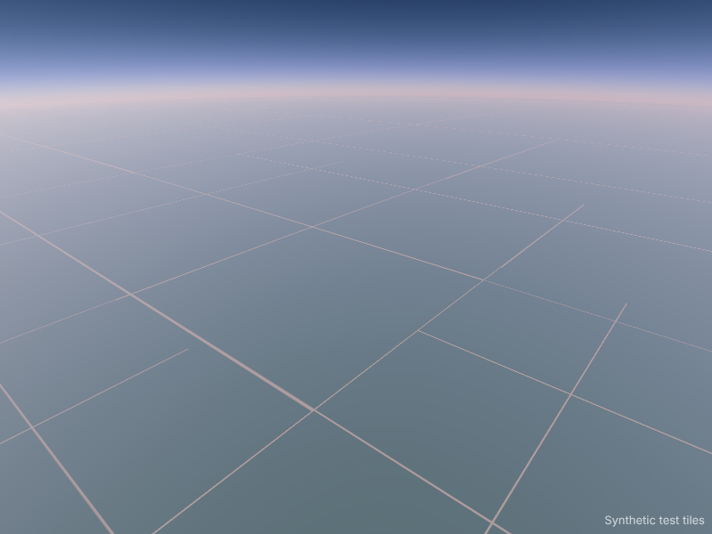

# react-three-earth

A WebGPU map engine for three.js and React Three Fiber v10: a 3D globe with streaming terrain, raster
imagery composed on the GPU, and a physically based atmosphere. Built to be extended, and built for
coding agents: it ships its own agent skills, units are in every name, and `earth.inspect()` returns
JSON.

> **Status: early.** The 3D globe works (terrain, imagery, atmosphere, controls, centimetre precision).
> The 2D map view, vector map styles and on-device numbers are in progress. See
> [SPIKE.md](https://github.com/Romainlg29/react-three-earth/blob/master/docs/spike/SPIKE.md) for what was measured.



## Features

- **WebGPU first**, with three's WebGL2 fallback, through `WebGPURenderer` and TSL node materials.
- **Terrain** from quantized-mesh tilesets (Re:Earth Terrain, Cesium World Terrain, self-hosted), streamed
  by [3DTilesRendererJS](https://github.com/NASA-AMMOS/3DTilesRendererJS) within a memory budget.
- **Imagery** from any XYZ raster server, decoded off the main thread and composed onto terrain tiles on
  the GPU within a per-frame time budget. Layers stack and fade at no cost.
- **Atmosphere**: our own TSL port of Bruneton's precomputed scattering. Sky, sunlight, aerial perspective
  and a solar ephemeris, with lookup textures generated on the device. No network requests.
- **Centimetre precision anywhere on Earth**: the scene is ECEF metres and model-view matrices are computed
  in 64-bit on the CPU.
- **React and vanilla are equal**: every component has a three.js class of the same name.
- **Agent-first**: [skills](#agent-skills) shipped in the package, JSON `inspect()`, errors that say the fix.

## Install

```sh
pnpm add react-three-earth three@0.187.0 @react-three/fiber@10.0.0-alpha.6 @react-three/tsl@10.0.0-alpha.6 react react-dom
```

three is pinned to r187 and React Three Fiber to v10. Vanilla three.js only needs `react-three-earth`
and `three@0.187.0`.

## Quick start (React Three Fiber)

```tsx
import { Canvas, useThree } from '@react-three/fiber'
import { setCameraView } from 'react-three-earth'
import { Atmosphere, AttributionControl, Earth, EarthControls, Imagery, QuantizedMeshSource, RasterTileSource, Terrain } from 'react-three-earth/react'
import { useLayoutEffect } from 'react'

/** Starts the camera over Mount Fuji. R3F's default camera sits at the centre of the Earth. */
function InitialView() {
  const camera = useThree(state => state.camera)
  useLayoutEffect(() => {
    setCameraView(camera, { longitudeDegrees: 138.7274, latitudeDegrees: 35.3606, heightMeters: 2000, distanceMeters: 60_000, headingDegrees: -40, pitchDegrees: -25 })
  }, [camera])
  return null
}

export function App() {
  return (
    <Canvas renderer={{ antialias: true, reversedDepthBuffer: true }} camera={{ near: 1, far: 1e8 }} dpr={[1, 2]}>
      <Earth date={new Date('2026-11-22T07:00:00Z')}>
        <InitialView />
        <Terrain>
          <QuantizedMeshSource url="https://terrain.reearth.land/cesium-mesh/ellipsoid/" attribution="Terrain: Re:Earth Terrain, Mapterhorn" />
        </Terrain>
        <Imagery>
          <RasterTileSource
            url="https://tile.openstreetmap.org/{z}/{x}/{y}.png"
            attribution='© <a href="https://www.openstreetmap.org/copyright">OpenStreetMap</a> contributors'
          />
        </Imagery>
        <Atmosphere />
        <EarthControls />
        <AttributionControl />
      </Earth>
    </Canvas>
  )
}
```

The canvas needs a sized parent (`html, body, #root { height: 100%; margin: 0 }`). Every source takes an `attribution`, and `<AttributionControl />` shows them all (compact on small screens); tile providers such as OpenStreetMap require visible credit.

## Quick start (vanilla three.js)

```ts
import { AgXToneMapping, PerspectiveCamera, Scene, Timer } from 'three'
import { pass } from 'three/tsl'
import { RenderPipeline, WebGPURenderer } from 'three/webgpu'
import { Atmosphere, Earth, EarthControls, Imagery, QuantizedMeshSource, RasterTileSource, Terrain, setCameraView } from 'react-three-earth'

const renderer = new WebGPURenderer({ antialias: true, reversedDepthBuffer: true })
renderer.setSize(innerWidth, innerHeight)
document.body.append(renderer.domElement)
await renderer.init()

const scene = new Scene()
const camera = new PerspectiveCamera(60, innerWidth / innerHeight, 1, 1e8)
setCameraView(camera, { longitudeDegrees: 138.7274, latitudeDegrees: 35.3606, distanceMeters: 60_000, pitchDegrees: -25 })

const earth = new Earth()
earth.connect(renderer) // 64-bit model-view matrices
scene.add(earth)

const terrain = new Terrain({ sources: [new QuantizedMeshSource({ url: 'https://terrain.reearth.land/cesium-mesh/ellipsoid/' })] })
earth.setTerrain(terrain)
earth.addImagery(new Imagery({ sources: [new RasterTileSource({ url: 'https://tile.openstreetmap.org/{z}/{x}/{y}.png' })] }))

const atmosphere = new Atmosphere()
atmosphere.install(renderer)
earth.setAtmosphere(atmosphere)
renderer.toneMapping = AgXToneMapping
renderer.toneMappingExposure = 10
const scenePass = pass(scene, camera)
const pipeline = new RenderPipeline(renderer)
pipeline.outputNode = atmosphere.createAerialPerspective(scenePass.getTextureNode('output'), scenePass.getTextureNode('depth'), camera)

const controls = new EarthControls(earth, camera, renderer.domElement)
controls.setEllipsoid(terrain.tiles.ellipsoid, terrain.tiles.group)

const timer = new Timer()
renderer.setAnimationLoop(() => {
  timer.update()
  controls.update(timer.getDelta())
  earth.update(camera, renderer) // load tiles, aim the sun
  pipeline.render()
})
```

## API at a glance

| React (`react-three-earth/react`) | Vanilla (`react-three-earth`) | Role |
| --- | --- | --- |
| `<Earth date>` | `new Earth({ date })`, `connect`, `update`, `inspect` | root; ECEF metres; drives the sun |
| `<Terrain errorTargetPixels memoryBudgetBytes createMaterial …>` | `new Terrain({ sources, … })` | the ground, one terrain source |
| `<QuantizedMeshSource url attribution>` | `new QuantizedMeshSource({ url, attribution })` | quantized-mesh terrain |
| `<Imagery opacity>` | `new Imagery({ sources, opacity })` | a raster layer; layers stack |
| `<RasterTileSource url levels tileDimensionPixels projection attribution>` | `new RasterTileSource({ … })` | XYZ raster tiles |
| `<Atmosphere exposure parameters>` | `new Atmosphere({ parameters })`, `install`, `createAerialPerspective` | sky, sun, haze |
| `<EarthControls enableDamping>` | `new EarthControls(scene, camera, element)` | orbit, pan, zoom |
| `<AttributionControl compact customAttribution>` | `new AttributionControl({ earth, container, compact })`, `earth.getAttributions()`, `attributionchange` | credit line, compact on small screens |
| `useEarth`, `useEarthFrame`, `useEarthState` | | hooks |
| | `setCameraView`, `toCartesian`, `AtmosphereParameters` | helpers |

Units are SI and spelled out in names: `heightMeters`, `memoryBudgetBytes`,
`imageryCompositionBudgetMilliseconds`, `longitudeDegrees`.

## Inspect

```ts
earth.inspect()
// {
//   date: '2026-11-22T07:00:00.000Z',
//   terrain: { url, tilesLoaded, tilesVisible, tilesDownloading, tilesParsing, memoryUsedBytes, memoryBudgetBytes,
//              imageryTilesComposited, imageryMainThreadMilliseconds, imageryCompositionsPending, … },
//   imageryLayers: 1,
//   atmosphere: { ready: true, generationTimeMilliseconds: 812 },
// }
```

Plain JSON, cheap to poll: for HUDs, devtools, tests and agents.

## Agent skills

The package ships [Agent Skills](https://agentskills.io) in `skills/`, versioned with the code and
validated in CI (every TypeScript example is typechecked against the source). Wire them into your agent
(`AGENTS.md`, `CLAUDE.md`, Cursor rules…) with [TanStack Intent](https://github.com/TanStack/intent):

```sh
npx @tanstack/intent@latest install          # once per project
npx @tanstack/intent@latest list             # see the skills of installed packages
npx @tanstack/intent@latest load react-three-earth#getting-started
```

| Skill | Use when |
| --- | --- |
| `getting-started` | building a globe from scratch, in React or vanilla |
| `coordinates-and-units` | placing objects or the camera at a longitude, latitude and height |
| `terrain-and-imagery-sources` | choosing terrain and imagery providers, stacking layers, custom sources |
| `atmosphere-and-sun` | sky, time of day, exposure, haze, custom post-processing |
| `react-hooks-and-frame-loop` | Earth state in React UI, per-frame code, scheduler order, `frameloop="demand"` |
| `customize-terrain-shading` | custom terrain materials and TSL effects |
| `inspect-and-debug` | blank or black globe, missing tiles, performance budgets, browser tests |

Without Intent, point your agent at `node_modules/react-three-earth/skills/<name>/SKILL.md`.

## License

MIT. Third-party code and dependencies are listed in
[THIRD_PARTY_NOTICES.md](https://github.com/Romainlg29/react-three-earth/blob/master/THIRD_PARTY_NOTICES.md).
